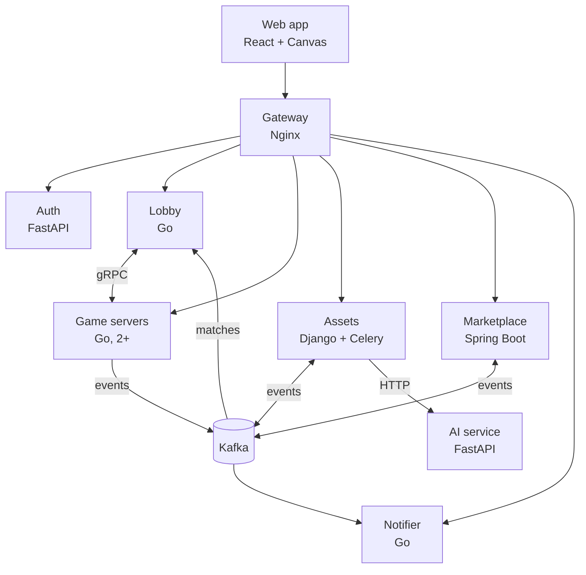

# Doodle Arena

A real-time multiplayer draw-and-guess game where every finished drawing becomes a unique item that players can trade for coins in a player marketplace.

It's a portfolio project for backend internship interviews, so depth, correctness and explainability matter more than features or polish. Three parts are built deep and measured:

1. **Game-server reliability:** one owner per room, reconnect without missing events, failover when a server dies.
2. **Marketplace correctness:** a double-entry coin ledger, atomic ownership transfer, idempotent payments.
3. **Scale:** a live-stream room where thousands of viewers watch one drawer.

## Status

**Milestones M1 (foundations), M2 (game core) and M3 (drawing lifecycle) are done.** Today the stack gives you:

- **A playable game:** rooms and quick play in the lobby, live rounds over WebSockets with an authoritative game server, two drawers on one canvas from four players, hints, scoring and a weekly leaderboard.
- **Reliability:** one owner per room with a lease and fencing tokens, resume without missing events, and failover to the other game server within about 6.5 s of a kill (the [evidence log](docs/roadmap.md#evidence-log) has the measurements).
- **Every service** runs in Docker Compose behind one Nginx gateway, and CI checks each one (lint, tests, Docker build).
- **Google sign-in** works: RS256 access tokens with JWKS, and rotating refresh tokens with reuse detection.
- **Contracts:** shared protobuf contracts for Kafka events and gRPC, with generated code for Go, Java and Python.
- **Drawings:** every finished round becomes a drawing, rendered, stored by content hash, moderated by the AI stub (or a moderator in the Django admin at `/admin/`), announced on Kafka, and shown in the web app's gallery with a replay.
- **Telemetry:** traces, metrics and logs from every service in Grafana, with logs linked to their traces.

The marketplace is being built in Stage 4 of the [roadmap](docs/roadmap.md): so far the double-entry coin ledger (Postgres-enforced invariants, a reconciliation job with its gauges) and the read-only wallet API.

## Architecture



The gateway and every service send traces, metrics and logs over OTLP to one collector. Locally that's the `grafana/otel-lgtm` container: Grafana with Tempo, Loki and Prometheus.

| Service | Stack | Job | Route |
|---|---|---|---|
| gateway | Nginx | Reverse proxy, rate limits, tracing | `localhost:8080` |
| auth | Python, FastAPI | Google OAuth 2.0 with PKCE, JWT, refresh rotation | `/api/auth/` |
| lobby | Go | Rooms, quick play, game-server registry, allocation, weekly leaderboard | `/api/lobby/` |
| game-server | Go, 2 instances | Rounds, guessing, per-room event log, failover | `/ws/<server_id>/rooms/<room_id>` |
| assets | Python, Django + Celery | Render, store and moderate drawings; replays | `/api/assets/`, `/admin/` |
| marketplace | Java, Spring Boot | Coin ledger, ownership, listings, Stripe | `/api/market/` |
| notifier | Go | Signed outgoing webhooks with retries | `/api/notifier/` |
| ai | Python, FastAPI | Moderation (a stub for now) | internal |
| web | TypeScript, React | The game UI | `/` |

Data stores: PostgreSQL (one database per service), Redis, MongoDB, Kafka (KRaft), and S3-compatible object storage (SeaweedFS locally). The [design doc](docs/design-doc.md) explains every choice.

## Quick start

**You need:** Docker (with at least 8 GB for its VM), Go 1.27, JDK 25, `uv`, Node 24 and the Buf CLI. [docs/setup.md](docs/setup.md) has the exact versions. Only Docker is needed to *run* the stack; the rest is for tests.

1. **Optional, for sign-in:** create a Google OAuth client.
   - In Google Cloud Console → APIs & Services → Credentials, create an OAuth client of type "Web application".
   - Authorized redirect URI: `http://localhost:8080/api/auth/google/callback`.
   - Authorized JavaScript origin: `http://localhost:8080`.
   - Put the credentials in `.env`, never in a commit:

     ```bash
     cp .env.example .env    # then set GOOGLE_CLIENT_ID and GOOGLE_CLIENT_SECRET in .env
     ```

   Without it everything else works, and sign-in returns 503.
2. **Start the stack.** The first run builds every image and fills `.env` with random local passwords:

   ```bash
   make up
   ```

3. **Check it:**

   ```bash
   make smoke              # every service's /healthz through the gateway, plus the rate limit
   make telemetry-check    # one request's trace and logs reach Grafana
   ```

4. **Open it:**
   - The app: http://localhost:8080 ("Sign in with Google" if you did step 1).
   - Grafana: http://localhost:3000. In Explore, pick Tempo to search traces, and use "Related logs" to jump to a span's logs.
5. **Stop it:**

   ```bash
   make down
   ```

   Data stays in Docker volumes until you remove them.

## Everyday commands

| Command | What it does |
|---|---|
| `make up` / `make down` | Start or stop the local stack |
| `make smoke` | Health of every service through the gateway, plus the rate limit |
| `make telemetry-check` | Trace, logs and metrics reach Grafana |
| `make test [s=<service>]` | Tests with the host toolchains; integration tests use Testcontainers |
| `make lint [s=<service>]` | Linters and type checks (`s=ci` lints the GitHub Actions workflows) |
| `make proto` | Lint `proto/` and regenerate Go, Java and Python code |
| `make logs s=<service>`, `make ps` | Follow a service's logs, list containers |
| `./scripts/fake-events.sh` | Publish a fake finished round and match to Kafka |
| `uv run --project services/auth --with websockets python scripts/drills/failover.py kill\|pause [n]` | Failover drill: bots play, the room's game server is killed or paused, and the drill measures the resume |
| `node scripts/drills/web-seats.mts [room_id]` | Extra players running the web app's own client in Node; with no room id, a bot-only match (dev tokens from `mint_tokens.py`) |

## Repository layout

```text
services/   gateway, auth, lobby, game-server, assets, marketplace, notifier, ai
proto/      Shared contracts (gRPC and Kafka events) and generated code in proto/gen/
web/        React + TypeScript web app
infra/      docker-compose.yml and container setup scripts
scripts/    make targets: dev-up, test, lint, smoke, telemetry-check, proto
tools/      eventctl: publish and decode Kafka events
docs/       Design doc, roadmap, ADRs, observability, setup, interview notes
```

## How we work

- **One roadmap task at a time,** each on a branch `stage-<n>/<task-id>-<short-name>` with one commit per working step. Tasks start with a plan that a human approves; in Claude Code that's `/milestone <task-id>`.
- **Contracts first:** change `proto/` and run `make proto` before the code that uses it. CI fails on breaking changes and on stale generated code.
- **CI runs the same scripts as `make`.** Each service has its own path-filtered workflow, and the whole stack boots in CI when it changes.
- **Humans own the architecture.** Decisions are recorded as ADRs in [docs/adr/](docs/adr/).

## Documentation

| Document | What's in it |
|---|---|
| [docs/design-doc.md](docs/design-doc.md) | Architecture, services, data ownership, contracts, key flows, decision log |
| [docs/roadmap.md](docs/roadmap.md) | Stages, tasks, milestone exit criteria, evidence log |
| [docs/observability.md](docs/observability.md) | Log format, metric names, tracing rules, alerts |
| [docs/adr/](docs/adr/) | Architecture decision records |
| [docs/setup.md](docs/setup.md) | Tools, versions, accounts and secrets |
| [docs/keyword-coverage.md](docs/keyword-coverage.md) | Which interview skill each part of the system covers |
| [docs/interview-notes.md](docs/interview-notes.md) | Talking points collected after each task |
| [proto/README.md](proto/README.md) | Contract rules and where generated code lands |

## Troubleshooting

- **Port 5432 is busy:** the stack's Postgres listens on host port **15432**, so a Postgres installed on your machine doesn't clash.
- **Google shows `redirect_uri_mismatch`:** the OAuth client must list exactly `http://localhost:8080/api/auth/google/callback`.
- **Logs stop reaching Grafana:** Loki refuses writes when Docker's disk is over 90% full. It answers "Ingester is shutting down". Free space with `docker system prune`.
- **Testcontainers can't find Docker:** `make test` sets `DOCKER_HOST` from your Docker context. If you run `pytest` or `go test` directly, export it yourself.
