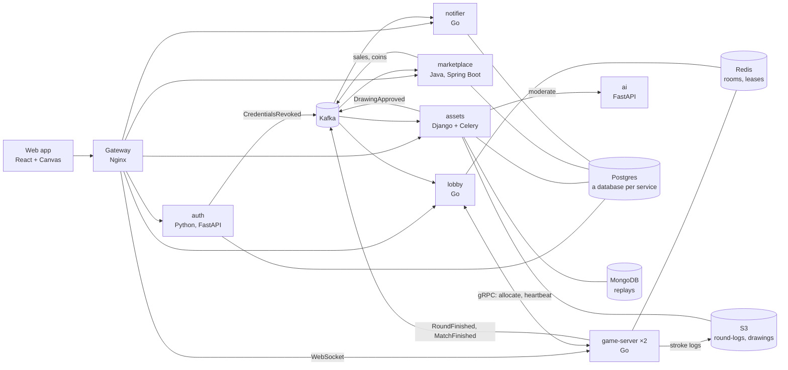

# Doodle Arena

A real-time multiplayer draw-and-guess game. Every finished drawing becomes a unique item that players own and can trade for coins in a player marketplace.

It's a portfolio project for backend internship interviews, so depth, correctness and explainability matter more than features or polish. It focuses on three parts. The first two are built deep, measured and documented; the third is next:

1. **Game-server reliability:** one owner per room, resume without missing events, failover when a server dies, and a drain when it stops.
2. **Marketplace correctness:** a double-entry coin ledger, ownership that moves with the coins in one transaction, idempotent payments.
3. **Scale** (Stage 6, next): a live-stream room where thousands of viewers watch one drawer.

## Status

Milestones M1 to M5 are done: the game, the drawing pipeline, the economy, and production readiness. It runs locally in Docker Compose and in AWS (ECS on Fargate, one EC2 data host) with Terraform. Stage 6, scale and depth, is next. The [roadmap](docs/roadmap.md) has every task and its evidence.

What that means in practice:

- **A playable game:**
  - rooms and quick play;
  - live rounds over WebSockets, run by an authoritative game server;
  - two drawers on one canvas;
  - hints, scoring and a weekly leaderboard.
- **Drawings:** every finished round is rendered, stored by content hash, moderated, minted as an owned item, and shown in a gallery with a replay.
- **An economy:**
  - a coin ledger whose entries always sum to zero;
  - listings and purchases;
  - royalties for co-authors;
  - match rewards;
  - Stripe coin packs (test mode);
  - signed webhooks for developers.
- **Security:**
  - Google sign-in with RS256 tokens and rotating refresh tokens;
  - short-lived join tickets for WebSockets;
  - per-service credentials enforced in every store: Postgres roles, Redis ACL users, an S3 identity per bucket, and Kafka users with per-topic ACLs.
- **Operations:**
  - traces, metrics and logs from every service in Grafana;
  - dashboards and alert rules as code, with alerts to Discord, and runbooks;
  - load tests, failover drills, Lighthouse.

## Architecture



- **Each service owns its data.** It reaches another service's data only through Kafka events, gRPC or HTTP. The one exception is deliberate: assets reads the stroke logs the game server wrote (a claim check).
- **The game server is authoritative.** A room is one actor goroutine. It writes every event to a Redis stream under a lease with a fencing token before broadcasting it, so another server can take the room over exactly where it stopped.
- **Money moves in Postgres transactions.** A purchase moves coins and ownership together, and an idempotency key makes a retry a no-op. The events after it leave through an outbox.
- **Telemetry:** every service, the gateway and the browser send traces, metrics and logs over OTLP to one collector, with Grafana, Tempo, Loki and Prometheus behind it.

The [design doc](docs/design-doc.md) explains every choice; the [ADRs](docs/adr/) record the decisions.

### Terms used below

- **Actor:** each room runs in one goroutine that owns all of its state; everything else sends it messages. No locks around room state.
- **Lease and fencing token:**
  - A game server holds a short Redis lease on each room it runs, renewed every 1.5 s.
  - Taking a room over increments the room's fencing token.
  - Every write checks the token, so a server that lost the room (a zombie) can't write after the takeover.
- **Outbox:** an event saved in the same database transaction as the change it announces. A separate loop then publishes it to Kafka, so an event is never lost and never sent for a change that didn't happen.
- **Claim check:** the event carries a pointer to the stroke log in S3, not the strokes themselves.
- **Mint:** create the owned item for an approved drawing, with its first entry in the ownership history.
- **Resume:** a reconnecting player gets the events after the last `seq` it saw, not the whole room again.
- **Drain:** what a server does when it stops on purpose: no new rooms, its rooms move to other servers, then it exits.

### Three flows

1. **A round becomes an owned drawing.**
   - The game server uploads the round's stroke log to S3 and publishes `RoundFinished`.
   - assets renders the image, has it moderated (by the AI service, or a moderator in the Django admin), stores it, and publishes `DrawingApproved` or `DrawingRejected` through its outbox.
   - The marketplace mints an approved one: the first drawer owns it, every drawer is recorded as an author (royalties on later sales), and the ownership history starts.
2. **A purchase.**
   - In one Postgres transaction, the marketplace locks the listing, then the balance rows in a fixed order, so two purchases can't deadlock.
   - It writes ledger entries that sum to zero, splits the royalties, and moves the ownership.
   - `SaleCompleted` goes into the outbox in the same transaction; the notifier delivers it as a signed webhook.
   - The request's `Idempotency-Key` is stored under a `UNIQUE` constraint, so a retry returns the first result instead of buying twice.
3. **A game server goes away.**
   - **Killed:** every player of that server is cut off. The lobby sees the heartbeats stop (6 s) and moves the rooms to the other server, which restores each one from Redis. The players' clients ask the lobby where the room is now and resume.
   - **Stopped (a deploy):** the server drains. It tells the lobby at once and keeps its rooms playing until each one has moved. Its players are cut off only for the reconnect itself.

### Measured

| What | Number | Where |
|---|---|---|
| A server stopped in AWS under an 80-room load | players disconnected for 0.5 to 2.0 s with the drain, against 16 to 17.5 s before it (41 rooms moved within 6.8 s) | [performance](docs/performance.md#2-failover-under-load) |
| A server killed, local | players back in 8.1 to 8.3 s (the 6-second detection, then the move); 12.9 s with the servers capped at 0.25 CPU | [performance](docs/performance.md#2-failover-under-load) |
| Stroke fan-out in AWS, 10 rooms | p95 24 ms; a 0.25-vCPU game server holds about 20 to 40 rooms | [performance](docs/performance.md#1-the-game-under-load-task-53) |
| Lighthouse in AWS (mobile) | performance 1.00, LCP 1.2 s, CLS 0 | [performance](docs/performance.md#3-the-web-app-task-54) |
| A cold AWS stack | about 9 minutes up, 5 down | [performance](docs/performance.md#4-aws-sessions) |

## Run it locally

**You need** Docker with at least 8 GB for its VM. That's all for running the stack. The tests and drills also need Go 1.27, JDK 25, `uv`, Node 24 and the Buf CLI ([docs/setup.md](docs/setup.md) has the exact versions).

1. **Optional, for sign-in:** create a Google OAuth client of type "Web application".
   - Redirect URI: `http://localhost:8080/api/auth/google/callback`.
   - JavaScript origin: `http://localhost:8080`.
   - Run `cp .env.example .env`, then set `GOOGLE_CLIENT_ID` and `GOOGLE_CLIENT_SECRET` in `.env`, never in a commit.

   Without it everything else works, and sign-in returns 503.
2. **Start the stack.** The first run builds every image. It also creates `.env` if it's missing, and fills every `change-me` in it with a random password; values you set are kept:

   ```bash
   make up
   ```

3. **Check it.** Each check prints one `ok` line per step and ends with a pass line:

   ```bash
   make smoke
   ```

   ```bash
   make telemetry-check
   ```

4. **Open it:** the app at http://localhost:8080 and Grafana at http://localhost:3000 (dashboards in the "Doodle Arena" folder).
5. **Stop it** with `make down`. Data stays in Docker volumes.

To play without Google, `node scripts/drills/web-seats.mts` plays a bot-only match with the web app's own client (Node 24).

## Run it in AWS

This one-time step creates the state bucket, ECR and the SSM parameters ([docs/setup.md](docs/setup.md), "AWS"):

```bash
make aws-bootstrap
```

Then, for each session (it costs money from up to down, about $0.30 to $0.80 an hour, measured):

```bash
make aws-push
```

```bash
DOMAIN=icanfly.click make aws-up
```

```bash
DOMAIN=icanfly.click make aws-down
```

The data outlives the session (ADR 0016). `aws-down` backs up every service's database and the drawings to a bucket that stays, and destroys nothing if that fails. `aws-up` restores the latest backup before the migrations.

While the stack is up:
- `make aws-grafana` opens Grafana on `localhost:3300` through Session Manager.
- `DOMAIN=icanfly.click make aws-check` runs the checks against AWS.
- The load balancer is open to everyone; `ALLOWED_CIDRS=<ip>/32` narrows it.

## Commands

| Command | What it does |
|---|---|
| `make up` / `make down` / `make ps` / `make logs s=<service>` | The local stack |
| `make test [s=<service>]` / `make lint [s=<service>]` | Tests and linters with the host toolchains, as CI runs them (integration tests use Testcontainers) |
| `make smoke` | Every service's health through the gateway, plus the rate limit |
| `make telemetry-check` / `make alerts-check` | A request's trace and logs reach Grafana / every dashboard, alert rule and the contact point load and evaluate |
| `make pipeline-check` | A round becomes an approved, stored, announced drawing |
| `make kafka-acl-check` / `make data-acl-check` | Kafka, Redis and S3 refuse what each service must not do |
| `make loadtest` / `make loadtest-smoke` | k6: up to 80 four-player rooms over 12 minutes / two rooms for a minute |
| `make lighthouse` | Lighthouse against the production web image (or AWS with `GATEWAY`) |
| `make proto` | Lint `proto/` and regenerate the Go, Java and Python code |
| `uv run --project services/auth --with websockets python scripts/drills/failover.py kill\|pause\|stop` | Bots play while the room's server is killed, frozen or stopped; reports the resume |

CLAUDE.md, the project's working notes for humans and its coding agent, lists every command and drill with its options, and the known gotchas.

## Where to start reading

| To understand | Read |
|---|---|
| A room: one actor, write before broadcast | `services/game-server/internal/room/actor.go`, `room/game.go` |
| Leases, fencing and takeover | `services/game-server/internal/roomstore/roomstore.go` (its Lua scripts), ADR 0007 |
| Failover and drain in the lobby | `services/lobby/internal/rooms/reassign.go` |
| Live rooms: relays fan a room out to viewers | `services/game-server/internal/relay/relay.go`, ADR 0017 |
| A purchase (locks, ledger, ownership, outbox in one transaction) | `services/marketplace/src/main/java/com/doodlearena/marketplace/listing/PurchaseService.java`, then `ledger/LedgerService.java` |
| Idempotency keys | `services/marketplace/src/main/java/com/doodlearena/marketplace/idempotency/IdempotencyService.java`, ADR 0012 |
| The drawing pipeline | `services/assets/drawings/consumer.py`, `pipeline.py`, `relay.py` |
| Token verification | `libs/go/authn/authn.go`, ADR 0001 |
| Kafka users and ACLs | `infra/kafka/init.sh`, ADR 0013 |

## Repository layout

```text
services/   gateway, auth, lobby, game-server, assets, marketplace, notifier, ai
libs/go/    Go packages the Go services share: authn, logging, kafkaauth, and the test helpers kafkatest, redistest, tcretry
proto/      gRPC services and Kafka event schemas; generated code in proto/gen/
web/        React + TypeScript web app
infra/      docker-compose.yml, store setup (Kafka, Redis, SeaweedFS, Postgres), observability
            as code, the AWS data host, Terraform
scripts/    what make runs: dev-up, test, lint, the checks, AWS, drills
loadtest/   k6 scenarios
tools/      eventctl: publish and decode Kafka events
fixtures/   shared test cases (JWTs) used by more than one language
docs/       design doc, roadmap, ADRs, observability, performance, runbooks, setup, interview notes
```

## How we work

- **One roadmap task at a time,** on a branch `stage-<n>/<task-id>-<short-name>`, with one commit per working step. Each task starts with a plan a human approves.
- **Contracts first:** change `proto/` and run `make proto` before the code that uses it. CI fails on breaking changes and on stale generated code.
- **CI runs the same scripts as `make`.** Each service has its own path-filtered workflow, and the whole stack boots in CI with every check when infrastructure changes.
- **Humans own the architecture.** Decisions are ADRs in [docs/adr/](docs/adr/) and rows in the design doc's decision log.

## Documentation

| Document | What's in it |
|---|---|
| [docs/design-doc.md](docs/design-doc.md) | Architecture, services, data ownership, contracts, key flows, decision log |
| [docs/roadmap.md](docs/roadmap.md) | Stages, tasks, milestone criteria, the evidence log of every measurement |
| [docs/performance.md](docs/performance.md) | The current measured numbers and how they changed |
| [docs/observability.md](docs/observability.md) | Log format, metric names, tracing rules, alerts, dashboards |
| [docs/runbooks/](docs/runbooks/) | What to do when each alert fires |
| [docs/adr/](docs/adr/) | Architecture decision records |
| [docs/setup.md](docs/setup.md) | Tools, versions, accounts and secrets; AWS |
| [docs/keyword-coverage.md](docs/keyword-coverage.md) | Which interview skill each part of the system covers |
| [docs/interview-notes.md](docs/interview-notes.md) | Talking points collected after each task |

## Troubleshooting

- **Port 5432 is busy:** the stack's Postgres listens on host port **15432**.
- **Google shows `redirect_uri_mismatch`:** the OAuth client must list exactly `http://localhost:8080/api/auth/google/callback`.
- **Logs stop reaching Grafana:** Loki refuses writes when Docker's disk is over 90% full ("Ingester is shutting down"). `docker system prune` frees space.
- **A service is refused by Kafka or Redis:** each store has a user per service. `make logs s=kafka | grep "is Denied"`, or Redis's `ACL LOG`, says which grant is missing (CLAUDE.md, "Gotchas").
- **Testcontainers can't find Docker:** `make test` sets `DOCKER_HOST` from your Docker context. If you run `pytest` or `go test` directly, export it yourself.
