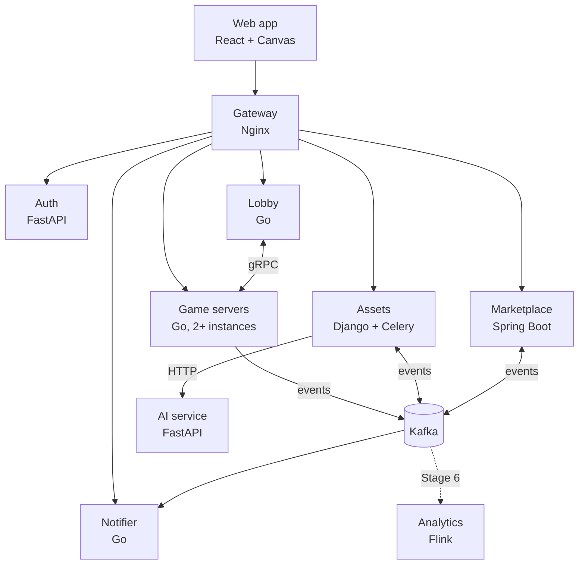
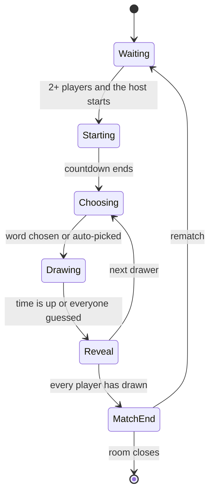

# Doodle Arena: design doc

Status: living document, written at project kickoff (October 2026).
Owners: Bowen and Will. Decisions that change this document are recorded as ADRs in `docs/adr/`.

## 1. Summary

Doodle Arena is a real-time multiplayer draw-and-guess game. One or two players draw a secret word while the others guess. When a round ends, the drawing is rendered to an image, moderated, and becomes a unique item that players can buy and sell for coins in a player marketplace. Players earn coins by playing and can buy coin packs through Stripe in test mode. Coins can't be cashed out.

The project exists to show backend depth in internship interviews. Three parts are built deep and measured:

1. **Game server reliability:** reconnecting, failover when a server dies, and exactly one owner per room.
2. **Marketplace correctness:** a double-entry ledger, atomic ownership transfer and idempotent payments.
3. **Scale (Stage 6):** a live-stream room where thousands of viewers watch one drawer.

Everything else stays deliberately simple.

## 2. Goals and non-goals

Goals:

- Cover the skill keywords in `docs/keyword-coverage.md`, each for a real reason.
- Build a working skeleton of the whole system in about one week (Stages 1–5), then add depth and measured numbers in week two (Stage 6).
- Back every deep part with evidence: tests, load-test numbers and fault-injection results.

Non-goals:

- Polished game design or graphics.
- Real money leaving the system. Coins are closed-loop.
- Blockchain or NFTs. Ownership lives in a central ledger.
- GraphQL, mobile apps, and multi-cloud in the core path. GCP, Azure, Jenkins and Kubernetes are optional extras (Stage 7).

## 3. Architecture

Data stores: PostgreSQL, Redis, MongoDB, S3-compatible object storage (SeaweedFS locally, S3 in AWS) and, in Stage 6, Elasticsearch. Telemetry goes to an OpenTelemetry Collector, then to Prometheus, Tempo and Loki, with Grafana on top (see `docs/observability.md`).

The web app talks REST and WebSocket through the gateway. The lobby and game servers talk gRPC. Everything that happens *after* something else (rewards, rendering, notifications, analytics) goes through Kafka, so a slow or broken consumer never blocks a game round.

## 4. Services

### Ownership

| Service | Language | Owner | First stage |
|---|---|---|---|
| gateway | Nginx config | Bowen | 1 |
| auth | Python (FastAPI) | Bowen | 1 |
| lobby | Go | Bowen | 2 |
| game-server | Go | Bowen | 2 |
| assets | Python (Django + Celery) | Bowen | 3 |
| ai | Python (FastAPI) | Bowen | 3 (stub) |
| marketplace | Java (Spring Boot) | Will | 4 |
| notifier | Go | Bowen | 4 |
| analytics | Java (Flink) | Will | 6 |
| web | TypeScript (React) | Bowen | 1 |

Until Will joins the project, Bowen covers every service, including marketplace and analytics. The table shows the intended long-term owners.

### 4.1 Gateway (Nginx)

- Routes `/api/auth/*` to auth, `/api/lobby/*` to lobby, `/api/assets/*` and `/admin/*` to assets, `/api/market/*` to marketplace, `/api/notifier/*` to notifier, `/ws/*` to game servers, and `/otlp/*` to the collector for browser telemetry.
- Passes the `Upgrade` and `Connection` headers for WebSockets, with a long read timeout.
- Applies coarse per-IP rate limiting with `limit_req`, which is a leaky bucket. Fine-grained limits live in the services.
- Serves `/healthz` for itself and `/healthz/<service>` for every service, including each game-server instance (used by `make smoke`). These are restricted to internal traffic in AWS.
- Only routes; it doesn't verify tokens (ADR 0001). It strips any client-supplied `X-User-*` and `X-Roles` headers, and never routes to a service's internal port.
- Locally, the whole system is one origin, `http://localhost:8080`: the gateway also proxies the Vite dev server for the web app, so there is no CORS and the refresh cookie is first-party. TLS terminates at the gateway (or the load balancer in front of it) only in AWS.
- WebSockets use `/ws/<server_id>/rooms/<room_id>`: an explicit map sends each `server_id` to its game-server instance, and unknown ids get 404 (ADR 0002).

### 4.2 Auth (FastAPI)

Owns the Postgres database `auth`.

- Google OAuth 2.0 authorization code flow, with PKCE and a `state` parameter. It requests only the `openid profile` scopes, so Google never sends an email address.
- Issues a short-lived JWT access token (about 15 minutes) signed with RS256, with `aud` set to `doodle-api`. Public keys are served at `/api/auth/.well-known/jwks.json`.
- Issues an opaque refresh token (32 random bytes, 30 days) in the cookie `da_refresh`: HttpOnly, SameSite=Strict, Path=`/api/auth`, and Secure in AWS. Refresh tokens are stored as SHA-256 hashes and rotated on every use. Every login starts a family. Reusing an already-used refresh token revokes the whole family.
- `/refresh` locks the presented token (`SELECT … FOR UPDATE`), so concurrent uses of one token serialize: one wins, and the rest count as reuse. The web app therefore sends at most one refresh at a time (single-flight).
- `/refresh` and `/logout` are cookie-authenticated POSTs. Besides SameSite=Strict, they refuse any `Origin` other than the web app's.
- JWT claims: `sub` (user id), `roles` (`player`, `moderator`, `admin`), `name` (the display name, which the lobby copies into join tickets so game servers can show it; a rename shows after the next refresh), `iss`, `aud`, `iat`, `exp`, `jti`. The header carries `kid`, the RFC 7638 thumbprint of the signing key.
- Stores the minimum user data: Google subject id, display name, avatar URL and roles. No email address.
- API keys (Stage 4) for developers who register webhooks or call the public read API. Format `da_<prefix>_<secret>`, stored as the prefix plus a hash, with scopes and `last_used_at`. Other services verify keys through an internal endpoint and cache the result briefly.
- Internal endpoints (such as `/internal/api-keys/verify`) are served on a separate internal port that the gateway never routes.
- Each service verifies JWTs itself, against the cached JWKS: see ADR 0001 (Accepted) for the exact checks and for how the Django admin signs moderators in.

### 4.3 Lobby (Go)

Owns the Redis key prefix `lobby:*`.

- REST: create a room, list public rooms, quick play, join a room, read the leaderboard.
- Keeps a registry of game servers. Each game server sends a gRPC `Heartbeat` every 2 seconds with its addresses, load and per-room status (players, waiting or playing), and an entry expires after 6 seconds without one. The registry gRPC port (9090) is internal.
- Allocates new rooms to the least-loaded healthy game server through gRPC `AllocateRoom` (fewest sockets, then fewest rooms; draining servers are skipped). Each call has a 2-second deadline; if a server is full, draining or unreachable, the lobby tries the next one, up to three. Every request names the target (`server_id`), so a cached connection that reaches another instance after containers swap IP addresses is refused instead of creating a room there; on a refusal or a mismatched answer the lobby drops the connection, looks the name up again and asks the same server once more. A server that didn't answer is tried last for the next 10 seconds, so a server that heartbeats but can't be reached doesn't add its deadline to every create. The room is stored only after a server has taken it.
- On join, returns the room's WebSocket URL (`<ws_address>/rooms/<room_id>`, where `ws_address` is the gateway path the game server reports, such as `/ws/game-server-1`) and a join ticket: a token signed with the lobby's Ed25519 key, valid for 60 seconds and usable once, that names the user and the room (ADR 0005). The lobby doesn't enforce `max_players`: only the game server knows whether a joining player is already in the room (a reconnect), so it decides. Quick play uses the reported counts to pick the fullest waiting room with space.
- Redis keys: `lobby:server:{server_id}` (the last heartbeat, 6-second TTL), `lobby:servers` (set of server ids), `lobby:room:{room_id}` (the room, expiring 10 minutes after its server last reported it; only the owning server's heartbeat refreshes it), `lobby:rooms:public` (sorted set by creation time, for the room list).
- Heartbeats and `AllocateRoom` aren't authenticated: for now the internal gRPC relies on network isolation (ADR 0006). So the lobby accepts only a `/ws…` gateway path as `ws_address` and `host:port` as `control_address`; a bogus heartbeat can't send players to another host.
- Notices dead game servers through missed heartbeats and reassigns their rooms. Clients that reconnect get the new server's URL.
- Consumes `MatchFinished` to update a weekly leaderboard in a Redis sorted set. `ZINCRBY` isn't idempotent, so the consumer first records the `match_id` (`SET NX` with a TTL longer than a week) and skips matches it has already seen.

### 4.4 Game server (Go)

Owns the Redis key prefixes `room:*` and `rl:*`, and the bucket `round-logs`.

- Runs each room as an actor: one goroutine owns all of a room's state. Details are in section 9.
- Classic mode: one drawer, or two drawers sharing a canvas when the room has four or more players. Everyone else guesses.
- Server-authoritative timers, scoring, hint reveals and answer checks. The first correct guess is the first one the room actor processes.
- A per-player token bucket limits guesses and chat.
- At the end of a round, it uploads the stroke log (a gzipped `doodle.game.v1.StrokeLog` at `<match_id>/<round_no>.binpb.gz`) to `round-logs` and publishes `RoundFinished` with the object key. At the end of a match, it publishes `MatchFinished` with placements but no coin amounts, because the marketplace decides rewards.
  - The room actor never does this I/O. It hands each finished round or match to a publisher with a bounded in-memory queue (1024) and one worker, which keeps a room's last `RoundFinished` ahead of its `MatchFinished`.
  - The upload comes first, so an event never points at a missing object. Each event has a 2-minute deadline and keeps its `event_id` across retries. Uploads retry with backoff. The producer is franz-go's idempotent producer with `acks=all`, which retries in order on its own without duplicates. The publisher retries only definite failures, and after the deadline it stops waiting and counts the event as failed. The record stays buffered and may still be delivered, so an event can arrive twice, which consumers absorb (at-least-once).
  - When the queue is full (Kafka or S3 down for a long time), new events are dropped, logged with their ids and counted, rather than blocking rooms. A crash loses what is queued. Making this durable belongs with the Redis Stream event log (task 2.5), which could serve as the outbox.
  - Every finished round is published, even one with no strokes. A match is published only if at least one round finished: one that ended during the countdown is not a result and earns nothing. Undo removes strokes from the canvas, so the stroke log contains only the strokes that remained. The canvas has a fixed 4:3 aspect, so events report 800 x 600.
- At least two instances run locally, so failover can be tested. In Stage 6 the same binary also runs in a relay role for the live-stream room.

### 4.5 Assets (Django + Celery)

Owns the Postgres database `assets`, the MongoDB database `assets`, the bucket `drawings`, a Redis logical database for Celery, and (Stage 6) the Elasticsearch index `drawings`.

Consumes `RoundFinished` and runs a Celery pipeline for each drawing:

1. Fetch the stroke log from `round-logs` (claim check) and store it as a replay document in MongoDB.
2. Render a PNG and a thumbnail. Hash the PNG with SHA-256 and upload both images to `drawings` under content-addressed keys (`sha256/<hash>.png`), so identical images are stored once.
3. Ask the AI service to moderate the image, with a timeout and retries using exponential backoff and jitter. If the last attempt fails, the drawing waits in the Django admin review queue.
4. Mark the drawing approved or rejected, and publish `DrawingApproved` or `DrawingRejected`.

Processing is idempotent: a unique `(match_id, round_no)` constraint stops a replayed `RoundFinished` from creating a second drawing.

The service also serves drawing metadata, presigned image URLs and replays over REST. Django admin is the moderation console. In Stage 6 it indexes drawings and active listings (from `market.listings.v1`) into Elasticsearch.

Drawing metadata lives in Postgres because Django's ORM and admin are built for SQL databases. MongoDB holds the replays: large, write-once documents that are always read whole and whose stroke format may change over time.

### 4.6 Marketplace (Spring Boot)

Owns the Postgres database `marketplace`.

- Coin ledger, wallets, drawing ownership and provenance, listings, purchases, royalties, round rewards and Stripe coin packs. Details are in section 8.
- Consumes `DrawingApproved` (creates the first ownership record) and `MatchFinished` (pays rewards).
- Publishes through a transactional outbox: `SaleCompleted`, `ListingCreated`, `ListingCancelled` and `CoinsCredited`.
- Runs a reconciliation job every minute that checks the ledger and ownership invariants and exports them as metrics.

### 4.7 Notifier (Go)

Owns the Postgres database `notifier`.

- Developers register webhook endpoints with an API key and choose event types. Each endpoint gets its own signing secret.
- Consumes `SaleCompleted` (and optionally `CoinsCredited`) and delivers events as signed HTTP POST requests.
- Signature header: `Doodle-Signature: t=<unix-seconds>,v1=<hex HMAC-SHA256 of "<t>.<body>">`. A `Doodle-Event-Id` header lets receivers dedupe. Receivers should reject timestamps older than 5 minutes.
- Retries use exponential backoff with full jitter (base 2 seconds, cap 30 minutes, at most 8 attempts) and 5-second timeouts. After the last attempt, the delivery is marked `DEAD` and published to `notifier.dlq.v1`.
- The delivery log can be queried over REST.
- Endpoint URLs come from outside users, so the notifier blocks server-side request forgery: it resolves the host at send time and refuses loopback, private, link-local (including `169.254.169.254`) and unique-local addresses, and it doesn't follow redirects. Production endpoints must use HTTPS.

### 4.8 AI service (FastAPI)

Stateless.

- Stage 3: `POST /v1/moderate` is a stub that approves by default. Configuration can make it reject, slow down or fail, for testing retries.
- Later (Stage 7): a real moderation model, `POST /v1/guess` (an AI player that guesses from the canvas) and `POST /v1/similarity` (embeddings for "close!" hints), with an eval set built from real drawings.

### 4.9 Analytics (Flink, Stage 6)

- Job 1: top guesses per live room over a sliding window, read from `live.guesses.v1` and written to `live.top-guesses.v1`.
- Job 2: wash-trading detection over `market.sales.v1`, such as the same accounts trading back and forth or circular trades within a time window. Flags go to a dashboard and an alert.

### 4.10 Web app (React + Canvas)

Pages: login, lobby, room (canvas, guesses, scores, timer), gallery and replays, marketplace, wallet (buy coins), and developer settings (API keys and webhooks). Follows `.claude/rules/web.md`.

The room client (task 2.3):

- Pages route by path (`/` is the lobby, `/rooms/<room_id>` a room), so an invite link opens the room. There is no router library.
- State is a pure reducer over server messages: `welcome` replaces it, events apply only when `seq` is newer, and scores, phases and the word change only when the server says so. The chat feed isn't part of the view, so a reconnect keeps it.
- The canvas has a fixed 4:3 aspect and two layers. The base layer paints only the server's `stroke_batch` events, so every player sees the same picture; the overlay paints the drawer's own stroke at once and drops it when the server's copy arrives, so drawing doesn't lag by a round trip. Points go out every 50 ms (`VITE_STROKE_BATCH_MS`, or `?batch_ms=` for one experiment) or at 512 points.
- The connection asks the lobby for a new ticket on every attempt and reconnects with jittered exponential backoff (0.5 s doubling to 8 s, giving up after 12 attempts, about a minute, which matches the seat grace). Close codes 4000, 4003, 4004 and 4009 and a lobby `ROOM_NOT_FOUND` end the connection instead. A gap in `seq` or a `room_moved` reconnects at once.
- The timer counts down to the server's deadline on the local clock. It is display only; the server ends phases. Clock skew shows as a timer that is a little off.
- The ping round-trip time is shown next to the connection status; exporting it as `web.ws.rtt` comes with browser telemetry (task 5.4).

## 5. Data ownership

| Store | Database, prefix or bucket | What it holds | Owner |
|---|---|---|---|
| PostgreSQL | `auth` | Users, refresh tokens, API keys | auth |
| PostgreSQL | `assets` | Drawing metadata and moderation status | assets |
| PostgreSQL | `marketplace` | Accounts, ledger, balances, ownership, listings, idempotency keys, outbox, Stripe events | marketplace |
| PostgreSQL | `notifier` | Endpoints and deliveries | notifier |
| Redis | `room:*` | Room event streams, snapshots, leases, fencing counters | game-server |
| Redis | `rl:*` | Rate-limit buckets | game-server |
| Redis | `lobby:*` | Rooms, game-server registry, leaderboards | lobby |
| Redis | Separate logical database | Celery broker and results | assets |
| MongoDB | `assets.replays` | Stroke logs for replays | assets |
| Object storage | `round-logs` bucket | Raw round stroke logs; a lifecycle rule deletes them after 7 days | game-server |
| Object storage | `drawings` bucket | PNGs and thumbnails, content-addressed | assets |
| Elasticsearch | `drawings` index | Search over drawings and listings (Stage 6) | assets |
| Kafka | Topics in section 6.2 | Events between services | Each topic's producer |

Locally there is one Postgres server with four databases and one database user per service, plus one Redis, one MongoDB, SeaweedFS for S3, and one Kafka broker in KRaft mode.

## 6. Contracts

Contracts live in `proto/` and change only with human approval (see `.claude/rules/contracts.md`). `proto/README.md` explains the layout, code generation (`make proto`) and where generated code lands for each language.

### 6.1 gRPC

| Service | Served by | Called by | Methods |
|---|---|---|---|
| `doodle.game.v1.ControlService` | Each game server | Lobby | `AllocateRoom(room_id, mode, settings, host_user_id, server_id)` (idempotent per `room_id`; refused with `FAILED_PRECONDITION` by any server that isn't `server_id`), `DrainServer()` before a deploy |
| `doodle.lobby.v1.RegistryService` | Lobby | Game servers | `Heartbeat(server_id, ws_address, control_address, rooms[], sockets, draining)` every 2 seconds; `rooms` carries each room's players and phase |

Every call has a deadline. `AllocateRoom` returns `RESOURCE_EXHAUSTED` when the server is full and `FAILED_PRECONDITION` while it drains. Stage 7 may add `doodle.ai.v1` for the AI guesser.

### 6.2 Kafka event catalog

Every message on a topic is that topic's wrapper message: one `oneof event` with a case per event type (ADR 0004). There is no schema registry; Buf checks compatibility in CI. Every event inside a wrapper starts with `EventMeta meta = 1`: `event_id` (UUID), `event_type`, `schema_version`, `occurred_at` and `producer`. Trace context travels in the Kafka `traceparent` header. Consumers dedupe on `event_id` or on a natural key. A consumer that finds an unset or unknown `oneof` case (a newer producer) logs it, counts it, commits the offset and moves on.

| Topic | Wrapper | Events | Producer | Consumers | Key | Stage |
|---|---|---|---|---|---|---|
| `game.rounds.v1` | `RoundEvent` | `RoundFinished` | game-server | assets | `room_id` | 2 |
| `game.matches.v1` | `MatchEvent` | `MatchFinished` | game-server | marketplace, lobby | `room_id` | 2 |
| `assets.drawings.v1` | `DrawingEvent` | `DrawingApproved`, `DrawingRejected` | assets | marketplace | `drawing_id` | 3 |
| `market.listings.v1` | `ListingEvent` | `ListingCreated`, `ListingCancelled` | marketplace (outbox) | assets (search, Stage 6) | `drawing_id` | 4 |
| `market.sales.v1` | `SaleEvent` | `SaleCompleted` | marketplace (outbox) | notifier, assets, analytics | `drawing_id` | 4 |
| `market.wallet.v1` | `WalletEvent` | `CoinsCredited` | marketplace (outbox) | notifier (optional) | `user_id` | 4 |
| `notifier.dlq.v1` | `DeadLetterEvent` | `DeliveryDead` | notifier | alerting, humans | `endpoint_id` | 4 |
| `live.guesses.v1` | `ViewerGuessEvent` | `ViewerGuess` | game-server relays | analytics | `room_id` | 6 |
| `live.top-guesses.v1` | `TopGuessesEvent` | `TopGuesses` | analytics | game-server | `room_id` | 6 |

Key payload fields:

- `RoundFinished`: `match_id`, `room_id`, `round_no`, `word`, `drawer_ids` (the first one becomes the initial owner), `stroke_log_key`, `stroke_count`, `canvas_width`, `canvas_height`, `ended_at`.
- `MatchFinished`: `match_id`, `room_id`, `mode`, `started_at`, `ended_at`, `results[]` with `user_id`, `score` and `placement`.
- `DrawingApproved`: `drawing_id`, `match_id`, `round_no`, `author_ids`, `initial_owner_id`, `sha256`, `image_key`, `thumb_key`.
- `SaleCompleted`: `sale_id`, `listing_id`, `drawing_id`, `seller_id`, `buyer_id`, `price`, `royalties[]` with `user_id` and `amount`, `completed_at`.
- `CoinsCredited`: `user_id`, `amount`, `reason` (`stripe_purchase` or `reward`), `reference`.

`RoundFinished` uses the claim-check pattern. A round's stroke log can be large, so the event carries only the object key, and the log itself lives in the `round-logs` bucket. This also avoids an ordering problem: if strokes travelled on their own topic, the assets service couldn't know when it had all of them. The object is a gzip-compressed `doodle.game.v1.StrokeLog` protobuf, so its format is versioned and checked by Buf like every other contract.

### 6.3 REST API sketch

All endpoints go through the gateway, use JSON, and require a JWT bearer token unless noted. Errors look like `{"error": {"code": "LISTING_NOT_AVAILABLE", "message": "...", "request_id": "..."}}`. Lists use cursor pagination.

Auth:

- `GET /api/auth/google/login` and `GET /api/auth/google/callback` (no JWT)
- `POST /api/auth/refresh` (refresh cookie), `POST /api/auth/logout`, `GET /api/auth/me`
- `GET /api/auth/.well-known/jwks.json` (public)
- `POST`, `GET`, `DELETE /api/auth/api-keys` (Stage 4)

Lobby:

- `POST /api/lobby/rooms` takes `{public, settings}` (both optional) and returns the room; `GET /api/lobby/rooms?limit=&cursor=` returns `{rooms, next_cursor}` with live player counts
- `POST /api/lobby/rooms/{room_id}/join` and `POST /api/lobby/quickplay` return `{room_id, ws_url, ticket, expires_at}`, with `Cache-Control: no-store`
- `GET /api/lobby/leaderboard`

Assets:

- `GET /api/assets/drawings/{id}`, `GET /api/assets/drawings?author_id=...`
- `GET /api/assets/drawings/{id}/replay`
- `GET /api/assets/search?q=...` (Stage 6)
- `/admin/`: Django admin for moderators

Marketplace:

- `GET /api/market/wallet`, `GET /api/market/wallet/transactions`
- `GET /api/market/listings`, `POST /api/market/listings` (requires `Idempotency-Key`), `DELETE /api/market/listings/{id}`
- `POST /api/market/listings/{id}/purchase` (requires `Idempotency-Key`): `200`, `409 LISTING_NOT_AVAILABLE` or `422 INSUFFICIENT_FUNDS`
- Every endpoint that takes an `Idempotency-Key` can also return `409 IDEMPOTENCY_KEY_IN_PROGRESS` (the same key is still being processed) or `422 IDEMPOTENCY_KEY_REUSED` (the same key with a different request body). Clients tell these apart by `error.code`, not by the status code.
- `GET /api/market/drawings/{id}/ownership-history`
- `GET /api/market/coin-packs`, `POST /api/market/coin-packs/{id}/checkout` (returns a Stripe Checkout URL)
- `POST /api/market/stripe/webhook` (verified by Stripe signature, no JWT)

Notifier (authenticated with an API key):

- `POST`, `GET`, `DELETE /api/notifier/endpoints`
- `GET /api/notifier/endpoints/{id}/deliveries`, `POST /api/notifier/endpoints/{id}/test`

### 6.4 WebSocket protocol

The client connects to the URL from the lobby (`/ws/<server_id>/rooms/<room_id>`, ADR 0002) and sends `hello` with its join ticket and, when resuming, `last_seq`, within 10 seconds. Messages are JSON text frames shaped `{"type": ..., "data": ...}`. A client message is at most 64 KB (a server message such as `welcome` can be larger, because it carries the canvas). Coordinates are normalized to 0–10000, so canvas size doesn't matter; a point is `[x, y, t_ms]` and a batch has 1–512 points. Deadlines are Unix milliseconds. A binary format is a Stage 6 experiment. The client pings every 15 seconds; a socket idle for 60 seconds is closed.

Client to server:

- `hello {ticket, last_seq?}`
- `start {}` (host only; needs 2+ connected players, in Waiting or after a match)
- `choose_word {index}` (drawer only)
- `stroke_batch {stroke_id, points: [[x, y, t_ms], ...], color, width, done}`: `color` is `#rrggbb`, `width` is 1–200 in the same normalized units as coordinates (so a line looks the same on every screen), and `t_ms` counts from the start of the stroke
- `undo {stroke_id}`: a player can undo only their own strokes
- `guess {text}` (1–100 characters; outside a round it is chat)
- `ping {t}` (answered with `pong` without involving the room)

Server to client, shared room events (each wrapped as `event {seq, type, data}` and stored in the room's event log): `player_joined {user_id, name}`, `player_left {user_id}`, `player_removed {user_id}` (seat freed after the rejoin grace), `host_changed {user_id}`, `match_started {match_id, order, deadline}`, `choosing {round_no, drawer_ids, deadline}`, `round_started {round_no, drawer_ids, word_length, deadline}`, `stroke_batch {user_id, stroke_id, points, color, width, done}`, `stroke_undone {stroke_id, user_id}`, `hint {mask}`, `chat {user_id, text}` (wrong guesses are shown as chat), `correct_guess {user_id, order}`, `round_ended {round_no, word, scores, round_points}`, `match_ended {match_id, results}` (results carry `placement` with competition ranking: 1, 2, 2, 4).

Server to client, private messages (no `seq`, never stored in the shared log): `welcome {user_id, view, seq}`, `word_options {words}` (drawer), `your_word {word}` (drawers), `guess_result {correct}`, `rate_limited`, `room_moved {reason}`, `error {code, message}`, `pong {t}`.

`view` is built for each player from the room state (phase, host, players with scores, the round, the hint mask and the canvas). It contains the word only after the round has ended; drawers get the word through `your_word`, the only message that carries it during a round. The stored snapshot (section 9) contains the word, so it is never sent to a client as it is. On `welcome`, a client replaces its state and then applies events with `seq` greater than `welcome.seq`; until task 2.5 a reconnect always gets a full `welcome`.

Guess rules: a guess is compared after lowercasing and keeping only the letters a–z. A guess that contains the word without being it is answered only privately (`guess_result {correct: false}`) and never broadcast, because that would show everyone the word. Drawers, and players who already guessed, can't chat while a round runs. Guesses and chat pass a per-player token bucket (5 at once, then 1 per second); a rate-limited guess gets `rate_limited` and is not processed.

Close codes: 4000 bad first message, 4001 invalid or reused ticket, 4003 room full, 4004 no such room, 4008 no `hello` in time, 4009 the same player connected again elsewhere, 1003 binary frame, 1008 flooding, 1009 message too big, 1011 ticket store unavailable, 1013 too slow (the send queue filled up), 1001 server shutting down. After a close, a client asks the lobby for a new ticket (tickets are single-use) and reconnects.

## 7. Key flows

### 7.1 Login

1. The browser opens `/api/auth/google/login?return_to=/path`. Auth creates a random `state`, an OIDC `nonce` and a PKCE verifier. It stores them in `da_oauth`: an HMAC-signed, HttpOnly, SameSite=Lax cookie that lasts 10 minutes and is scoped to the callback path. Then it redirects to Google with the S256 code challenge. `return_to` must be a local path.
2. Google redirects back to `/api/auth/google/callback`. Auth checks the cookie and that `state` matches it, which binds the login to this browser and stops login CSRF. It exchanges the code with the verifier, then verifies Google's ID token: signature, `iss`, `aud`, `exp` and `nonce`.
3. Auth creates or updates the user by Google subject id, starts a refresh-token family, sets `da_refresh`, clears `da_oauth`, and redirects to `return_to`.
4. The web app calls `/api/auth/refresh` (single-flight) to get an access token, keeps it in memory only, and refreshes again a minute before it expires.

### 7.2 Create and join a room

1. `POST /api/lobby/rooms`: the lobby picks the least-loaded healthy game server and calls `AllocateRoom`.
2. The game server creates the room actor and takes the room's lease.
3. `POST /api/lobby/rooms/{id}/join` returns the WebSocket URL and a join ticket.
4. The client connects and sends `hello`. The game server verifies the ticket and replies with `welcome`, which carries that player's view of the room.

### 7.3 Round lifecycle

Defaults, all configurable: up to 8 players; each player draws once per match; 10 seconds to choose a word from 3 options (on timeout the first option is used); 80 seconds to draw; hints reveal letters at 40% and 70% of the drawing time (each reveals `max(1, len/4)` more, never more than half the word); a round ends early when every connected guesser is correct, or when the drawer leaves. Fixed: a 3-second countdown (Starting), 5 seconds of Reveal. A match ends early when fewer than 2 players are connected. Only the host starts a match; when the host isn't connected, hosting passes to the earliest-joined connected player. A disconnected player keeps their seat and score for 60 seconds (between matches; during a match until it ends), so `max_players` counts seats and a reconnecting player always gets back in. A room with nobody connected closes after 60 seconds and drops out of the heartbeats. A guesser earns `max(20, 100 - 15 * (order - 1))` points, and each drawer earns 10 points per correct guesser.

### 7.4 Reconnect

1. The client remembers the last `seq` it applied.
2. After a disconnect, it reconnects with backoff. Tickets are single-use (ADR 0005), so before every attempt it asks the lobby for the room's current URL and a new ticket. After a failover or `room_moved`, that URL names the new server.
3. It sends `hello {ticket, last_seq}`. The server replays every event after `last_seq` from the stream, then resends the player's private state.
4. If `last_seq` is older than the stream's retention, the server sends a fresh `welcome` with the player's full view instead.

### 7.5 Game server failover

1. Game server A dies, or is cut off from the lobby. The lobby sees its heartbeats stop within 6 seconds (a restarted A that comes back without its rooms is noticed the same way: its heartbeats no longer list them).
2. The lobby calls `AllocateRoom` on game server B for each of A's rooms.
3. B takes each lease by force (ADR 0007): it increments the fence (its new token) and overwrites the lease, then loads the snapshot, replays the stream after the snapshot's `seq`, and restarts the timers from the stored deadlines. A room that has closed answers `NOT_FOUND`, and the lobby forgets it.
4. Clients reconnect through the lobby and resume (section 7.4).
5. If A is still alive (a partition) or comes back as a zombie, its next write or lease renewal fails the fencing check within about 1.5 seconds; it stops the room, sends `room_moved` and closes those sockets with 4010. Because the actor writes events before broadcasting them, nothing A's players saw is missing on B.

Target: players resume within 10 seconds. Measure this and record it in the evidence log.

### 7.6 Drawing lifecycle

1. `RoundFinished` triggers the assets pipeline (section 4.5).
2. `DrawingApproved` reaches the marketplace, which creates the ownership record for the initial owner with `INSERT ... ON CONFLICT DO NOTHING` and records the authors for royalties.

### 7.7 Buying coins with Stripe

1. The web app calls `POST /api/market/coin-packs/{id}/checkout`. The marketplace creates a Stripe Checkout Session with `user_id` and `pack_id` in the metadata, using a Stripe idempotency key.
2. The user pays with a Stripe test card.
3. Stripe sends `checkout.session.completed` to the webhook endpoint. The marketplace verifies the signature, records the Stripe event id (a duplicate is ignored), and credits the coins with the idempotency key `stripe:<session_id>`. That debits `stripe_clearing` and credits the user.
4. It writes `CoinsCredited` to the outbox and returns `2xx` quickly.

Locally, use the Stripe CLI (`stripe listen --forward-to ...`) to forward webhooks.

### 7.8 Listing and buying a drawing

1. The owner lists a drawing at a price. A drawing can have only one active listing.
2. A buyer sends `POST /purchase` with an `Idempotency-Key`. The purchase transaction runs (section 8).
3. The winning buyer gets `200`. Anyone who loses the race gets `409` and pays nothing.
4. `SaleCompleted` reaches the notifier (webhooks) and the assets service (search index).

### 7.9 Round rewards

1. `MatchFinished` reaches the marketplace.
2. It computes coins by placement (default: 30 for first, 20 for second, 10 for third, 5 for everyone else) with the idempotency key `reward:<match_id>:<user_id>`. That debits `rewards_issuance` and credits the player.

### 7.10 Outgoing webhooks

1. `SaleCompleted` reaches the notifier, which finds every endpoint subscribed to that event type and creates a delivery row for each.
2. It sends a signed POST. On failure it schedules a retry with backoff and jitter.
3. After the last attempt, the delivery becomes `DEAD`, a `DeliveryDead` event goes to `notifier.dlq.v1`, and an alert fires.

## 8. Marketplace data model and rules

Tables (the Flyway migrations are the source of truth):

- `accounts(account_id, owner_type user|system, owner_id, created_at)`
- `balances(account_id PK, balance BIGINT, updated_at)`, with a check that user balances are never negative
- `ledger_transactions(tx_id, type, idempotency_key UNIQUE, metadata JSONB, created_at)`
- `ledger_entries(entry_id, tx_id, account_id, amount BIGINT, created_at)`: signed amounts, partitioned by month in Stage 6
- `drawing_authors(drawing_id, user_id, author_order)`
- `ownership(drawing_id PK, owner_id, version, updated_at)`
- `ownership_events(event_id, drawing_id, from_owner, to_owner, sale_id, kind MINT|SALE, created_at)`: append-only provenance
- `listings(listing_id, drawing_id, seller_id, price, status ACTIVE|SOLD|CANCELLED, created_at, closed_at)`, with a partial unique index on `drawing_id WHERE status = 'ACTIVE'`
- `idempotency_keys(user_id, key, request_hash, status IN_PROGRESS|DONE, response_code, response_body, created_at)`, primary key `(user_id, key)`, kept for 24 hours
- `stripe_events(stripe_event_id PK, type, processed_at)`
- `outbox(id, topic, key, payload, headers, created_at, published_at)`

The purchase transaction runs under READ COMMITTED with explicit row locks:

1. `SELECT ... FOR UPDATE` the listing and check that it is `ACTIVE`. Otherwise return `409`.
2. Lock the balance rows of the buyer, the seller and every royalty recipient in ascending `account_id` order. The fixed order prevents deadlocks.
3. Check that the buyer can pay. Otherwise return `422`.
4. Insert the ledger transaction and its entries (they sum to zero), update the balances, mark the listing `SOLD`, set the new owner and bump `ownership.version`, and append an ownership event.
5. Insert `SaleCompleted` into the outbox. Commit.

Royalties apply when the seller isn't an author of the drawing. `royalty_total = floor(price * 10 / 100)`. Each author gets `floor(royalty_total / author_count)`, the remainder goes to the first author, and the seller gets `price - royalty_total`. When an author sells (the first sale), there is no royalty.

The outbox publisher reads unpublished rows in batches (`FOR UPDATE SKIP LOCKED`), publishes them to Kafka and marks them published. Delivery is at-least-once, so consumers dedupe.

The reconciliation job checks four invariants every minute:

- The sum of all `ledger_entries.amount` is 0.
- Each account's balance equals the sum of its entries.
- No user balance is negative.
- Every approved drawing has exactly one ownership row.

## 9. Game server internals

Rooms are the unit of sharding: each room lives on exactly one game server at a time, and more rooms simply means more servers.

The room actor:

- One goroutine per room owns all of the room's state and processes inputs from its channel in order: socket messages, timer ticks and control calls.
- It gives every shared event the next `seq` and appends it to `room:{id}:events` with the explicit stream ID `<seq>-0`, so `seq` maps directly to a stream ID. It then broadcasts the event to the room's local sockets.
- Each socket has a bounded send buffer. A slow client is disconnected and can resume; it never blocks the actor.

Redis keys for each room:

| Key | Type | Purpose |
|---|---|---|
| `room:{id}:events` | Stream | Shared events with explicit IDs `<seq>-0` |
| `room:{id}:snapshot` | String or hash | Full room state plus its `seq`, written at every state transition and every 200 events |
| `room:{id}:lease` | String | The owning `server_id`, with a 5-second TTL renewed every 1.5 seconds |
| `room:{id}:fence` | Counter | Incremented when a server takes the lease; the result is that server's fencing token |
| `room:{id}:ticket:{ticket_id}` | String | A used join ticket, set with `SET NX` and a TTL that outlives the ticket (at most 65 seconds), so each ticket works once (ADR 0005) |

Writes go through a Lua script that checks the lease holder and the fencing token before it appends events or writes the snapshot. A server whose check fails stops the room immediately. The stream is trimmed to keep everything after the latest snapshot plus a margin.

Recovery is the latest snapshot plus the events after its `seq`. Deadlines in the snapshot are absolute timestamps, so the new owner can continue the timers.

Stage 6 adds relays. They are the same binary in a relay role, read a room's stream with `XREAD`, and fan it out to thousands of viewer sockets. The room owner still processes every input alone.

## 10. Consistency model

| Data | Consistency | Why |
|---|---|---|
| Coins, ownership, listings | Strong: a single Postgres primary with ACID transactions | Money and items must never be lost or duplicated |
| State inside a room | Linearizable through a single owner (actor plus lease plus fencing) | Fairness: everyone must agree on who guessed first |
| Leaderboard | Eventual (Kafka to Redis) | A few seconds of lag is fine |
| Drawing metadata and search | Eventual | A few seconds of lag is fine |
| Read replicas (Stage 6) | Eventual, with read-your-writes for a user's own actions | Reads after a user's own write go to the primary for a short window |

In CAP terms, the marketplace chooses consistency during a network partition: it rejects writes rather than risk double-spending. The leaderboard and search choose availability and catch up later.

## 11. Security

- Authentication: Google OAuth 2.0 with PKCE; short-lived RS256 JWT access tokens that every service verifies itself (ADR 0001); rotated refresh tokens with reuse detection; API keys for developers. Roles: `player`, `moderator`, `admin`.
- Internal endpoints and gRPC listen on internal ports that the gateway never routes.
- The lobby and game servers don't authenticate each other over gRPC yet (ADR 0006, Option C): in AWS, security groups allow port 9090 only between them. ADR 0006 lists when to switch to mTLS or signed service tokens, both already prototyped.
- WebSockets use single-use join tickets that expire after 60 seconds, never a JWT in the URL. The lobby signs them with an Ed25519 key, and game servers hold only the public key, so they can verify tickets but never mint them (ADR 0005).
- Outgoing webhooks are signed with a per-endpoint secret and a timestamp, and never go to internal addresses (section 4.7); incoming Stripe webhooks are verified with Stripe's signature.
- Secrets come from environment variables (`.env` locally, never committed; `.env.example` lists the names). In AWS they come from SSM Parameter Store or Secrets Manager.
- Logs never contain secrets, tokens, API keys, email addresses or individual strokes.
- Every endpoint validates its input. Rate limits apply at the gateway (coarse) and in the game server (per player).
- The Django admin is reachable only for `moderator` and `admin` roles: Google sign-in is bridged into a short Django session (ADR 0001). It is restricted further in AWS.

## 12. Observability

See `docs/observability.md` for the pipeline, the log format, metric names, tracing rules, dashboards and alerts.

## 13. Deployment

Local:

- Docker Compose runs everything: two game-server instances, one instance of every other service, Postgres, Redis, MongoDB, Kafka (KRaft), SeaweedFS and `grafana/otel-lgtm`.
- Everything is reached through the gateway at `http://localhost:8080`, one origin with no TLS (section 4.1).
- `make test` runs each service's tests with the host toolchains (Go, JDK, uv, Node). Integration tests start their own containers with Testcontainers. CI does the same with `setup-*` actions.
- The Stripe CLI forwards test webhooks to the marketplace.
- Pinned tool and image versions, and how they map to AWS, are listed in `docs/setup.md`.

CI (GitHub Actions, `.github/workflows/`):

- One workflow per service, triggered by path filters: lint, unit tests, integration tests (Testcontainers on the runner's Docker), Docker image build. The service workflows are thin; they call reusable workflows per language (`_go`, `_python`, `_java`, `_web`) and `_docker`.
- CI runs the same `scripts/lint.sh` and `scripts/test.sh` as `make lint` and `make test`, so local and CI results match.
- `proto.yml`: `buf breaking` against the PR base (or the previous push), then `make proto`, failing if the committed generated code differs.
- `stack.yml`: `make up` plus `make smoke`, when the stack changes (infra, scripts, gateway, Dockerfiles), on `master` and on demand.
- `workflows.yml`: actionlint on the workflow files (`make lint s=ci` locally).
- Actions are pinned to full commit SHAs, and Dependabot updates them weekly. Workflows have read-only permissions, and event data never goes straight into `run:` scripts.
- A path-filtered workflow that doesn't run never reports a status, so it can't be a required check. If `master` gets branch protection, add an always-run gate job first.
- From Stage 5: push images on merge to the default branch (`master`), plus Lighthouse CI for the web app.

AWS (Stage 5):

- The shape of the deployment is open: see ADR 0003.
- Fixed parts: S3 for both buckets, CloudWatch for AWS resource metrics and logs, a billing alarm, Terraform in `infra/terraform/`, and secrets in SSM Parameter Store or Secrets Manager.

Releases:

- Rolling deploys. A game server first receives `DrainServer`: it stops accepting new rooms, finishes or hands off its rounds, and only then shuts down.
- Every signal carries `service.version`, so dashboards can compare versions during a rollout. CI adds a deploy marker in Grafana.

## 14. Decision log

| # | Decision | Why |
|---|---|---|
| D1 | Draw-and-guess game plus a player marketplace for unique drawings; coins are closed-loop | Real-time problems and money-correctness problems both appear naturally |
| D2 | The game server is authoritative; one actor goroutine per room | Fair ordering without locks; easy to reason about |
| D3 | A per-room event log in Redis Streams with `seq` numbers | One mechanism serves reconnects now and fan-out relays in Stage 6 |
| D4 | Room ownership through a Redis lease with fencing tokens | Exactly one writer per room, even during failover or with a zombie server |
| D5 | Ownership and the ledger in one Postgres database; a purchase is one ACID transaction | Avoids a distributed transaction (saga) in v1 |
| D6 | Rewards come from a `MatchFinished` event, not a synchronous gRPC call; the marketplace decides amounts | A marketplace outage can't stall a game; money rules stay in one service |
| D7 | One Stripe flow (coin packs); skins and memberships are cut | Tradable drawings replace skins; memberships add no new backend problems |
| D8 | Media merged into the assets service (Django + Celery) | One owner for a drawing's whole life, and one fewer service |
| D9 | One database per service | Standard microservices boundary; stops hidden coupling |
| D10 | REST externally, gRPC internally; no GraphQL | "REST/GraphQL" means either one; REST is enough |
| D11 | AWS only in the core path; GCP, Azure and Jenkins are optional | Postings mean "a cloud", not three; depth beats breadth |
| D12 | Nginx gateway; the token bucket lives in the game server | Less code at the edge; per-player limits need game context |
| D13 | Claim check for round stroke logs (object key in the event) | Keeps Kafka messages small and avoids cross-topic ordering problems |
| D14 | SeaweedFS for local S3 | MinIO's community edition is no longer maintained |
| D15 | Drawing metadata in Postgres; replays in MongoDB | Django needs SQL; replays are large documents read whole |
| D16 | JSON WebSocket messages in v1; binary format is a Stage 6 experiment | Easy debugging first, measured optimization later |
| D17 | OpenTelemetry to Prometheus, Tempo and Loki, plus CloudWatch; Grafana alerting to Discord | One UI for every signal; alerts arrive where the team already is |
| D18 | Every service verifies RS256 JWTs itself, with one audience (`doodle-api`); the gateway only routes; the Django admin bridges Google sign-in into a short session (ADR 0001) | No extra hop, no trusted headers, one identity for players and moderators |
| D19 | Each Kafka topic carries one wrapper message with a `oneof` per event type; no schema registry, Buf only (ADR 0004) | The contract says what each topic holds and `buf breaking` checks it; no extra stateful service |
| D20 | The lobby signs join tickets with Ed25519; game servers verify with the public key only; tickets last 60 seconds and are single-use through Redis `SET NX` (ADR 0005) | Only the lobby can mint tickets, rotation needs no coordinated restart, and a leaked ticket can't be replayed |
| D21 | WebSockets connect to `/ws/<server_id>/rooms/<room_id>`, a direct URL from the lobby that the gateway maps to the instance (ADR 0002) | Always agrees with the lobby's view of the owner; consistent hashing would save no lobby call because tickets are single-use |
| D22 | No authentication on the lobby–game-server gRPC for now; network isolation and security groups only, with mTLS and service tokens prototyped as the upgrade path (ADR 0006) | No real users or real money yet, zero cost, and the upgrade touches no contract |
| D23 | A new owner takes a room's lease by force with a new fencing token; the old owner's next write fails and it sends `room_moved` (ADR 0007) | Recovery within the 10-second target, and safety never depends on the old owner stepping down |

New decisions become ADRs (`/adr`) and get a line here when accepted.

## 15. Open questions

- ADR 0003: the shape of the AWS deployment. Decide at the start of Stage 5.
- Coin pack prices and the reward amounts (defaults are in section 7).
- Before task 4.3: what happens to an `IN_PROGRESS` idempotency key when the process crashes mid-request. One option is to insert the key in the same transaction as the purchase, so a crash rolls it back; another is to let `IN_PROGRESS` rows expire after a short timeout.
- Before task 4.6: royalties for co-drawn drawings. Today, when one of two co-authors sells for the first time, the other gets nothing, and only `drawer_ids[0]` ever becomes the owner. Also, when the buyer is an author, their account appears twice in the lock set, so the set must be deduplicated.
- `docs/keyword-coverage.md` mentions two things this doc doesn't design yet: Redis cache-aside for listings and wallet reads (which Redis key prefix does the marketplace own, and should balances be cached at all, given they need strong consistency?), and a MongoDB replica set.

## 16. Deferred and optional features

- Stage 6: the live-stream room, tipping, Flink jobs, Elasticsearch search, limited drops (flash sales), query tuning, a read replica and table partitioning.
- Stage 7 (optional): auctions, including a live auction in the room; a full co-op mode with per-player undo; ranked mode (Elo or MMR); pHash plagiarism detection; the AI guesser, "close!" hints and evals; an MCP server; A/B testing; Lambda thumbnails; GCP and Azure extras; Jenkins; Kubernetes.
