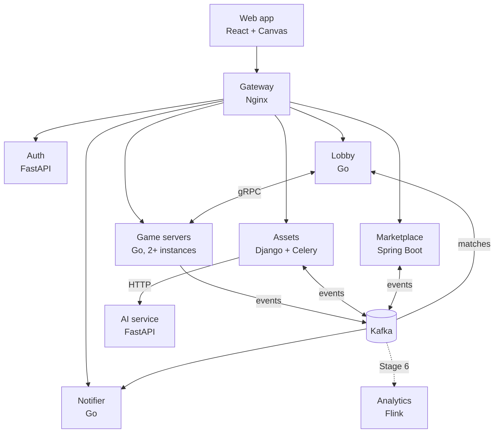
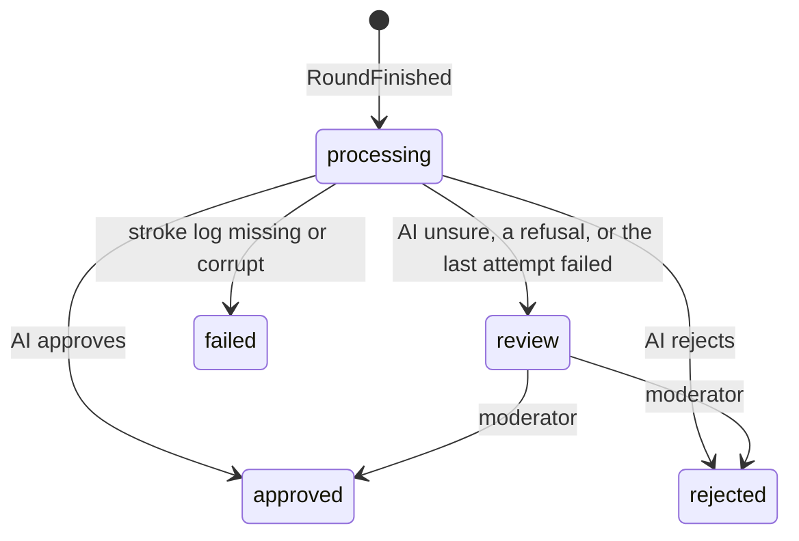
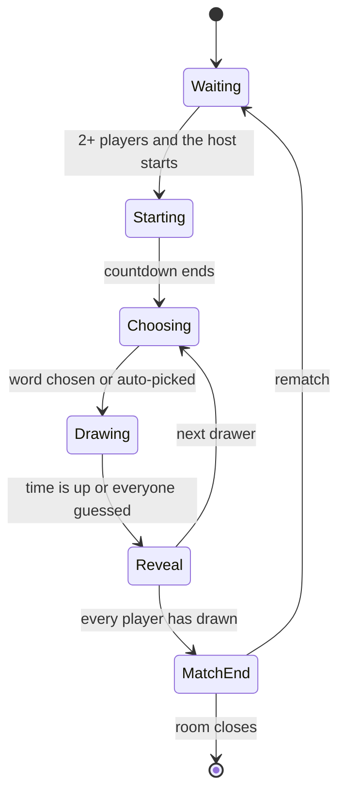

# Doodle Arena: design doc

Status: living document, written at project kickoff (October 2026).
Owners: Bowen and Will. Decisions that change this document are recorded as ADRs in `docs/adr/`.

## 1. Summary

Doodle Arena is a real-time multiplayer draw-and-guess game. One or two players draw a secret word while the others guess. When a round ends, the drawing is rendered to an image, moderated, and becomes a unique item that players can buy and sell for coins in a player marketplace. Players earn coins by playing and can buy coin packs through Stripe in test mode. Coins can't be cashed out.

The project exists to show backend depth in internship interviews. Three parts are built deep and measured:

1. **Game server reliability:** reconnecting, failover when a server dies, and exactly one owner per room.
2. **Marketplace correctness:** a double-entry ledger, atomic ownership transfer and idempotent payments.
3. **Scale (Stage 6):** a live-stream room where thousands of viewers watch one drawer.

Everything else stays deliberately simple.

## 2. Goals and non-goals

Goals:

- Cover the skill keywords in `docs/keyword-coverage.md`, each for a real reason.
- Build a working skeleton of the whole system in about one week (Stages 1–5), then add depth and measured numbers in week two (Stage 6).
- Back every deep part with evidence: tests, load-test numbers and fault-injection results.

Non-goals:

- Polished game design or graphics.
- Real money leaving the system. Coins are closed-loop.
- Blockchain or NFTs. Ownership lives in a central ledger.
- GraphQL, mobile apps, and multi-cloud in the core path. GCP, Azure, Jenkins and Kubernetes are optional extras (Stage 7).

## 3. Architecture

Data stores: PostgreSQL, Redis, MongoDB, S3-compatible object storage (SeaweedFS locally, S3 in AWS) and, in Stage 6, Elasticsearch. Telemetry goes to an OpenTelemetry Collector, then to Prometheus, Tempo and Loki, with Grafana on top (see `docs/observability.md`).

The web app talks REST and WebSocket through the gateway. The lobby and game servers talk gRPC. Everything that happens *after* something else (rewards, rendering, notifications, analytics) goes through Kafka, so a slow or broken consumer never blocks a game round.

## 4. Services

### Ownership

| Service | Language | Owner | First stage |
|---|---|---|---|
| gateway | Nginx config | Bowen | 1 |
| auth | Python (FastAPI) | Bowen | 1 |
| lobby | Go | Bowen | 2 |
| game-server | Go | Bowen | 2 |
| assets | Python (Django + Celery) | Bowen | 3 |
| ai | Python (FastAPI) | Bowen | 3 (stub) |
| marketplace | Java (Spring Boot) | Will | 4 |
| notifier | Go | Bowen | 4 |
| analytics | Java (Flink) | Will | 6 |
| web | TypeScript (React) | Bowen | 1 |

Until Will joins the project, Bowen covers every service, including marketplace and analytics. The table shows the intended long-term owners.

### 4.1 Gateway (Nginx)

- Routes `/api/auth/*` to auth, `/api/lobby/*` to lobby, `/api/assets/*` and `/admin/*` to assets, `/api/market/*` to marketplace, `/api/notifier/*` to notifier, and `/ws/*` to game servers. A route `/otlp/*` to the collector, for browser telemetry, comes with task 5.4.
- Passes the `Upgrade` and `Connection` headers for WebSockets, with a long read timeout.
- Applies coarse per-IP rate limiting with `limit_req`, which is a leaky bucket. Fine-grained limits live in the services.
- Serves `/healthz` for itself and `/healthz/<service>` for every service, including each game-server instance (used by `make smoke`). These are restricted to internal traffic in AWS.
- Only routes; it doesn't verify tokens (ADR 0001). It refuses (400 `IDENTITY_HEADER`) any request that carries an `X-User-*` or `X-Roles` header, on every route; nginx can't match header names by pattern, so a small njs check (`services/gateway/identity.js`) does it. It never routes to a service's internal port.
- Locally, the whole system is one origin, `http://localhost:8080`: the gateway also proxies the Vite dev server for the web app, so there is no CORS and the refresh cookie is first-party. TLS terminates at the gateway (or the load balancer in front of it) only in AWS.
- WebSockets use `/ws/<server_id>/rooms/<room_id>`: an explicit map sends each `server_id` to its game-server instance, and unknown ids get 404 (ADR 0002).

### 4.2 Auth (FastAPI)

Owns the Postgres database `auth`.

- Google OAuth 2.0 authorization code flow, with PKCE and a `state` parameter. It requests only the `openid profile` scopes, so Google never sends an email address.
- Issues a short-lived JWT access token (about 15 minutes) signed with RS256, with `aud` set to `doodle-api`. Public keys are served at `/api/auth/.well-known/jwks.json`.
- Issues an opaque refresh token (32 random bytes, 30 days) in the cookie `da_refresh`: HttpOnly, SameSite=Strict, Path=`/api/auth`, and Secure in AWS. Refresh tokens are stored as SHA-256 hashes and rotated on every use. Every login starts a family. Reusing an already-used refresh token revokes the whole family.
- `/refresh` locks the presented token (`SELECT … FOR UPDATE`), so concurrent uses of one token serialize: one wins, and the rest count as reuse. The web app therefore sends at most one refresh at a time: single-flight within a tab, and a Web Lock (`doodle-auth-refresh`) across the tabs of the origin, which share the cookie. Without Web Locks (an old browser, or a page outside a secure context) only the per-tab single-flight applies.
- `/refresh` and `/logout` are cookie-authenticated POSTs. Besides SameSite=Strict, they refuse any `Origin` other than the web app's. A request without an `Origin` header is allowed: SameSite=Strict already keeps the cookie off every cross-site request, and requiring the header would only break clients that omit it.
- JWT claims: `sub` (user id), `roles` (`player`, `moderator`, `admin`), `name` (the display name, which the lobby copies into join tickets so game servers can show it; a rename shows after the next refresh), `iss`, `aud`, `iat`, `exp`, `jti`. The header carries `kid`, the RFC 7638 thumbprint of the signing key.
- Stores the minimum user data: Google subject id, display name, avatar URL and roles. No email address.
- API keys (Stage 4) for developers who register webhooks or call the public read API. Format `da_<prefix>_<secret>`, stored as the prefix plus a hash, with scopes and `last_used_at`. Other services verify keys through an internal endpoint and cache the result briefly.
- Internal endpoints (such as `/internal/api-keys/verify`) are served on a separate internal port that the gateway never routes.
- Each service verifies JWTs itself, against the cached JWKS: see ADR 0001 (Accepted) for the exact checks and for how the Django admin signs moderators in.

### 4.3 Lobby (Go)

Owns the Redis key prefix `lobby:*`.

- REST: create a room, list public rooms, quick play, join a room, read the leaderboard.
- Keeps a registry of game servers. Each game server sends a gRPC `Heartbeat` every 2 seconds with its addresses, load and per-room status (connected players, held seats, waiting or playing), and an entry expires after 6 seconds without one. The registry gRPC port (9090) is internal.
- Allocates new rooms to the least-loaded healthy game server through gRPC `AllocateRoom` (fewest sockets, then fewest rooms; draining servers are skipped). Each call has a 2-second deadline; if a server is full, draining or unreachable, the lobby tries the next one, up to three. Every request names the target (`server_id`), so a cached connection that reaches another instance after containers swap IP addresses is refused instead of creating a room there; on a refusal or a mismatched answer the lobby drops the connection, looks the name up again and asks the same server once more. A server that didn't answer is tried last for the next 10 seconds, so a server that heartbeats but can't be reached doesn't add its deadline to every create. The room is stored only after a server has taken it. The lobby's gRPC client takes no service config from DNS: gRPC's DNS resolver would otherwise also look up a `_grpc_config` TXT record before reporting any address, and a cold upstream took 5–8 s to answer it, longer than the first call's deadline.
- On join, returns the room's WebSocket URL (`<ws_address>/rooms/<room_id>`, where `ws_address` is the gateway path the game server reports, such as `/ws/game-server-1`) and a join ticket: a token signed with the lobby's Ed25519 key, valid for 60 seconds and usable once, that names the user and the room (ADR 0005). The lobby doesn't enforce `max_players`: only the game server knows whether a joining player is already in the room (a reconnect), so it decides. Quick play uses the reported status to pick the fullest waiting room with a free seat: it compares held seats, not connected players, with `max_players`, because a player who steps away keeps their seat and the game server would refuse the joiner (ADR 0008). It looks at the 60 newest public rooms.
- Redis keys: `lobby:server:{server_id}` (the last heartbeat, 6-second TTL), `lobby:servers` (set of server ids), `lobby:room:{room_id}` (the room, expiring 10 minutes after its server last reported it; only the owning server's heartbeat refreshes it), `lobby:rooms:public` (sorted set by creation time, for the room list), `lobby:leaderboard:{week}` (sorted set of user ids by points; expires 35 days after its last write), `lobby:lb:seen:{match_id}` (a counted match, 8-day TTL), `lobby:names` (hash of user id to display name), `lobby:server_rooms:{server_id}` (set of the rooms placed on that server, so the reassigner finds a dead server's rooms), `lobby:room_hosts` (set of server ids with rooms, pruned lazily when a server's set is empty), `lobby:reassigner` (lock, 10-second TTL: every lobby instance tries every 2 seconds, and only the holder runs a reassignment pass, so a crashed holder can delay failover by up to 10 seconds).
- Heartbeats and `AllocateRoom` aren't authenticated: for now the internal gRPC relies on network isolation (ADR 0006). So the lobby accepts only a `/ws…` gateway path as `ws_address` and `host:port` as `control_address`; a bogus heartbeat can't send players to another host.
- Notices dead game servers through missed heartbeats and reassigns their rooms. Clients that reconnect get the new server's URL.
- Consumes `MatchFinished` from `game.matches.v1` (consumer group `lobby-leaderboard`) to keep a weekly leaderboard: the sum of each player's match scores per ISO week, with the week taken from `ended_at` in UTC (Monday to Sunday, named like `2026-W42`). `ZINCRBY` isn't idempotent, so one Lua script does both steps: `SET NX lobby:lb:seen:{match_id}` (8-day TTL, longer than any week a match can count towards), and only if that marker is new, `ZINCRBY` for every result. A crash can't separate the marker from the increments, and two deliveries at the same moment can't both pass the check. Offsets are committed only after the script ran (at-least-once), and while Redis is down the consumer retries instead of moving past a match. An unset or unknown `oneof` case, or bytes that don't decode, is logged with topic, partition and offset, counted, committed and skipped (ADR 0004). Each record's `traceparent` continues the producer's trace (span `lobby.leaderboard.apply`).
- Display names for the leaderboard come from a name cache, since `MatchFinished` carries only user ids: every join and quick play stores the access token's `name` claim in `lobby:names`. A player who never joined through the lobby shows without a name. A failure to store a name never fails the join.

### 4.4 Game server (Go)

Owns the Redis key prefix `room:*` and the bucket `round-logs`.

- Runs each room as an actor: one goroutine owns all of a room's state. Details are in section 9.
- Classic mode: one drawer, or two drawers sharing a canvas when a round starts with four or more present players. Everyone else guesses.
  - Pairing: the next two players in the draw order who haven't drawn yet. Each player still draws once per match, so 5 players play rounds of 2, 2 and 1 drawers.
  - The first drawer picks the word. Both drawers get it and draw on the same canvas, and each can undo only their own strokes (strokes are keyed by user and `stroke_id`). Each drawer earns the drawer points.
  - If the first drawer leaves while choosing and the second is still there, the options pass to the second drawer, and `choosing` is sent again with the new order. The original deadline stays, so passing the choice back and forth can't stall a round. The one who left stays a drawer: they saw the options, so they must not guess that round.
- Server-authoritative timers, scoring, hint reveals and answer checks. The first correct guess is the first one the room actor processes.
- A per-player token bucket limits guesses and chat. It lives in memory, in the room actor, so it starts full again when another server takes the room over.
- At the end of a round, it uploads the stroke log (a gzipped `doodle.game.v1.StrokeLog` at `<match_id>/<round_no>.binpb.gz`) to `round-logs` and publishes `RoundFinished` with the object key. At the end of a match, it publishes `MatchFinished` with placements but no coin amounts, because the marketplace decides rewards.
  - **Every finished round or match is durable first (ADR 0009).** The actor builds its outbox entry (the round or match as gzipped JSON, a fixed `event_id`, and the end span's `traceparent`) before its commit, and the commit script adds it to `room:{id}:outbox` in the same call as the `round_ended` or `match_ended` event, under the same lease check. If the commit fails, neither exists, and the next owner replays the round. Each entry is deleted only after Kafka has its event.
  - The room actor never does the I/O. After the broadcast it hands each finished round or match, with its entry, to a publisher with a bounded in-memory queue (1024) and one worker, which keeps a room's last `RoundFinished` ahead of its `MatchFinished`. The queue is only the hand-off: the outbox holds the event.
  - The upload comes first, so an event never points at a missing object. Each event has a 2-minute deadline and keeps its `event_id` across retries. Uploads retry with backoff. The producer is franz-go's idempotent producer with `acks=all`, which retries in order on its own without duplicates. The publisher retries only definite failures, and after the deadline it stops waiting and counts the event as failed. The record stays buffered and may still be delivered, so an event can arrive twice, which consumers absorb (at-least-once).
  - When the queue is full (Kafka or S3 down for a long time), a new job is dropped rather than blocking rooms, and a job that misses its deadline is given up; either way the entry stays in the outbox. Every 30 seconds each server queues again its rooms' entries older than a minute, skipping those still queued or in flight. A server that takes a room over queues whatever the previous owner's outbox still holds, so a crash or a kill delays events instead of losing them. An empty room isn't closed while its outbox has entries: it waits another `EmptyTTL` and tries again, keeping its lease, so its entries always have an owner.
  - Every finished round is published, even one with no strokes. A match is published only if at least one round finished: one that ended during the countdown is not a result and earns nothing. Undo removes strokes from the canvas, so the stroke log contains only the strokes that remained. The canvas has a fixed 4:3 aspect, so events report 800 x 600.
- Sends the lobby a `Heartbeat` every 2 seconds, starting at startup. Its gRPC client takes no service config from DNS (`WithDisableServiceConfig`), so the first heartbeat doesn't wait for a `_grpc_config.<host>` TXT lookup that Docker's DNS forwards upstream: a new server registers within milliseconds instead of up to 8 seconds.
- At least two instances run locally, so failover can be tested. In Stage 6 the same binary also runs in a relay role for the live-stream room.

### 4.5 Assets (Django + Celery)

Owns the Postgres database `assets`, the MongoDB database `assets`, the bucket `drawings`, a Redis logical database for Celery, and (Stage 6) the Elasticsearch index `drawings`.

Consumes `RoundFinished` and runs a Celery pipeline for each drawing:

1. Fetch the stroke log from `round-logs` (claim check) and store it as a replay document in MongoDB.
2. Render a PNG and a thumbnail. Hash the PNG with SHA-256 and upload both images to `drawings` under content-addressed keys (`sha256/<hash>.png`), so identical images are stored once.
3. Ask the AI service to moderate the image, with a timeout and retries using exponential backoff and jitter. If the last attempt fails, the drawing waits in the Django admin review queue.
4. Mark the drawing approved or rejected, and publish `DrawingApproved` or `DrawingRejected`.

Processing is idempotent: a unique `(match_id, round_no)` constraint stops a replayed `RoundFinished` from creating a second drawing.

Processes (one image): gunicorn serves the REST API and the admin; `assets-consumer` reads `game.rounds.v1`; `assets-worker` runs Celery with Redis logical database 1 as its broker; `assets-beat` (exactly one) runs the recovery sweeper every minute; `assets-migrate` applies the Django migrations and `mongo-users` creates assets' MongoDB user before they start. Celery tasks are acknowledged after they finish and redelivered when their worker dies (`acks_late`, `reject_on_worker_lost`, prefetch 1), so every task runs at least once and must be idempotent. There is no result backend: a drawing's state lives in Postgres.

A drawing's `id` is a UUIDv7: random, so it can't be guessed, and time-ordered, so new rows land at the end of the primary-key index and the gallery can page by id. Its `status` is the only state machine:

The consumer (`drawings/consumer.py`, group `assets`, manual commits) turns each `RoundFinished` into a row with `get_or_create` on `(match_id, round_no)`, sends the pipeline task, and only then commits the offset. A drawing still `processing` gets its task again on every delivery, which covers a crash between the insert and the send. A round with `stroke_count` 0 creates nothing. Records it can't read, or that the database refuses (a value longer than its column), are logged, counted and committed so they never block the partition; only connection errors (Postgres, the broker) are retried, on the same record.

The pipeline task (`prepare_drawing`) runs fetch, render and upload, each skipped when the row already has its result. The replay document in `assets.replays` (`_id` = drawing id, its own `schema_version`, points as `[x, y, t]` arrays) is the source of truth once stored, because the bucket copy expires after 7 days. Pillow renders a 1024 px image (long side, the drawers' aspect ratio) and a 256 px thumbnail, at 2x and downsampled, with no metadata, so the same strokes always give the same bytes. They go to `sha256/<hash>.png` and `sha256/<hash>.thumb.png` (HEAD first, PUT only if missing). The hash is of the rendered image, so a renderer change gives new keys; old objects stay valid. Store outages retry with exponential backoff and full jitter (up to 6 attempts: the first and 5 retries); a missing or corrupt log makes the drawing `failed` with the reason. A prepared drawing then gets `moderate_drawing`: the thumbnail goes to the AI service (`POST /v1/moderate`, section 4.8) with a 3-second timeout. Approve and reject are applied through the guarded `decide`; `review` (the AI is unsure) sends the drawing to the queue. Timeouts, connection errors, `429` and `5xx` are retried with exponential backoff and full jitter; the budget is 4 calls, counted on the row (`moderation_attempts`) so it holds across redeliveries, after which the drawing waits in the review queue with the reason (ADR 0011). Only one task calls at a time: claiming the drawing (`moderation_claimed_until`, 60 s) and counting the attempt are one conditional UPDATE, so a duplicate task stops there. Any other `4xx`, or an answer the client can't read, goes to the queue at once. Beat runs the sweeper every minute, which re-queues every drawing still `processing` 10 minutes after its last change, locking them with `SKIP LOCKED` (`prepare_drawing` skips what's done and sends the moderation task again), and deletes expired admin sessions every hour. The admin shows each drawing through a staff-only view that streams it from the bucket.

A decision leaves the service only through the transactional outbox (ADR 0010): `decide()` writes `DrawingApproved` or `DrawingRejected` (keyed by `drawing_id`, `reason` `moderation:rejected` or `manual:rejected`) into `drawings_outboxevent` in the same transaction as the status change, so neither can happen without the other. An approval needs the drawing's image. `assets-relay` locks unpublished rows in id order (`FOR UPDATE SKIP LOCKED`), produces them with an idempotent producer (acks=all), and stamps `published_at` only for what Kafka confirmed; a crash after the ack republishes with the same `event_id`, so consumers dedupe on it or on `drawing_id`. Published rows are purged after 7 days. Drawings decided before the outbox existed get their events once from `manage.py backfill_decision_events`.

Progress inside `processing` is the pipeline's own columns (`replay_id`, `sha256`, the image keys), each filled once, so a redelivered task skips the steps already done. Every status change is one conditional `UPDATE ... WHERE status IN (...)` (`drawings/moderation.py`): under READ COMMITTED, of two concurrent decisions exactly one changes the row. The AI decides only from `processing` and a moderator only from `review`, so a late AI answer can't overrule the queue. Check constraints make a decided drawing always name who decided and when.

Moderators sign in to the admin with Google (ADR 0001): `/admin/login/` sends the browser to the web app's `/moderate`, which calls `POST /admin/sso/` once with its access token. Role `moderator` makes a staff user in the `moderators` group (view drawings, approve or reject in the queue); `admin` makes a superuser. Drawings are read-only in the admin.

The service also serves drawing metadata, presigned image URLs and replays over REST. Django admin is the moderation console. In Stage 6 it indexes drawings and active listings (from `market.listings.v1`) into Elasticsearch.

Drawing metadata lives in Postgres because Django's ORM and admin are built for SQL databases. MongoDB holds the replays: large, write-once documents that are always read whole and whose stroke format may change over time.

### 4.6 Marketplace (Spring Boot)

Owns the Postgres database `marketplace`.

- Coin ledger, wallets, drawing ownership and provenance, listings, purchases, royalties, round rewards and Stripe coin packs. Details are in section 8.
- Consumes `DrawingApproved` (creates the first ownership record) and `MatchFinished` (pays rewards).
- Publishes through a transactional outbox: `SaleCompleted`, `ListingCreated`, `ListingCancelled` and `CoinsCredited`.
- Runs a reconciliation job every minute that checks the ledger and ownership invariants and exports them as metrics.
- Verifies access tokens itself (ADR 0001) with Spring Security's resource server; SQL is written by hand through `JdbcClient` and migrated by Flyway at startup.
- Consumes `assets.drawings.v1` with Spring for Apache Kafka in the consumer group `marketplace` (task 4.2). An offset is committed only after its record's transaction committed. A record it can't read (undecodable, an unset or unknown event) or an event that breaks its contract is logged, counted and committed; anything else, such as Postgres being down, is retried on the same record (1 s doubling to 30 s, no limit), so the partition waits instead of skipping a mint. A new group starts at the earliest offset, so every drawing already approved is minted.

### 4.7 Notifier (Go)

Owns the Postgres database `notifier`.

- Developers register webhook endpoints with an API key and choose event types. Each endpoint gets its own signing secret.
- Consumes `SaleCompleted` (and optionally `CoinsCredited`) and delivers events as signed HTTP POST requests.
- Signature header: `Doodle-Signature: t=<unix-seconds>,v1=<hex HMAC-SHA256 of "<t>.<body>">`. A `Doodle-Event-Id` header lets receivers dedupe. Receivers should reject timestamps older than 5 minutes.
- Retries use exponential backoff with full jitter (base 2 seconds, cap 30 minutes, at most 8 attempts) and 5-second timeouts. After the last attempt, the delivery is marked `DEAD` and published to `notifier.dlq.v1`.
- The delivery log can be queried over REST.
- Endpoint URLs come from outside users, so the notifier blocks server-side request forgery: it resolves the host at send time and refuses loopback, private, link-local (including `169.254.169.254`) and unique-local addresses, and it doesn't follow redirects. Production endpoints must use HTTPS.

### 4.8 AI service (FastAPI)

Stateless.

- Stage 3: `POST /v1/moderate` is a stub. The body is the drawing as `image/png` (at most 2 MB; `X-Drawing-Id` for logs). It answers `200 {decision, reason, model}` with `decision` one of `approve`, `reject` or `review` (unsure: a human decides), `503 MODERATION_UNAVAILABLE` when it fails, `415` or `400 INVALID_IMAGE` for bad input. It approves by default; `MODERATION_MODE` (`approve`, `reject`, `review`, `fail`), `MODERATION_DELAY_MS` and `MODERATION_FAILURE_RATE` change that, and `PUT /internal/moderation-mode` changes them at runtime until the next restart (`scripts/ai-mode.sh`). `/internal/*` answers only on the internal port 9091, which the gateway never routes and compose never publishes; both ports are sockets of one uvicorn server.
- Later (Stage 7): a real moderation model, `POST /v1/guess` (an AI player that guesses from the canvas) and `POST /v1/similarity` (embeddings for "close!" hints), with an eval set built from real drawings.

### 4.9 Analytics (Flink, Stage 6)

- Job 1: top guesses per live room over a sliding window, read from `live.guesses.v1` and written to `live.top-guesses.v1`.
- Job 2: wash-trading detection over `market.sales.v1`, such as the same accounts trading back and forth or circular trades within a time window. Flags go to a dashboard and an alert.

### 4.10 Web app (React + Canvas)

Pages: login, lobby, room (canvas, guesses, scores, timer), the weekly leaderboard (`/leaderboard`: ranks, names and points for one ISO week, your own row highlighted, previous and next week), gallery and replays, marketplace, wallet (buy coins), and developer settings (API keys and webhooks). Follows `.claude/rules/web.md`.

The room client (task 2.3):

- Pages route by path (`/` is the lobby, `/rooms/<room_id>` a room), so an invite link opens the room. There is no router library.
- State is a pure reducer over server messages: `welcome` replaces it, events apply only when `seq` is newer, and scores, phases and the word change only when the server says so. The chat feed isn't part of the view, so a reconnect keeps it.
- The canvas has a fixed 4:3 aspect and two layers. The base layer paints only the server's `stroke_batch` events, so every player sees the same picture; the overlay paints the drawer's own stroke at once and drops it when the server's copy arrives, so drawing doesn't lag by a round trip. Points go out every 50 ms (`VITE_STROKE_BATCH_MS`, or `?batch_ms=` for one experiment) or at 512 points.
- The connection asks the lobby for a new ticket on every attempt and reconnects with jittered exponential backoff (0.5 s doubling to 8 s, giving up after 12 attempts, about a minute, which matches the seat grace). Close codes 4000, 4003, 4004 and 4009 and a lobby `ROOM_NOT_FOUND` or `SIGNED_OUT` end the connection instead (4004 is the client's own code for `ROOM_NOT_FOUND`; the server never sends it). A gap in `seq`, or a `resumed {seq}` ahead of the last applied event, reconnects at once; `room_moved` reconnects after the usual jittered backoff, so a fenced server's players don't all ask the lobby in the same millisecond.
- The timer counts down to the server's deadline on the local clock. It is display only; the server ends phases. Clock skew shows as a timer that is a little off.
- The ping round-trip time is shown next to the connection status; exporting it as `web.ws.rtt` comes with browser telemetry (task 5.4).

The gallery (task 3.5):

- `/gallery` lists everyone's approved drawings (newest first, "Load more" follows `next_cursor`) or, on "My drawings", your own in any state with its status. Opened from the end of a match (`/gallery?match_id=<id>`), it lists that match's drawings in round order. Thumbnails load straight from storage through their presigned URLs.
- `/drawings/<id>` shows a drawing and plays its replay with the live canvas's `drawPoints`, so it looks like the round did. A stroke starts at its `server_received_ms` minus its last point's `t_ms`, and each point lands at that start plus its own `t_ms` (`game/replay.ts`). The replay starts at the first point, pauses longer than a second are squeezed to one, and it plays at 1x, 2x or 4x. Undone strokes are left out: the log says that a stroke was undone, not when, so the replay ends on the same picture as the PNG.

## 5. Data ownership

| Store | Database, prefix or bucket | What it holds | Owner |
|---|---|---|---|
| PostgreSQL | `auth` | Users, refresh tokens, API keys | auth |
| PostgreSQL | `assets` | Drawing metadata and moderation status, the outbox of drawing events, admin sessions | assets |
| PostgreSQL | `marketplace` | Accounts, ledger, balances, ownership, listings, idempotency keys, outbox, Stripe events | marketplace |
| PostgreSQL | `notifier` | Endpoints and deliveries | notifier |
| Redis | `room:*` | Room event streams, snapshots, leases, fencing counters | game-server |
| Redis | `lobby:*` | Rooms, game-server registry, leaderboards | lobby |
| Redis | Logical database 1 | Celery broker (no result backend) | assets |
| MongoDB | `assets.replays` (user `assets`, `readWrite` on `assets` only) | Stroke logs for replays | assets |
| Object storage | `round-logs` bucket | Raw round stroke logs; a lifecycle rule deletes them after 7 days. Assets reads them: the claim check in `RoundFinished` (D13) is the one deliberate exception to "no service reads another's bucket" | game-server |
| Object storage | `drawings` bucket | PNGs and thumbnails, content-addressed | assets |
| Elasticsearch | `drawings` index | Search over drawings and listings (Stage 6) | assets |
| Kafka | Topics in section 6.2 | Events between services | Each topic's producer |

Locally there is one Postgres server with four databases and one database user per service, plus one Redis, one MongoDB, SeaweedFS for S3, and one Kafka broker in KRaft mode.

## 6. Contracts

Contracts live in `proto/` and change only with human approval (see `.claude/rules/contracts.md`). `proto/README.md` explains the layout, code generation (`make proto`) and where generated code lands for each language.

### 6.1 gRPC

| Service | Served by | Called by | Methods |
|---|---|---|---|
| `doodle.game.v1.ControlService` | Each game server | Lobby | `AllocateRoom(room_id, mode, settings, host_user_id, server_id)` (idempotent per `room_id`; refused with `FAILED_PRECONDITION` by any server that isn't `server_id`), `DrainServer()` before a deploy |
| `doodle.lobby.v1.RegistryService` | Lobby | Game servers | `Heartbeat(server_id, ws_address, control_address, rooms[], sockets, draining)` every 2 seconds; `rooms` carries each room's connected players, held seats and phase |

Every call has a deadline. `AllocateRoom` returns `INVALID_ARGUMENT` for a malformed room id, mode or settings, `FAILED_PRECONDITION` when it is meant for another server or this one drains, `RESOURCE_EXHAUSTED` when the server is full (`MAX_ROOMS`, 100 by default), `NOT_FOUND` for a room that has ended (its tombstone), `UNAVAILABLE` when the room store can't be reached or the room's previous copy here is still stopping, and `INTERNAL` when stored state can't be restored. For a room this server already runs it checks its lease first: a copy that lost the lease is stopped and the room taken again with a new token. Stage 7 may add `doodle.ai.v1` for the AI guesser.

### 6.2 Kafka event catalog

Every message on a topic is that topic's wrapper message: one `oneof event` with a case per event type (ADR 0004). There is no schema registry; Buf checks compatibility in CI. Every event inside a wrapper starts with `EventMeta meta = 1`: `event_id` (UUID), `event_type`, `schema_version`, `occurred_at` and `producer`. Trace context travels in the Kafka `traceparent` header. Consumers dedupe on `event_id` or on a natural key. A consumer that finds an unset or unknown `oneof` case (a newer producer) logs it, counts it, commits the offset and moves on.

| Topic | Wrapper | Events | Producer | Consumers | Key | Stage |
|---|---|---|---|---|---|---|
| `game.rounds.v1` | `RoundEvent` | `RoundFinished` | game-server | assets | `room_id` | 2 |
| `game.matches.v1` | `MatchEvent` | `MatchFinished` | game-server | marketplace, lobby | `room_id` | 2 |
| `assets.drawings.v1` | `DrawingEvent` | `DrawingApproved`, `DrawingRejected` | assets | marketplace | `drawing_id` | 3 |
| `market.listings.v1` | `ListingEvent` | `ListingCreated`, `ListingCancelled` | marketplace (outbox) | assets (search, Stage 6) | `drawing_id` | 4 |
| `market.sales.v1` | `SaleEvent` | `SaleCompleted` | marketplace (outbox) | notifier, assets, analytics | `drawing_id` | 4 |
| `market.wallet.v1` | `WalletEvent` | `CoinsCredited` | marketplace (outbox) | notifier (optional) | `user_id` | 4 |
| `notifier.dlq.v1` | `DeadLetterEvent` | `DeliveryDead` | notifier | alerting, humans | `endpoint_id` | 4 |
| `live.guesses.v1` | `ViewerGuessEvent` | `ViewerGuess` | game-server relays | analytics | `room_id` | 6 |
| `live.top-guesses.v1` | `TopGuessesEvent` | `TopGuesses` | analytics | game-server | `room_id` | 6 |

Key payload fields:

- `RoundFinished`: `match_id`, `room_id`, `round_no`, `word`, `drawer_ids` (the first one becomes the initial owner), `stroke_log_key`, `stroke_count`, `canvas_width`, `canvas_height`, `ended_at`.
- `MatchFinished`: `match_id`, `room_id`, `mode`, `started_at`, `ended_at`, `results[]` with `user_id`, `score` and `placement`.
- `DrawingApproved`: `drawing_id`, `match_id`, `round_no`, `author_ids`, `initial_owner_id`, `sha256`, `image_key`, `thumb_key`.
- `SaleCompleted`: `sale_id`, `listing_id`, `drawing_id`, `seller_id`, `buyer_id`, `price`, `royalties[]` with `user_id` and `amount`, `completed_at`.
- `CoinsCredited`: `user_id`, `amount`, `reason` (`stripe_purchase` or `reward`), `reference`.

`RoundFinished` uses the claim-check pattern. A round's stroke log can be large, so the event carries only the object key, and the log itself lives in the `round-logs` bucket. This also avoids an ordering problem: if strokes travelled on their own topic, the assets service couldn't know when it had all of them. The object is a gzip-compressed `doodle.game.v1.StrokeLog` protobuf, so its format is versioned and checked by Buf like every other contract.

### 6.3 REST API sketch

All endpoints go through the gateway, use JSON, and require a JWT bearer token unless noted. Errors look like `{"error": {"code": "LISTING_NOT_AVAILABLE", "message": "...", "request_id": "..."}}`. Lists use cursor pagination.

Auth:

- `GET /api/auth/google/login` and `GET /api/auth/google/callback` (no JWT)
- `POST /api/auth/refresh` (refresh cookie), `POST /api/auth/logout`, `GET /api/auth/me`
- `GET /api/auth/.well-known/jwks.json` (public)
- `POST`, `GET`, `DELETE /api/auth/api-keys` (Stage 4)

Lobby:

- `POST /api/lobby/rooms` takes `{public, mode, settings}` (all optional; `mode` is `classic`) and returns `201` with `{room_id, host_id, mode, public, settings, created_at}`. Settings and their ranges: `max_players` 2–8 (default 8), `choose_seconds` 5–30 (10), `draw_seconds` 30–180 (80), `word_options` 1–5 (3); out of range is `400 INVALID_SETTINGS`, unknown fields or a bad mode `400 INVALID_REQUEST`, and no game server able to take the room `503 NO_GAME_SERVER` with `Retry-After: 2`.
- `GET /api/lobby/rooms?limit=<1..50>&cursor=` (limit 20 by default) returns `{rooms, next_cursor}`, each room with its connected `players`, `max_players` and `phase`; a bad cursor is `400 INVALID_REQUEST`.
- Joining a room that doesn't exist is `404 ROOM_NOT_FOUND`; a room being moved is `503 ROOM_UNAVAILABLE` with `Retry-After: 2`. Without a valid token every lobby endpoint answers `401 UNAUTHENTICATED`.
- `POST /api/lobby/rooms/{room_id}/join` and `POST /api/lobby/quickplay` return `{room_id, ws_url, ticket, expires_at}`, with `Cache-Control: no-store`
- `GET /api/lobby/leaderboard?week=<YYYY-Www>&limit=<1..100>` returns `{week, entries: [{rank, user_id, name, score}], me: {rank, score} | null}`. The week defaults to the current ISO week (UTC) and the limit to 20; a malformed or nonexistent week (such as `2025-W53`) or a limit out of range is `400 INVALID_REQUEST`. Ranks use competition ranking: equal scores share a rank and the next one is skipped (1, 2, 2, 4). `me` is the caller's own place, even below the limit, and `null` if they scored nothing that week. `name` is empty for a player the lobby never saw join.

Assets:

- `GET /api/assets/drawings?author_id=&match_id=&limit=<1..50>&cursor=` returns `{drawings, next_cursor}`, newest first (keyset on the UUIDv7 id). Without a filter it lists approved drawings (the gallery); with `author_id` or `match_id`, the matching approved drawings, plus the caller's own in any state.
- `GET /api/assets/drawings/{id}` returns `{id, match_id, round_no, word, author_ids, initial_owner_id, status, ended_at, created_at, has_replay, image_url, thumb_url}`. `image_url` and `thumb_url` are presigned GET URLs straight to object storage, valid 15 minutes and handed out again for 10 (so a browser's cache works), `null` before the images exist. Approved drawings are visible to every signed-in player; other drawings only to their authors, and `404 DRAWING_NOT_FOUND` to everyone else.
- `GET /api/assets/drawings/{id}/replay` returns the replay document: `{drawing_id, schema_version, canvas_width, canvas_height, round_started_at, strokes: [{user_id, color, width, undone, server_received_ms, points: [[x, y, t_ms], ...]}]}`, or `404 REPLAY_NOT_FOUND`.
- A bad `limit`, `cursor` or `author_id` is `400 INVALID_REQUEST`; a missing or invalid token `401 UNAUTHENTICATED`; another method `405 METHOD_NOT_ALLOWED`; any other path under `/api/assets/` `404 NOT_FOUND`, all in the shared error format. The API authenticates with the `Authorization` header only, never a cookie, so it is exempt from Django's CSRF checks.
- `GET /api/assets/search?q=...` (Stage 6)
- `/admin/`: Django admin for moderators. `/admin/login/` redirects to the web app's `/moderate`, which signs in through `GET /admin/sso/` (returns `{csrf_token}`) and `POST /admin/sso/?next=<admin page>` with the access token in `Authorization` and the CSRF token in `X-CSRFToken` (returns `{next}`; `401 UNAUTHENTICATED` for a missing or invalid token, `403 FORBIDDEN` without the `moderator` or `admin` role)

Marketplace:

- `GET /api/market/wallet` returns `{user_id, balance, updated_at}` for the caller (the token's subject). A user who never had coins gets `balance` 0 and `updated_at` null; a read never creates an account.
- `GET /api/market/wallet/transactions?limit=<1..50>&cursor=` returns `{transactions: [{tx_id, type, amount, created_at}], next_cursor}`: the caller's ledger entries, newest first (keyset on the entry id; limit 20 by default). `amount` is signed: positive for coins in, negative for coins out. A bad `limit` or `cursor` is `400 INVALID_REQUEST`.
- Every marketplace endpoint answers `401 UNAUTHENTICATED` without a valid token, `404 NOT_FOUND` for an unknown path and `405 METHOD_NOT_ALLOWED` for another method, in the shared error format.
- A listing is `{listing_id, drawing_id, seller_id, price, status, buyer_id, sale_id, created_at, closed_at}` (`status` is `ACTIVE`, `SOLD` or `CANCELLED`).
- `POST /api/market/listings` takes `{drawing_id, price}` (requires `Idempotency-Key`) and returns `201` with the listing. `price` is a JSON integer from 1 to 1,000,000 coins (`1.5` or `"5"` are `400 INVALID_REQUEST`). `403 NOT_OWNER` unless the caller owns the drawing, `404 DRAWING_NOT_FOUND` for a drawing never minted, `409 ALREADY_LISTED` when it already has an active listing.
- `DELETE /api/market/listings/{id}` cancels it and returns the listing; cancelling a cancelled listing returns it again (no key needed). `403 NOT_OWNER` for anyone but the seller, `409 LISTING_NOT_AVAILABLE` once sold, `404 LISTING_NOT_FOUND`.
- `GET /api/market/listings?drawing_id=&seller_id=&limit=<1..50>&cursor=` returns `{listings, next_cursor}`: active listings, newest first. `GET /api/market/listings/{id}` returns one listing in any status.
- `POST /api/market/listings/{id}/purchase` (requires `Idempotency-Key`, no body) returns `200 {sale_id, listing_id, drawing_id, seller_id, buyer_id, price, royalties: [{user_id, amount}], completed_at}` (the seller received `price` minus the royalties), `409 LISTING_NOT_AVAILABLE` (sold or cancelled: a lost race), `422 INSUFFICIENT_FUNDS`, `422 CANNOT_BUY_OWN_LISTING` or `404 LISTING_NOT_FOUND`.
- Every endpoint that takes an `Idempotency-Key` answers `400 IDEMPOTENCY_KEY_REQUIRED` without one (1 to 255 printable characters), and can also return `409 IDEMPOTENCY_KEY_IN_PROGRESS` (the same key is still being processed) or `422 IDEMPOTENCY_KEY_REUSED` (the same key with a different method, path or body). Clients tell these apart by `error.code`, not by the status code. A key remembers successes and business outcomes (403, 404, 409, 422), which are replayed byte for byte with `Idempotency-Replayed: true`; a new attempt needs a new key (ADR 0012).
- `GET /api/market/drawings/{id}/ownership-history` returns `{drawing_id, owner_id, version, author_ids, events: [{kind, from_owner, to_owner, sale_id, created_at}]}`: the current owner, authors in drawing order, and every change of hands oldest first (`kind` is `MINT`, with no `from_owner` or `sale_id`, or `SALE`). Any signed-in player may read it; a drawing that was never minted, or a malformed id, is `404 DRAWING_NOT_FOUND`.
- `GET /api/market/coin-packs` returns `{packs: [{pack_id, coins, price_cents, currency}]}`: `small` (100 coins, $0.99), `medium` (550, $4.99), `large` (1,200, $9.99), from config.
- `POST /api/market/coin-packs/{id}/checkout` (requires `Idempotency-Key`, no body) returns `200 {session_id, checkout_url}`: the browser goes to `checkout_url` and comes back to `/wallet?checkout=success&session_id=…` or `/wallet?checkout=cancelled`. `404 COIN_PACK_NOT_FOUND`, `502 STRIPE_UNAVAILABLE` when Stripe fails, `503 STRIPE_NOT_CONFIGURED` without a Stripe key.
- `POST /api/market/stripe/webhook` (no JWT; verified by the `Stripe-Signature` header) returns `200 {received, result}` with `result` one of `processed`, `duplicate`, `ignored`, `unknown_session`; `400 INVALID_SIGNATURE` for a missing, wrong or more than 5-minute-old signature; `503 STRIPE_NOT_CONFIGURED` without a webhook secret.

Notifier (authenticated with an API key):

- `POST`, `GET`, `DELETE /api/notifier/endpoints`
- `GET /api/notifier/endpoints/{id}/deliveries`, `POST /api/notifier/endpoints/{id}/test`

### 6.4 WebSocket protocol

The client connects to the URL from the lobby (`/ws/<server_id>/rooms/<room_id>`, ADR 0002) and sends `hello` with its join ticket and, when resuming, `last_seq`, within 10 seconds. Messages are JSON text frames shaped `{"type": ..., "data": ...}`. A client message is at most 64 KB (a server message such as `welcome` can be larger, because it carries the canvas). Coordinates are normalized to 0–10000, so canvas size doesn't matter; a point is `[x, y, t_ms]` and a batch has 1–512 points. Deadlines are Unix milliseconds. A binary format is a Stage 6 experiment. The client pings every 5 seconds; a socket idle for 60 seconds is closed. A frozen server keeps its TCP sockets open, so the client also checks liveness itself: any server message must arrive within 10 seconds of opening a socket and within 5 seconds of a ping, or the client abandons the socket (without waiting for its close) and reconnects (section 7.4).

Client to server:

- `hello {ticket, last_seq?}`
- `start {}` (host only; needs 2+ connected players, in Waiting or after a match)
- `choose_word {index}` (the first drawer only)
- `stroke_batch {stroke_id, points: [[x, y, t_ms], ...], color, width, done}`: `color` is `#rrggbb`, `width` is 1–200 in the same normalized units as coordinates (so a line looks the same on every screen), and `t_ms` counts from the start of the stroke
- `undo {stroke_id}`: a player can undo only their own strokes
- `guess {text}` (1–100 characters; outside a round it is chat)
- `ping {t}` (answered with `pong` without involving the room)

Server to client, shared room events (each wrapped as `event {seq, type, data}` and stored in the room's event log): `player_joined {user_id, name}`, `player_left {user_id}`, `player_removed {user_id}` (seat freed after the rejoin grace), `host_changed {user_id}`, `match_started {match_id, order, deadline}`, `choosing {round_no, drawer_ids, deadline}` (`drawer_ids[0]` chooses; sent again within a round when the choice passes to the second drawer), `round_started {round_no, drawer_ids, word_length, deadline}`, `stroke_batch {user_id, stroke_id, points, color, width, done}`, `stroke_undone {stroke_id, user_id}`, `hint {mask}`, `chat {user_id, text}` (wrong guesses are shown as chat), `correct_guess {user_id, order}`, `round_ended {round_no, word, scores, round_points}`, `match_ended {match_id, results}` (results carry `placement` with competition ranking: 1, 2, 2, 4).

Server to client, private messages (no `seq`, never stored in the shared log): `welcome {user_id, view, seq}`, `word_options {words}` (the first drawer), `your_word {word}` (drawers), `guess_result {correct}`, `rate_limited`, `room_moved {reason}`, `resumed {seq}`, `error {code, message}`, `pong {t}`.

`view` is built for each player from the room state (phase, host, players with scores, the round, the hint mask and the canvas). It contains the word only after the round has ended; drawers get the word through `your_word`, the only message that carries it during a round. The stored snapshot (section 9) contains the word, so it is never sent to a client as it is. On `welcome`, a client replaces its state and then applies events with `seq` greater than `welcome.seq`. A member who reconnects with a `last_seq` the room still holds in memory (at most 200 events behind) gets no `welcome`. In order, it gets: the events after `last_seq`, replayed exactly; this step's own events (its `player_joined`, unless the server still counted its old socket as connected, and a `host_changed` if any); its private state (`your_word` or `word_options`); and last, `resumed {seq}`, the room's seq, so every resume gets an answer and the client can check that it has everything (ADR 0008). Further behind, or after a page reload (`last_seq` 0), it gets a full `welcome` and no `resumed`.

Guess rules: a guess is compared after lowercasing and keeping only the letters a–z. A guess that contains the word without being it is answered only privately (`guess_result {correct: false}`) and never broadcast, because that would show everyone the word. Drawers, and players who already guessed, can't chat while a round runs. Guesses and chat pass a per-player token bucket (5 at once, then 1 per second); a rate-limited guess gets `rate_limited` and is not processed.

`room_moved {reason}` (private) comes right before close 4010 when another server took the room over (ADR 0007).

Close codes: 4000 bad first message, 4001 invalid or reused ticket, 4003 room full, 4008 no `hello` in time, 4010 the room isn't (or is no longer) on this server: ask the lobby again and resume there (sent after a takeover, and to a valid ticket for a room this server doesn't hold, because the room is moving; the server never sends 4004), 4009 the same player connected again elsewhere, 1003 binary frame, 1008 flooding, 1009 message too big, 1011 room store (Redis) unavailable, 1013 too slow (the send queue filled up), 1001 server shutting down. After a close, a client asks the lobby for a new ticket (tickets are single-use) and reconnects.

## 7. Key flows

### 7.1 Login

1. The browser opens `/api/auth/google/login?return_to=/path`. Auth creates a random `state`, an OIDC `nonce` and a PKCE verifier. It stores them in `da_oauth`: an HMAC-signed, HttpOnly, SameSite=Lax cookie that lasts 10 minutes and is scoped to the callback path. Then it redirects to Google with the S256 code challenge. `return_to` must be a local path.
2. Google redirects back to `/api/auth/google/callback`. Auth checks the cookie and that `state` matches it, which binds the login to this browser and stops login CSRF. It exchanges the code with the verifier, then verifies Google's ID token: signature, `iss`, `aud`, `exp` and `nonce`.
3. Auth creates or updates the user by Google subject id, starts a refresh-token family, sets `da_refresh`, clears `da_oauth`, and redirects to `return_to`.
4. The web app calls `/api/auth/refresh` (single-flight) to get an access token, keeps it in memory only, and refreshes again a minute before it expires.

### 7.2 Create and join a room

1. `POST /api/lobby/rooms`: the lobby picks the least-loaded healthy game server and calls `AllocateRoom`.
2. The game server creates the room actor and takes the room's lease.
3. `POST /api/lobby/rooms/{id}/join` returns the WebSocket URL and a join ticket.
4. The client connects and sends `hello`. The game server verifies the ticket and replies with `welcome`, which carries that player's view of the room.

### 7.3 Round lifecycle

Defaults, all configurable: up to 8 players; each player draws once per match; 10 seconds to choose a word from 3 options (on timeout the first option is used); 80 seconds to draw; hints reveal letters at 40% and 70% of the drawing time (each reveals `max(1, len/4)` more, never more than half the word); a round ends early when every connected guesser is correct, or when every drawer has left (one of two leaving doesn't end it). Fixed: a 3-second countdown (Starting), 5 seconds of Reveal. A match ends early when fewer than 2 players are connected. Only the host starts a match; when the host isn't connected, hosting passes to the earliest-joined connected player. A disconnected player keeps their seat and score for 60 seconds (between matches; during a match until it ends), so `max_players` counts seats and a reconnecting player always gets back in. A room with nobody connected closes after 60 seconds and drops out of the heartbeats. A guesser earns `max(20, 100 - 15 * (order - 1))` points, and each drawer (both, in a pair) earns 10 points per correct guesser.

### 7.4 Reconnect

1. The client remembers the last `seq` it applied.
2. After a disconnect, it reconnects with jittered exponential backoff (0.5 s doubling to 8 s, about a minute in all). A socket the server has gone silent on counts as a disconnect (section 6.4), and so do `room_moved` and close 4010: the client waits a short backoff even then, because a zombie that wakes up fences all its rooms at once and its players shouldn't all reach the lobby in the same moment. Tickets are single-use (ADR 0005), so before every attempt it asks the lobby for the room's current URL and a new ticket. After a failover or `room_moved`, that URL names the new server.
3. It sends `hello {ticket, last_seq}`. The server replays every event after `last_seq` (from the room's in-memory buffer, which a new owner fills from the stream), then resends the player's private state.
4. If `last_seq` is more than 200 events behind, or older than the buffer, the server sends a fresh `welcome` with the player's full view instead.

While the lobby moves a room, `join` answers 503 `ROOM_UNAVAILABLE` with `Retry-After`; the client keeps retrying with backoff. Measured with `scripts/drills/failover.py`: players resume 5–8 s after their game server is killed, and 8–10 s after it is frozen with `docker pause`, without waiting for it to wake up (evidence log).

### 7.5 Game server failover

1. Game server A dies, or is cut off from the lobby. The lobby sees its heartbeats stop within 6 seconds (a restarted A that comes back without its rooms is noticed the same way: its heartbeats no longer list them).
2. The lobby calls `AllocateRoom` on game server B for each of A's rooms.
3. B takes each lease by force (ADR 0007): it increments the fence (its new token) and overwrites the lease, then loads the snapshot, replays the stream after the snapshot's `seq`, and restarts the timers from the stored deadlines. A room that has closed answers `NOT_FOUND`, and the lobby forgets it.
4. Clients reconnect through the lobby and resume (section 7.4).
5. If A is still alive (a partition) or comes back as a zombie, its next write or lease renewal fails the fencing check within about 1.5 seconds; it stops the room, sends `room_moved` and closes those sockets with 4010. Because the actor writes events before broadcasting them, nothing A's players saw is missing on B.

Target: players resume within 10 seconds. Measure this and record it in the evidence log.

### 7.6 Drawing lifecycle

1. `RoundFinished` triggers the assets pipeline (section 4.5).
2. `DrawingApproved` reaches the marketplace, which creates the ownership record for the initial owner with `INSERT ... ON CONFLICT DO NOTHING` and records the authors for royalties.

### 7.7 Buying coins with Stripe

1. The web app calls `POST /api/market/coin-packs/{id}/checkout` with an `Idempotency-Key` (claimed as in ADR 0012, around the Stripe call). The marketplace creates a Stripe Checkout Session with the pack's price inline (`price_data`, so the Stripe account needs no Products), the user in `client_reference_id` and the metadata (`user_id`, `pack_id`), and a Stripe idempotency key derived from the user and our key, so a retried request gets the same session. It records the sale in `stripe_checkouts`.
2. The user pays with a Stripe test card.
3. Stripe sends `checkout.session.completed` (and, for delayed payment methods, `checkout.session.async_payment_succeeded`) to the webhook endpoint. The marketplace verifies the signature (HMAC-SHA256 of the timestamp and raw body, at most 5 minutes old) and, in one transaction, records the Stripe event id (a redelivered event is a duplicate), looks up the session in `stripe_checkouts` (a session it didn't create, or whose metadata names another user, is logged and not credited), and credits the coins recorded there, never an amount from the event, with the ledger key `stripe:<session_id>`, so a second event about the same session pays nothing. That debits `stripe_clearing` and credits the user.
4. It writes `CoinsCredited` (reason `STRIPE_PURCHASE`, reference the session id) to the outbox and returns `2xx` quickly. Every answer after a valid signature is `2xx`, so Stripe doesn't retry a case that retrying can't fix. Refunds and disputes aren't handled yet.

Locally, the Stripe CLI forwards the two checkout events to the gateway (`stripe listen --events checkout.session.completed,checkout.session.async_payment_succeeded --forward-to localhost:8080/api/market/stripe/webhook`; docs/setup.md).

### 7.8 Listing and buying a drawing

1. The owner lists a drawing at a price. A drawing can have only one active listing.
2. A buyer sends `POST /purchase` with an `Idempotency-Key`. The purchase transaction runs (section 8).
3. The winning buyer gets `200`. Anyone who loses the race gets `409` and pays nothing.
4. `SaleCompleted` reaches the notifier (webhooks) and the assets service (search index).

### 7.9 Round rewards

1. `MatchFinished` reaches the marketplace (consumer group `marketplace` on `game.matches.v1`, with the same commit, skip and retry rules as `assets.drawings.v1`).
2. It computes coins by placement (`app.rewards`; default: 30 for first, 20 for second, 10 for third, 5 for everyone else). Players with equal scores share a placement, so they get the same amount. A match with fewer than two players pays nothing.
3. One ledger transaction per match, with the idempotency key `reward:<match_id>`, debits `rewards_issuance` by the total and credits every player. A match is paid all or nothing, the system account's balance row is locked once per match (every reward and Stripe credit locks that one row), and a redelivered `MatchFinished` finds the transaction and pays nothing more. A result that breaks the contract (a blank or repeated player, placement 0, more players than a room holds) fails the whole match, with an error log and a count. Kafka doesn't authenticate producers yet (ADR 0013 adds SCRAM users and per-topic ACLs in task 5.5), so the 8-player limit also bounds what a forged event could pay.
4. The same transaction writes one `CoinsCredited` per player (reason `REWARD`, `reference` the match id) to the outbox.

### 7.10 Outgoing webhooks

1. `SaleCompleted` reaches the notifier, which finds every endpoint subscribed to that event type and creates a delivery row for each.
2. It sends a signed POST. On failure it schedules a retry with backoff and jitter.
3. After the last attempt, the delivery becomes `DEAD`, a `DeliveryDead` event goes to `notifier.dlq.v1`, and an alert fires.

## 8. Marketplace data model and rules

Tables (the Flyway migrations are the source of truth):

- `accounts(account_id, owner_type user|system, owner_id, created_at)`, `UNIQUE(owner_type, owner_id)`. `owner_id` is text: auth's user ids, or a system account's name. The system accounts `stripe_clearing` and `rewards_issuance` are created by the first migration; a user's account and balance row are created by their first posting.
- `balances(account_id PK, owner_type, balance BIGINT, updated_at)`. `owner_type` is a copy tied to `accounts` by a composite foreign key `(account_id, owner_type)`, so the check `owner_type = 'system' OR balance >= 0` can be a plain `CHECK`: user balances are never negative, system accounts may be
- `ledger_transactions(tx_id UUIDv7, type reward|stripe_purchase|sale, idempotency_key UNIQUE, metadata JSONB, created_at)`
- `ledger_entries(entry_id, tx_id, account_id, amount BIGINT <> 0, created_at)`: signed amounts, partitioned by month in Stage 6
- `drawing_authors(drawing_id, user_id, author_order)`, primary key `(drawing_id, author_order)`, `UNIQUE(drawing_id, user_id)`
- `ownership(drawing_id UUID PK, owner_id, version, minted_at, updated_at)`: `version` is 1 at mint and grows by one per sale, so it always equals the number of ownership events
- `ownership_events(event_id BIGINT identity, drawing_id, from_owner, to_owner, sale_id, kind MINT|SALE, source_event_id, created_at)`: append-only provenance (a trigger refuses `UPDATE`, `DELETE` and `TRUNCATE`). A `MINT` has no `from_owner` or `sale_id`, a `SALE` has both (a `CHECK`), and a partial unique index allows one `MINT` per drawing. `source_event_id` is the `DrawingApproved`'s `event_id`. The identity gives a drawing's history a strict order
- `listings(listing_id UUIDv7, drawing_id, seller_id, price 1..1000000, status ACTIVE|SOLD|CANCELLED, buyer_id, sale_id, created_at, closed_at)`, with a partial unique index on `drawing_id WHERE status = 'ACTIVE'` and a `CHECK` on the shape of each status (a sold listing has a buyer and a sale id)
- `idempotency_keys(user_id, key, operation, request_hash, status IN_PROGRESS|DONE, claim_token, locked_until, response_code, response_body TEXT, created_at, completed_at)`, primary key `(user_id, key)`, kept for 24 hours (ADR 0012)
- `stripe_checkouts(session_id PK, user_id, pack_id, coins, amount_cents, currency, created_at)`: every Checkout Session the marketplace created; the webhook credits these coins
- `stripe_events(stripe_event_id PK, type, session_id, result, processed_at)`: every verified webhook event, once
- `outbox(event_id, topic, key, payload, traceparent, created_at, published_at)`: `event_id` is also the event's `meta.event_id`

Every money movement goes through one ledger posting (`LedgerService.post`, task 4.1), inside the caller's transaction when there is one:

1. Postings to the same account are merged (a buyer who is also an author pays the price and gets a royalty share: one entry, one lock). The rest must be at least two accounts, no zero amount, summing to zero.
2. `INSERT INTO ledger_transactions ... ON CONFLICT (idempotency_key) DO NOTHING RETURNING tx_id`. No row means a replay: the existing `tx_id` is returned and nothing else is written. A concurrent call with the same key waits on the unique index until the first commits (then sees its row) or rolls back (then goes ahead).
3. Lock every balance row in one `SELECT ... WHERE account_id IN (...) ORDER BY account_id FOR UPDATE`. Postgres sorts before it locks, so every transaction takes its locks in the same order.
4. Refuse to take a user below zero (nothing is written, so a later call with the same key can still succeed), then insert the entries and update the balances.

Postgres enforces the same rules on its own, so a bug or a hand-written statement can't break them: a deferred constraint trigger checks at COMMIT that each transaction has at least two entries summing to zero, a trigger refuses `UPDATE`, `DELETE` and `TRUNCATE` on both ledger tables (mistakes are fixed with a reversing transaction), and the `CHECK` on `balances` refuses a negative user balance.

A request with an `Idempotency-Key` first claims the key in its own committed transaction, as `IN_PROGRESS` with a random `claim_token` and a 30-second lease. The work runs in a second transaction that ends by completing the key with an `UPDATE` that matches only that token. A crashed request's key is taken over once its lease expires; if the slow original then tries to finish, its completion matches nothing and its whole transaction rolls back, so the work happens at most once (ADR 0012).

The purchase transaction runs under READ COMMITTED with explicit row locks, always in the order listing, ownership, balances:

1. `SELECT ... FOR UPDATE` the listing and check that it is `ACTIVE` (otherwise `409`; concurrent buyers queue here) and that the buyer isn't the seller.
2. `SELECT ... FOR UPDATE` the drawing's ownership row and check that the seller still owns it.
3. Post the payment through the ledger with the key `sale:<listing_id>`, so a listing can be paid for only once: it locks the balance rows of the buyer, the seller (and, with task 4.6, every royalty recipient) in ascending `account_id` order and returns `422` if the buyer can't pay.
4. Mark the listing `SOLD` with the buyer and the sale id (the ledger transaction's id), set the new owner and bump `ownership.version` (`WHERE version = ?`), and append a `SALE` ownership event.
5. Insert `SaleCompleted` into the outbox, complete the idempotency key, and commit.

Creating a listing locks the ownership row `FOR SHARE`, so it can't race a sale of the same drawing, and lets the partial unique index decide between two listings of one drawing. Until task 4.6 the seller gets the whole price and `SaleCompleted.royalties` is empty.

Royalties (task 4.6) go to the drawing's authors who are neither the seller nor the buyer: nobody earns a royalty on their own sale, and paying yourself one would only be a discount. `royalty_total = floor(price * percent / 100)` with `percent` = 10 (`app.royalties.percent`). The recipients, in drawing order, each get `floor(royalty_total / recipients)`, the remainder goes to the first of them, and a share that comes to 0 is left out, so every ledger entry is non-zero. The seller gets `price - royalty_total`. So a solo author selling pays no royalty; one co-author selling pays the other; anyone else selling pays every author; and a co-author buying it back pays the full price to the others. The shares are entries of the purchase's ledger transaction (their balance rows are locked with the others, in account order) and are listed in `SaleCompleted.royalties`. Only integer coins are involved, and the price cap (1,000,000) keeps every product far from overflow.

The outbox relay runs in the marketplace process every 500 ms: it locks up to 100 unpublished rows (`FOR UPDATE SKIP LOCKED`, so several instances never send the same row at once), sends them with an idempotent producer (`acks=all`), waits up to 10 seconds for the acknowledgements, and marks the acknowledged rows published in the same transaction; the rest wait for the next pass. Each send runs under the trace context stored with its row. Delivery is at-least-once: a send that timed out may still arrive, and a crash after the acknowledgement resends the row, both with the same `event_id`, so consumers dedupe.

The reconciliation job checks four invariants every minute:

- The sum of all `ledger_entries.amount` is 0 (`market.ledger.imbalance`).
- Each account's balance equals the sum of its entries, and every account has a balance row (`market.ledger.mismatched_accounts`).
- No user balance is negative (also counted in `market.ledger.mismatched_accounts`).
- Every approved drawing has exactly one ownership row, and it agrees with its provenance (`market.ownership.violations`, task 4.2). The primary key already rules out a second row, so the job counts drawings with not exactly one `MINT` event, a `version` that isn't the number of ownership events, an owner who isn't the latest event's `to_owner`, or no authors, plus history or authors without an ownership row. That is what a sale that updated one table and not the other would leave.

It reads one REPEATABLE READ, read-only snapshot, so a posting that commits while it runs can't make the numbers disagree, and it takes no locks, so postings never wait for it. It scans the whole ledger, which is fine at this size; incremental checkpoints come with the monthly partitions (Stage 6).

## 9. Game server internals

Rooms are the unit of sharding: each room lives on exactly one game server at a time, and more rooms simply means more servers.

The room actor:

- One goroutine per room owns all of the room's state and processes inputs from its channel in order: socket messages, timer ticks and control calls.
- It gives every shared event the next `seq` and appends it to `room:{id}:events` with the explicit stream ID `<seq>-0`, so `seq` maps directly to a stream ID. It then broadcasts the event to the room's local sockets.
- Each socket has a bounded send buffer. A slow client is disconnected and can resume; it never blocks the actor.

Redis keys for each room:

| Key | Type | Purpose |
|---|---|---|
| `room:{id}:events` | Stream | Shared events with explicit IDs `<seq>-0` and fields `t` (server time, ms), `type`, `data` |
| `room:{id}:snapshot` | String (JSON) | Full room state plus its `seq`, written at every phase change and every 200 events |
| `room:{id}:lease` | String | `<server_id>:<token>`, with a 5-second TTL renewed every 1.5 seconds |
| `room:{id}:fence` | Counter | Incremented when a server takes the lease (by force, ADR 0007); the result is that server's fencing token. No TTL: it only goes up |
| `room:{id}:closed` | String | Tombstone of a room that ended (1 hour), so it is never restored |
| `room:{id}:outbox` | Stream | Finished rounds and matches not yet in Kafka (ADR 0009): auto IDs, fields `event_id`, `kind`, `payload` (gzipped JSON), `traceparent`. Added in the commit that ends the round, deleted once published |
| `room:{id}:ticket:{ticket_id}` | String | A used join ticket, set with `SET NX` and a TTL that outlives the ticket (at most 65 seconds), so each ticket works once (ADR 0005) |

The `{id}` in each key is literal braces around the room id: a Redis Cluster hash tag, so all of a room's keys live in one slot and one script can touch them.

Limits, besides the protocol's (section 6.4):

| Limit | Value | What happens past it |
|---|---|---|
| Messages from one socket | 100 at once, then 50 per second | Closed with 1008 (flooding) |
| Send queue per socket | 256 messages, 10-second write timeout | Closed with 1013 (too slow); the client resumes |
| Points per round | 40,000 | `error {code: canvas_full}`; the stroke is dropped |
| `stroke_id` | `[A-Za-z0-9_-]{1,32}`; `color` lowercase `#rrggbb` | `error {code: bad_request}` |
| Rooms per server | `MAX_ROOMS`, 100 by default | `AllocateRoom` answers `RESOURCE_EXHAUSTED` |
| Replay on resume | 200 events | A full `welcome` instead |

Rules the actor applies that the protocol doesn't show: a player who joins during a match goes to the back of the draw order and draws in that match; drawers can't chat while choosing either; a heartbeat's `sockets` is the sum of connected players, not open sockets.

Writes go through a Lua script that checks the lease holder and the fencing token before it appends events or writes the snapshot; ticket redemption and lease renewal compare the full lease value (`<server_id>:<token>`) too. A server whose check fails stops the room immediately and sends its sockets `room_moved`. The stream is trimmed to keep everything after the latest snapshot plus 500 events.

**Write, then broadcast.** After each input, the actor commits the step's events (plus a snapshot when one is due, and the outbox entries of what finished) in one script call, and only then sends them to sockets and hands finished rounds to the Kafka publisher. A client never sees an event that a new owner can't replay. If Redis can't be reached, the room stops (close 1011) instead of running without durability; the lobby restores it once Redis is back.

Recovery is the latest snapshot plus the events after its `seq`. Snapshots are written at every phase change, so the events after one only change a room within its phase (strokes, undos, hints, correct guesses, players coming and going), and the new owner applies exactly those. A property test checks over long random games that snapshot plus events always rebuild the live state. Deadlines in the snapshot are absolute timestamps, so the new owner continues the timers. The snapshot is JSON and changes additively: when task 2.6a replaced the single `drawer` with `drawers`, a snapshot that still has only `drawer` restores as `drawers = [drawer]`, so rooms stored by an older server survive the upgrade (a test checks this). The reverse is not safe: an older server would not know the second drawer, so a rollback during a pair round would treat them as a guesser who knows the word. Everyone is disconnected right after a takeover, so players count as present for a 15-second grace: the match doesn't end before they can resume.

Stage 6 adds relays. They are the same binary in a relay role, read a room's stream with `XREAD`, and fan it out to thousands of viewer sockets. The room owner still processes every input alone.

## 10. Consistency model

| Data | Consistency | Why |
|---|---|---|
| Coins, ownership, listings | Strong: a single Postgres primary with ACID transactions | Money and items must never be lost or duplicated |
| State inside a room | Linearizable through a single owner (actor plus lease plus fencing) | Fairness: everyone must agree on who guessed first |
| Leaderboard | Eventual (Kafka to Redis) | A few seconds of lag is fine |
| Drawing metadata and search | Eventual | A few seconds of lag is fine |
| Read replicas (Stage 6) | Eventual, with read-your-writes for a user's own actions | Reads after a user's own write go to the primary for a short window |

In CAP terms, the marketplace chooses consistency during a network partition: it rejects writes rather than risk double-spending. Room state does too: a game server that can't commit to Redis, or whose lease was taken, stops the room rather than diverge (ADR 0007). The leaderboard and search choose availability and catch up later.

## 11. Security

- Authentication: Google OAuth 2.0 with PKCE; short-lived RS256 JWT access tokens that every service verifies itself (ADR 0001); rotated refresh tokens with reuse detection; API keys for developers. Roles: `player`, `moderator`, `admin`.
- Internal endpoints and gRPC listen on internal ports that the gateway never routes (the AI stub's operator endpoint: port 9091). Calls from assets to the AI service aren't authenticated; like the lobby and game servers (ADR 0006), they rely on the internal network, and in AWS on security groups.
- The lobby and game servers don't authenticate each other over gRPC yet (ADR 0006, Option C): in AWS, security groups allow port 9090 only between them. ADR 0006 lists when to switch to mTLS or signed service tokens, both already prototyped.
- Kafka accepts any client on the internal network today, so anything that reaches it could publish `MatchFinished` or `DrawingApproved` (minting coins or drawings), take over a consumer group, or delete topics. ADR 0013 (accepted, implemented in task 5.5 before 5.2 exposes the stack) gives every service its own SCRAM user, ACLs that follow the catalog in section 6.2 (each topic's producer writes, its consumers read and use only their own groups, no service has admin rights) and a Kafka-only Compose network.
- WebSockets use single-use join tickets that expire after 60 seconds, never a JWT in the URL. The lobby signs them with an Ed25519 key, and game servers hold only the public key, so they can verify tickets but never mint them (ADR 0005).
- Outgoing webhooks are signed with a per-endpoint secret and a timestamp, and never go to internal addresses (section 4.7); incoming Stripe webhooks are verified with Stripe's signature.
- Secrets come from environment variables (`.env` locally, never committed; `.env.example` lists the names). In AWS they come from SSM Parameter Store or Secrets Manager.
- Logs never contain secrets, tokens, API keys, email addresses or individual strokes.
- Every endpoint validates its input. Rate limits apply at the gateway (coarse) and in the game server (per player).
- The Django admin is reachable only for `moderator` and `admin` roles: Google sign-in is bridged into a short Django session (ADR 0001). It is restricted further in AWS.

## 12. Observability

See `docs/observability.md` for the pipeline, the log format, metric names, tracing rules, dashboards and alerts.

## 13. Deployment

Local:

- Docker Compose runs everything: two game-server instances, one instance of every other service, Postgres, Redis, MongoDB, Kafka (KRaft), SeaweedFS and `grafana/otel-lgtm`.
- Everything is reached through the gateway at `http://localhost:8080`, one origin with no TLS (section 4.1).
- `make test` runs each service's tests with the host toolchains (Go, JDK, uv, Node). Integration tests start their own containers with Testcontainers. CI does the same with `setup-*` actions.
- The Stripe CLI forwards test webhooks to the marketplace.
- Pinned tool and image versions, and how they map to AWS, are listed in `docs/setup.md`.

CI (GitHub Actions, `.github/workflows/`):

- One workflow per service, triggered by path filters: lint, unit tests, integration tests (Testcontainers on the runner's Docker), Docker image build. The service workflows are thin; they call reusable workflows per language (`_go`, `_python`, `_java`, `_web`) and `_docker`.
- CI runs the same `scripts/lint.sh` and `scripts/test.sh` as `make lint` and `make test`, so local and CI results match.
- `proto.yml`: `buf breaking` against the PR base (or the previous push), then `make proto`, failing if the committed generated code differs.
- `stack.yml`: `make up` plus `make smoke`, when the stack changes (infra, scripts, gateway, Dockerfiles), on `master` and on demand.
- `workflows.yml`: actionlint on the workflow files (`make lint s=ci` locally).
- `secrets.yml`: gitleaks over the whole git history, on every PR and push with no path filter (`make lint s=secrets` locally). Exceptions live in `.gitleaks.toml`; today only the JWT test fixtures, whose signing key is never stored.
- Actions are pinned to full commit SHAs, and Dependabot updates them weekly. Workflows have read-only permissions, and event data never goes straight into `run:` scripts.
- A path-filtered workflow that doesn't run never reports a status, so it can't be a required check. If `master` gets branch protection, add an always-run gate job first.
- From Stage 5: push images on merge to the default branch (`master`), plus Lighthouse CI for the web app.

AWS (Stage 5):

- The shape of the deployment is open: see ADR 0003.
- Fixed parts: S3 for both buckets, CloudWatch for AWS resource metrics and logs, a billing alarm, Terraform in `infra/terraform/`, and secrets in SSM Parameter Store or Secrets Manager.

Releases:

- Rolling deploys. A game server first receives `DrainServer`: it stops accepting new rooms, finishes or hands off its rounds, and only then shuts down.
- Every signal carries `service.version`, so dashboards can compare versions during a rollout. CI adds a deploy marker in Grafana.

## 14. Decision log

| # | Decision | Why |
|---|---|---|
| D1 | Draw-and-guess game plus a player marketplace for unique drawings; coins are closed-loop | Real-time problems and money-correctness problems both appear naturally |
| D2 | The game server is authoritative; one actor goroutine per room | Fair ordering without locks; easy to reason about |
| D3 | A per-room event log in Redis Streams with `seq` numbers | One mechanism serves reconnects now and fan-out relays in Stage 6 |
| D4 | Room ownership through a Redis lease with fencing tokens | Exactly one writer per room, even during failover or with a zombie server |
| D5 | Ownership and the ledger in one Postgres database; a purchase is one ACID transaction | Avoids a distributed transaction (saga) in v1 |
| D6 | Rewards come from a `MatchFinished` event, not a synchronous gRPC call; the marketplace decides amounts | A marketplace outage can't stall a game; money rules stay in one service |
| D7 | One Stripe flow (coin packs); skins and memberships are cut | Tradable drawings replace skins; memberships add no new backend problems |
| D8 | Media merged into the assets service (Django + Celery) | One owner for a drawing's whole life, and one fewer service |
| D9 | One database per service | Standard microservices boundary; stops hidden coupling |
| D10 | REST externally, gRPC internally; no GraphQL | "REST/GraphQL" means either one; REST is enough |
| D11 | AWS only in the core path; GCP, Azure and Jenkins are optional | Postings mean "a cloud", not three; depth beats breadth |
| D12 | Nginx gateway; the token bucket lives in the game server | Less code at the edge; per-player limits need game context |
| D13 | Claim check for round stroke logs (object key in the event) | Keeps Kafka messages small and avoids cross-topic ordering problems |
| D14 | SeaweedFS for local S3 | MinIO's community edition is no longer maintained |
| D15 | Drawing metadata in Postgres; replays in MongoDB | Django needs SQL; replays are large documents read whole |
| D16 | JSON WebSocket messages in v1; binary format is a Stage 6 experiment | Easy debugging first, measured optimization later |
| D17 | OpenTelemetry to Prometheus, Tempo and Loki, plus CloudWatch; Grafana alerting to Discord | One UI for every signal; alerts arrive where the team already is |
| D18 | Every service verifies RS256 JWTs itself, with one audience (`doodle-api`); the gateway only routes; the Django admin bridges Google sign-in into a short session (ADR 0001) | No extra hop, no trusted headers, one identity for players and moderators |
| D19 | Each Kafka topic carries one wrapper message with a `oneof` per event type; no schema registry, Buf only (ADR 0004) | The contract says what each topic holds and `buf breaking` checks it; no extra stateful service |
| D20 | The lobby signs join tickets with Ed25519; game servers verify with the public key only; tickets last 60 seconds and are single-use through Redis `SET NX` (ADR 0005) | Only the lobby can mint tickets, rotation needs no coordinated restart, and a leaked ticket can't be replayed |
| D21 | WebSockets connect to `/ws/<server_id>/rooms/<room_id>`, a direct URL from the lobby that the gateway maps to the instance (ADR 0002) | Always agrees with the lobby's view of the owner; consistent hashing would save no lobby call because tickets are single-use |
| D22 | No authentication on the lobby–game-server gRPC for now; network isolation and security groups only, with mTLS and service tokens prototyped as the upgrade path (ADR 0006) | No real users or real money yet, zero cost, and the upgrade touches no contract |
| D23 | A new owner takes a room's lease by force with a new fencing token; the old owner's next write fails and it sends `room_moved` (ADR 0007) | Recovery within the 10-second target, and safety never depends on the old owner stepping down |
| D24 | Game servers report held seats (`RoomStatus.seats`) besides connected players, and every successful resume ends with a private `resumed {seq}` (ADR 0008) | Quick play never sends a player to a full room, and a resume always gets an answer the client can check |
| D25 | Finished rounds and matches go into a per-room outbox (`room:{id}:outbox`) in the same fenced commit as the round's end; the owner publishes and deletes them, a new owner re-queues them, and a room isn't closed while entries remain (ADR 0009) | No finished round or match is lost to a crash or an outage once rewards and drawings depend on them, and no event is written for a round a new owner replays |
| D26 | Assets publishes `DrawingApproved` and `DrawingRejected` through a transactional outbox and a dedicated relay process (ADR 0010) | The decision and its event commit together; one place talks to Kafka |
| D27 | Moderation retries with backoff and full jitter (4 calls, counted on the row), then falls back to the review queue; no circuit breaker; the AI may also answer "review" (ADR 0011) | An AI outage slows moderation down, never loses or auto-approves a drawing |
| D28 | A drawing has one `status` column (processing, review, approved, rejected, failed), a UUIDv7 id and `UNIQUE(match_id, round_no)`; every change is a guarded conditional UPDATE | Idempotent ingestion, one winner per decision, ids that sort by time and can't be guessed |
| D29 | Celery on Redis db 1 with acks_late, reject_on_worker_lost and prefetch 1, no result backend, plus a beat sweeper; confluent-kafka for the consumer and relay; Pillow (2x supersampled) for rendering | At-least-once tasks with Postgres as the state; mature libraries with 3.14 wheels; deterministic PNG bytes for content addressing |
| D30 | Browsers load images from presigned GET URLs straight to object storage; approved drawings are visible to every player, the rest only to their authors (404 for others) | Image bytes never pass through the app; ids leak nothing |
| D31 | The AI stub gets the thumbnail's PNG bytes; its mode comes from the environment and `PUT /internal/moderation-mode` on the internal port 9091 | No storage access for the AI service; drills without restarts, on a port nobody routes |
| D32 | The web replay reconstructs timing from `server_received_ms` and `t_ms`, squeezes pauses to 1 s and leaves undone strokes out; the gallery has everyone's and my drawings, and a match's from its end | Server time orders strokes; the replay ends on the minted picture |
| D33 | The ledger's invariants are enforced in Postgres as well as in the service: a deferred constraint trigger (entries sum to zero at COMMIT), append-only triggers, and a `CHECK` on `balances.owner_type`; the reconciliation job stays as the detector, and its gauges go missing rather than read 0 when it stops | A bug or a hand-written statement can't break the ledger; the job catches what gets past anyway, such as a disabled trigger or an edited balance |
| D34 | The marketplace consumes with Spring for Apache Kafka; records that can never succeed (unreadable, unknown, against the contract, refused by Postgres as data) are logged, counted and skipped, and everything else is retried on the same offset with no limit | An approved drawing is never skipped because of an outage; a bad record never blocks a partition |
| D35 | Idempotency keys are claimed in their own transaction with a 30-second lease and completed in the work's transaction by an update fenced with the claim's token; successes and business outcomes are stored and replayed byte for byte (ADR 0012) | A crashed request's key frees itself, the work happens at most once even when a retry overlaps the original, and the same key always gets the same answer |
| D36 | The marketplace's outbox relay runs inside the marketplace process every 500 ms with `FOR UPDATE SKIP LOCKED` and an idempotent producer | One deployable; several instances share the outbox safely; a Kafka outage only delays events |
| D37 | Match rewards are one ledger transaction per match (`reward:<match_id>`) that also writes a `CoinsCredited` per player; only matches with two or more players pay | All or nothing per match, one lock on the system account per match instead of one per player, and dedupe on the natural key |
| D38 | Kafka clients authenticate with SASL/SCRAM-SHA-512, one user per service; `StandardAuthorizer` ACLs (deny by default) let only each topic's producer write it and only its consumers read it and use their own groups; Kafka gets its own Compose network; `SASL_SSL` in AWS (ADR 0013) | Only the game server can mint coins through `MatchFinished` and only assets can mint drawings; configuration-only client changes and the same secret pattern as Postgres; the ACLs stay if the mechanism later becomes mTLS or MSK IAM |
| D39 | Coin packs live in config and are priced inline in Stripe Checkout; checkout takes an Idempotency-Key (ADR 0012) with a derived Stripe idempotency key; the webhook credits the coins recorded at checkout, deduped by Stripe event id and by the ledger key `stripe:<session_id>`; tests run against stripe-mock | Every environment works without setting up Stripe Products; a retried click gets the same session; a redelivered or second event never pays twice; the API calls are checked against Stripe's real shapes in CI |
| D40 | Royalties go to the drawing's authors who are neither the seller nor the buyer: 10 % floored, split in whole coins with the remainder to the first in drawing order, zero shares left out | One rule for solo and co-drawn drawings; nobody pays themselves; integer math whose shares always add up to the price |

New decisions become ADRs (`/adr`) and get a line here when accepted.

## 15. Open questions

- ADR 0003: the shape of the AWS deployment. Decide at the start of Stage 5.
- Coin pack prices and reward amounts are set (sections 6.3 and 7.9) and configurable; anti-farming (daily caps, bot-only matches) waits for the Stage 6 analytics.
- Co-drawn drawings have one owner: only `drawer_ids[0]` is minted as the owner. Their royalties are settled (section 8: every author who isn't party to a sale is paid); shared ownership isn't designed.
- `docs/keyword-coverage.md` mentions two things this doc doesn't design yet: Redis cache-aside for listings and wallet reads (which Redis key prefix does the marketplace own, and should balances be cached at all, given they need strong consistency?), and a MongoDB replica set.

## 16. Deferred and optional features

- Stage 6: the live-stream room, tipping, Flink jobs, Elasticsearch search, limited drops (flash sales), query tuning, a read replica and table partitioning.
- Stage 7 (optional): auctions, including a live auction in the room; a full co-op mode with per-player undo; ranked mode (Elo or MMR); pHash plagiarism detection; the AI guesser, "close!" hints and evals; an MCP server; A/B testing; Lambda thumbnails; GCP and Azure extras; Jenkins; Kubernetes.
