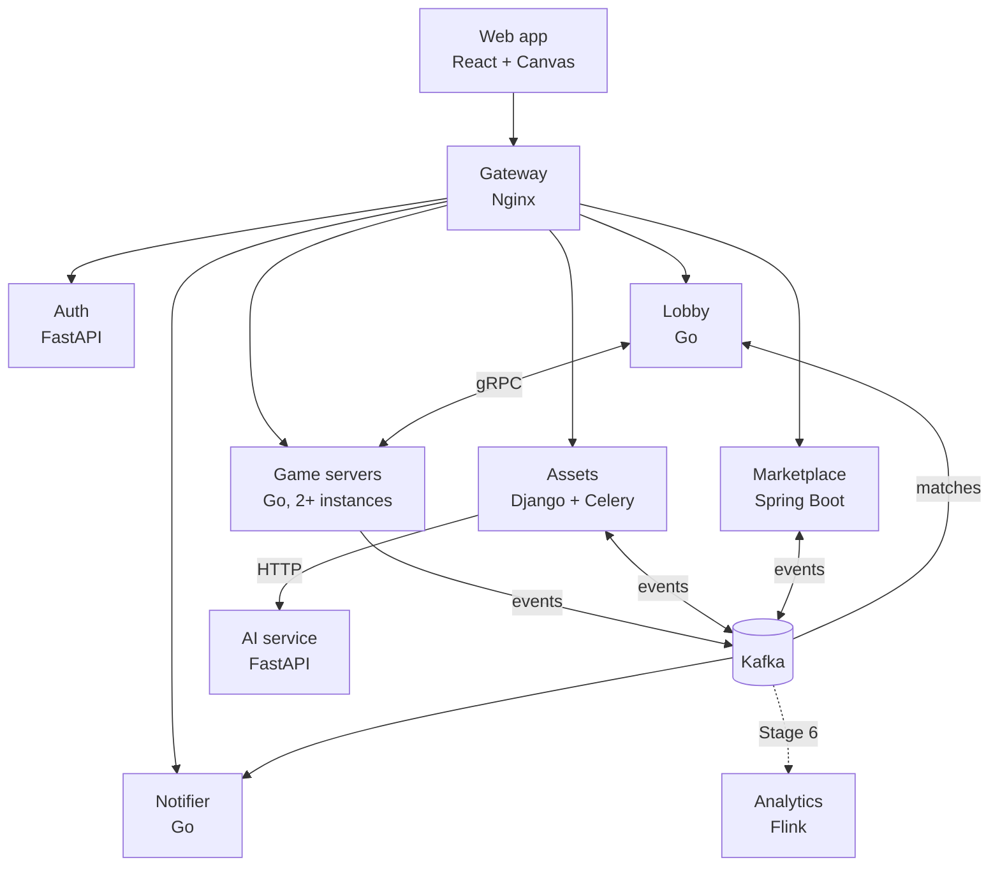
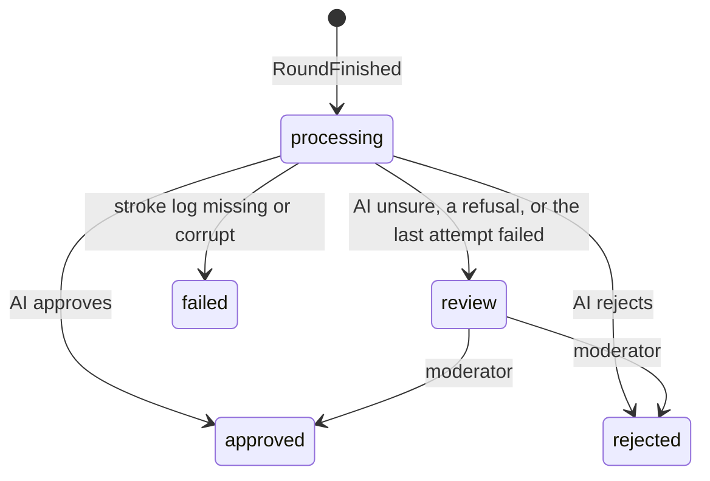
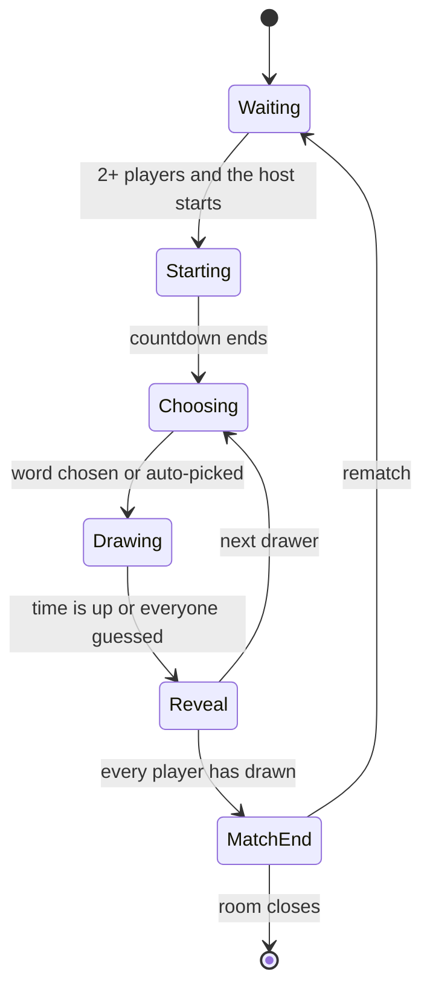

# Doodle Arena: design doc

Status: living document, written at project kickoff (October 2026).
Owners: Bowen and Will. Decisions that change this document are recorded as ADRs in `docs/adr/`.

## 1. Summary

Doodle Arena is a real-time multiplayer draw-and-guess game. One or two players draw a secret word while the others guess. When a round ends, the drawing is rendered to an image, moderated, and becomes a unique item that players can buy and sell for coins in a player marketplace. Players earn coins by playing and can buy coin packs through Stripe in test mode. Coins can't be cashed out.

The project exists to show backend depth in internship interviews. Three parts are built deep and measured:

1. **Game server reliability:** reconnecting, failover when a server dies, and exactly one owner per room.
2. **Marketplace correctness:** a double-entry ledger, atomic ownership transfer and idempotent payments.
3. **Scale (Stage 6):** a live-stream room where thousands of viewers watch one drawer.

Everything else stays deliberately simple.

## 2. Goals and non-goals

Goals:

- Cover the skill keywords in `docs/keyword-coverage.md`, each for a real reason.
- Build a working skeleton of the whole system in about one week (Stages 1–5), then add depth and measured numbers in week two (Stage 6).
- Back every deep part with evidence: tests, load-test numbers and fault-injection results.

Non-goals:

- Polished game design or graphics.
- Real money leaving the system. Coins are closed-loop.
- Blockchain or NFTs. Ownership lives in a central ledger.
- GraphQL, mobile apps, and multi-cloud in the core path. GCP, Azure, Jenkins and Kubernetes are optional extras (Stage 7).

## 3. Architecture

Data stores: PostgreSQL, Redis, MongoDB, S3-compatible object storage (SeaweedFS locally, S3 in AWS) and, in Stage 6, Elasticsearch. Telemetry goes to an OpenTelemetry Collector, then to Prometheus, Tempo and Loki, with Grafana on top (see `docs/observability.md`).

The web app talks REST and WebSocket through the gateway. The lobby and game servers talk gRPC. Everything that happens *after* something else (rewards, rendering, notifications, analytics) goes through Kafka, so a slow or broken consumer never blocks a game round.

## 4. Services

### Ownership

| Service | Language | Owner | First stage |
|---|---|---|---|
| gateway | Nginx config | Bowen | 1 |
| auth | Python (FastAPI) | Bowen | 1 |
| lobby | Go | Bowen | 2 |
| game-server | Go | Bowen | 2 |
| assets | Python (Django + Celery) | Bowen | 3 |
| ai | Python (FastAPI) | Bowen | 3 (stub) |
| marketplace | Java (Spring Boot) | Will | 4 |
| notifier | Go | Bowen | 4 |
| analytics | Java (Flink) | Will | 6 |
| web | TypeScript (React) | Bowen | 1 |

Until Will joins the project, Bowen covers every service, including marketplace and analytics. The table shows the intended long-term owners.

### 4.1 Gateway (Nginx)

- Routes `/api/auth/*` to auth, `/api/lobby/*` to lobby, `/api/assets/*` and `/admin/*` to assets, `/api/market/*` to marketplace, `/api/notifier/*` to notifier, and `/ws/*` to game servers. `/otlp/v1/metrics` goes to the collector's browser receiver (task 5.4: POST only, 64 KB, 2 requests a second per address; `docs/observability.md`, "Browser telemetry").
- Passes the `Upgrade` and `Connection` headers for WebSockets, with a long read timeout.
- Applies coarse per-IP rate limiting with `limit_req`, which is a leaky bucket. Fine-grained limits live in the services.
- Serves `/healthz` for itself and `/healthz/<service>` for every service, including each game-server instance (used by `make smoke`). These are restricted to internal traffic in AWS.
- Only routes; it doesn't verify tokens (ADR 0001). It refuses (400 `IDENTITY_HEADER`) any request that carries an `X-User-*` or `X-Roles` header, on every route; nginx can't match header names by pattern, so a small njs check (`services/gateway/identity.js`) does it. It never routes to a service's internal port.
- Locally, the whole system is one origin, `http://localhost:8080`: the gateway also proxies the Vite dev server for the web app, so there is no CORS and the refresh cookie is first-party. TLS terminates at the gateway (or the load balancer in front of it) only in AWS.
- WebSockets use `/ws/<server_id>/rooms/<room_id>`: an explicit map sends each `server_id` to its game-server instance, and unknown ids get 404 (ADR 0002).

### 4.2 Auth (FastAPI)

Owns the Postgres database `auth`.

- Google OAuth 2.0 authorization code flow, with PKCE and a `state` parameter. It requests only the `openid profile` scopes, so Google never sends an email address.
- Issues a short-lived JWT access token (about 15 minutes) signed with RS256, with `aud` set to `doodle-api`. Public keys are served at `/api/auth/.well-known/jwks.json`.
- Issues an opaque refresh token (32 random bytes, 30 days) in the cookie `da_refresh`: HttpOnly, SameSite=Strict, Path=`/api/auth`, and Secure in AWS. Refresh tokens are stored as SHA-256 hashes and rotated on every use. Every login starts a family. Reusing an already-used refresh token revokes the whole family.
- `/refresh` locks the presented token (`SELECT … FOR UPDATE`), so concurrent uses of one token serialize: one wins, and the rest count as reuse. The web app therefore sends at most one refresh at a time: single-flight within a tab, and a Web Lock (`doodle-auth-refresh`) across the tabs of the origin, which share the cookie. Without Web Locks (an old browser, or a page outside a secure context) only the per-tab single-flight applies.
- `/refresh` and `/logout` are cookie-authenticated POSTs. Besides SameSite=Strict, they refuse any `Origin` other than the web app's. A request without an `Origin` header is allowed: SameSite=Strict already keeps the cookie off every cross-site request, and requiring the header would only break clients that omit it.
- JWT claims: `sub` (user id), `roles` (`player`, `moderator`, `admin`), `name` (the display name, which the lobby copies into join tickets so game servers can show it; a rename shows after the next refresh), `iss`, `aud`, `iat`, `exp`, `jti`. The header carries `kid`, the RFC 7638 thumbprint of the signing key.
- Stores the minimum user data: Google subject id, display name, avatar URL and roles. No email address.
- API keys (task 4.7) for developers who register webhooks. Format `da_<prefix>_<secret>`: a 12-character prefix that finds the row and 32 random bytes stored only as their SHA-256 (random and long, so a plain hash is enough), with scopes (`webhooks`) and `last_used_at` (updated at most once a minute). A key is shown once; at most 10 are active per user (counted and created under a per-user advisory lock, so concurrent requests can't pass the cap). Other services verify keys through `/internal/api-keys/verify` (constant-time comparison; revoked keys refused) and cache the result: the notifier for 30 seconds (5 seconds for an unknown key), so a revoked key keeps working for up to 30 seconds. A bearer that can't be a key (wrong shape, or over 200 characters) is refused without asking auth. When a rotated refresh token is replayed (theft), the user's API keys are revoked along with the session, since a stolen access token could have created one, and a `CredentialsRevoked` goes to `auth.users.v1`, so the notifier disables the user's webhooks (ADR 0015). This happens once per family (`reuse_handled_at`), so replaying an old token again can't revoke the user's new keys. The same transaction sets `users.credentials_revoked_at`: an access token issued at or before it can't create, list or revoke API keys (`401 TOKEN_REVOKED`), so the thief's still-valid token can't mint a fresh key. Key creation checks again under the user's advisory lock, which the theft response also takes.
- Auth's events are written to its outbox in the transaction that causes them and published by the `auth-relay` process (`python -m app.relay`, same image; SKIP LOCKED batches, an idempotent producer, rows stamped after Kafka's acknowledgement and deleted after 7 days), like assets' relay.
- Internal endpoints (`/internal/api-keys/verify`) are served on a separate internal port, 9091 (one uvicorn on two sockets, like the AI service), that the gateway never routes and compose never publishes.
- Each service verifies JWTs itself, against the cached JWKS: see ADR 0001 (Accepted) for the exact checks and for how the Django admin signs moderators in. The lobby, the notifier and assets refetch the JWKS on an unknown `kid` (at most every 30 seconds) and once the cached set is 10 minutes old, so a key auth withdraws stops working within 10 minutes. While auth can't be reached they keep the last good set, but for at most an hour; after that they refuse every token until a fetch succeeds. A failed fetch is retried after 1 second, then 2, 4 and so on up to 30 seconds, so an outage costs auth at most one fetch per 30 seconds per process. While one request refreshes a stale set, the others keep using it rather than wait for the fetch.

### 4.3 Lobby (Go)

Owns the Redis key prefix `lobby:*`.

- REST: create a room, list public rooms, quick play, join a room, read the leaderboard.
- Keeps a registry of game servers. Each game server sends a gRPC `Heartbeat` every 2 seconds with its addresses, load and per-room status (connected players, held seats, waiting or playing), and an entry expires after 6 seconds without one. The registry gRPC port (9090) is internal.
- Allocates new rooms to the least-loaded healthy game server through gRPC `AllocateRoom` (fewest sockets, then fewest rooms; draining servers are skipped). Each call has a 2-second deadline; if a server is full, draining or unreachable, the lobby tries the next one, up to three. Every request names the target (`server_id`), so a cached connection that reaches another instance after containers swap IP addresses is refused instead of creating a room there; on a refusal or a mismatched answer the lobby drops the connection, looks the name up again and asks the same server once more. A server that didn't answer is tried last for the next 10 seconds, so a server that heartbeats but can't be reached doesn't add its deadline to every create. The room is stored only after a server has taken it. The lobby's gRPC client takes no service config from DNS: gRPC's DNS resolver would otherwise also look up a `_grpc_config` TXT record before reporting any address, and a cold upstream took 5–8 s to answer it, longer than the first call's deadline.
- On join, returns the room's WebSocket URL (`<ws_address>/rooms/<room_id>`, where `ws_address` is the gateway path the game server reports, such as `/ws/game-server-1`) and a join ticket: a token signed with the lobby's Ed25519 key, valid for 60 seconds and usable once, that names the user and the room (ADR 0005). The lobby doesn't enforce `max_players`: only the game server knows whether a joining player is already in the room (a reconnect), so it decides. Quick play uses the reported status to pick the fullest waiting room with a free seat: it compares held seats, not connected players, with `max_players`, because a player who steps away keeps their seat and the game server would refuse the joiner (ADR 0008). It looks at the 60 newest public rooms.
- Redis keys (the braces are literal Redis Cluster hash tags: keys changed together share a slot, and `services/lobby/internal/clustertest` runs the lobby's Redis code on a Redis Cluster):
  - `lobby:{registry}:server:<server_id>` (the last heartbeat, 6-second TTL) and `lobby:{registry}:servers` (set of server ids);
  - `lobby:{rooms}:room:<room_id>` (the room, expiring 10 minutes after its server last reported it; only the owning server's heartbeat refreshes it), `lobby:{rooms}:public` (sorted set by creation time, for the room list), `lobby:{rooms}:server:<server_id>` (set of the rooms placed on that server, so the reassigner finds a dead server's rooms) and `lobby:{rooms}:hosts` (set of server ids with rooms, pruned lazily when a server's set is empty);
  - `lobby:leaderboard:{<week>}` (sorted set of user ids by points; expires 35 days after its last write) and `lobby:leaderboard:{<week>}:seen:<match_id>` (a counted match, 8-day TTL);
  - `lobby:names` (hash of user id to display name); `lobby:reassigner` (lock, 10-second TTL: every lobby instance tries every 2 seconds, and only the holder runs a reassignment pass, re-taking the lock before every `AllocateRoom`, so a crashed holder can delay failover by up to 10 seconds).
- Heartbeats and `AllocateRoom` aren't authenticated: for now the internal gRPC relies on network isolation (ADR 0006). So the lobby accepts only a `/ws…` gateway path as `ws_address` and `host:port` as `control_address`; a bogus heartbeat can't send players to another host.
- Notices dead game servers through missed heartbeats and reassigns their rooms. Clients that reconnect get the new server's URL.
- Consumes `MatchFinished` from `game.matches.v1` (consumer group `lobby-leaderboard`) to keep a weekly leaderboard: the sum of each player's match scores per ISO week, with the week taken from `ended_at` in UTC (Monday to Sunday, named like `2026-W42`). `ZINCRBY` isn't idempotent, so one Lua script does both steps: `SET NX lobby:leaderboard:{<week>}:seen:<match_id>` (8-day TTL, longer than any week a match can count towards; the literal braces are a Redis Cluster hash tag the marker shares with the week's sorted set `lobby:leaderboard:{<week>}`, so the script's two keys are in one slot), and only if that marker is new, `ZINCRBY` for every result. A crash can't separate the marker from the increments, and two deliveries at the same moment can't both pass the check. Offsets are committed only after the script ran (at-least-once), and while Redis is down the consumer retries instead of moving past a match. An unset or unknown `oneof` case, or bytes that don't decode, is logged with topic, partition and offset, counted, committed and skipped (ADR 0004). Each record's `traceparent` continues the producer's trace (span `lobby.leaderboard.apply`).
- Display names for the leaderboard come from a name cache, since `MatchFinished` carries only user ids: every join and quick play stores the access token's `name` claim in `lobby:names`. A player who never joined through the lobby shows without a name. A failure to store a name never fails the join.

### 4.4 Game server (Go)

Owns the Redis key prefix `room:*` and the bucket `round-logs`.

- Runs each room as an actor: one goroutine owns all of a room's state. Details are in section 9.
- Classic mode: one drawer, or two drawers sharing a canvas when a round starts with four or more present players. Everyone else guesses.
  - Pairing: the next two players in the draw order who haven't drawn yet. Each player still draws once per match, so 5 players play rounds of 2, 2 and 1 drawers.
  - The first drawer picks the word. Both drawers get it and draw on the same canvas, and each can undo only their own strokes (strokes are keyed by user and `stroke_id`). Each drawer earns the drawer points.
  - If the first drawer leaves while choosing and the second is still there, the options pass to the second drawer, and `choosing` is sent again with the new order. The original deadline stays, so passing the choice back and forth can't stall a round. The one who left stays a drawer: they saw the options, so they must not guess that round.
- Server-authoritative timers, scoring, hint reveals and answer checks. The first correct guess is the first one the room actor processes.
- A per-player token bucket limits guesses and chat. It lives in memory, in the room actor, so it starts full again when another server takes the room over.
- At the end of a round, it uploads the stroke log (a gzipped `doodle.game.v1.StrokeLog` at `<match_id>/<round_no>.binpb.gz`) to `round-logs` and publishes `RoundFinished` with the object key. At the end of a match, it publishes `MatchFinished` with placements but no coin amounts, because the marketplace decides rewards.
  - **Every finished round or match is durable first (ADR 0009).** The actor builds its outbox entry (the round or match as gzipped JSON, a fixed `event_id`, and the end span's `traceparent`) before its commit, and the commit script adds it to `room:{id}:outbox` in the same call as the `round_ended` or `match_ended` event, under the same lease check. If the commit fails, neither exists, and the next owner replays the round. Each entry is deleted only after Kafka has its event.
  - The room actor never does the I/O. After the broadcast it hands each finished round or match, with its entry, to a publisher with a bounded in-memory queue (1024) and one worker, which keeps a room's last `RoundFinished` ahead of its `MatchFinished`. The queue is only the hand-off: the outbox holds the event.
  - The upload comes first, so an event never points at a missing object. Each event has a 2-minute deadline and keeps its `event_id` across retries. Uploads retry with backoff. The producer is franz-go's idempotent producer with `acks=all`, which retries in order on its own without duplicates. The publisher retries only definite failures, and after the deadline it stops waiting and counts the event as failed. The record stays buffered and may still be delivered, so an event can arrive twice, which consumers absorb (at-least-once).
  - When the queue is full (Kafka or S3 down for a long time), a new job is dropped rather than blocking rooms, and a job that misses its deadline is given up; either way the entry stays in the outbox. Every 30 seconds each server queues again its rooms' entries older than a minute, skipping those still queued or in flight. A server that takes a room over queues whatever the previous owner's outbox still holds, so a crash or a kill delays events instead of losing them. An empty room isn't closed while its outbox has entries: it waits another `EmptyTTL` and tries again, keeping its lease, so its entries always have an owner.
  - Every finished round is published, even one with no strokes. A match is published only if at least one round finished: one that ended during the countdown is not a result and earns nothing. Undo removes strokes from the canvas, so the stroke log contains only the strokes that remained. The canvas has a fixed 4:3 aspect, so events report 800 x 600.
- Sends the lobby a `Heartbeat` every 2 seconds, starting at startup. Its gRPC client takes no service config from DNS (`WithDisableServiceConfig`), so the first heartbeat doesn't wait for a `_grpc_config.<host>` TXT lookup that Docker's DNS forwards upstream: a new server registers within milliseconds instead of up to 8 seconds.
- At least two instances run locally, so failover can be tested. The same binary also runs in a relay role for live rooms (`ROLE=relay`, ADR 0017, task 6.1): `relay-1` and `relay-2` locally, section 9.

### 4.5 Assets (Django + Celery)

Owns the Postgres database `assets`, the MongoDB database `assets`, the bucket `drawings`, a Redis logical database for Celery, and (Stage 6) the Elasticsearch index `drawings`.

Consumes `RoundFinished` and runs a Celery pipeline for each drawing:

1. Fetch the stroke log from `round-logs` (claim check) and store it as a replay document in MongoDB.
2. Render a PNG and a thumbnail. Hash the PNG with SHA-256 and upload both images to `drawings` under content-addressed keys (`sha256/<hash>.png`), so identical images are stored once.
3. Ask the AI service to moderate the image, with a timeout and retries using exponential backoff and jitter. If the last attempt fails, the drawing waits in the Django admin review queue.
4. Mark the drawing approved or rejected, and publish `DrawingApproved` or `DrawingRejected`.

Processing is idempotent: a unique `(match_id, round_no)` constraint stops a replayed `RoundFinished` from creating a second drawing.

Processes (one image): gunicorn serves the REST API and the admin; `assets-consumer` reads `game.rounds.v1`; `assets-worker` runs Celery with Redis logical database 1 as its broker; `assets-beat` (exactly one) runs the recovery sweeper every minute; `assets-migrate` applies the Django migrations and `mongo-users` creates assets' MongoDB user before they start. Celery tasks are acknowledged after they finish and redelivered when their worker dies (`acks_late`, `reject_on_worker_lost`, prefetch 1), so every task runs at least once and must be idempotent. There is no result backend: a drawing's state lives in Postgres.

A drawing's `id` is a UUIDv7: random, so it can't be guessed, and time-ordered, so new rows land at the end of the primary-key index and the gallery can page by id. Its `status` is the only state machine:

The consumer (`drawings/consumer.py`, group `assets`, manual commits) turns each `RoundFinished` into a row with `get_or_create` on `(match_id, round_no)`, sends the pipeline task, and only then commits the offset. A drawing still `processing` gets its task again on every delivery, which covers a crash between the insert and the send. A round with `stroke_count` 0 creates nothing. Records it can't read, or that the database refuses (a value longer than its column), are logged, counted and committed so they never block the partition; only connection errors (Postgres, the broker) are retried, on the same record.

The pipeline task (`prepare_drawing`) runs fetch, render and upload, each skipped when the row already has its result. The replay document in `assets.replays` (`_id` = drawing id, its own `schema_version`, points as `[x, y, t]` arrays) is the source of truth once stored, because the bucket copy expires after 7 days. Pillow renders a 1024 px image (long side, the drawers' aspect ratio) and a 256 px thumbnail, at 2x and downsampled, with no metadata, so the same strokes always give the same bytes. They go to `sha256/<hash>.png` and `sha256/<hash>.thumb.png` (HEAD first, PUT only if missing). The hash is of the rendered image, so a renderer change gives new keys; old objects stay valid. Store outages retry with exponential backoff and full jitter (up to 6 attempts: the first and 5 retries); a missing or corrupt log makes the drawing `failed` with the reason. A prepared drawing then gets `moderate_drawing`: the thumbnail goes to the AI service (`POST /v1/moderate`, section 4.8) with a 3-second timeout. Approve and reject are applied through the guarded `decide`; `review` (the AI is unsure) sends the drawing to the queue. Timeouts, connection errors, `429` and `5xx` are retried with exponential backoff and full jitter; the budget is 4 calls, counted on the row (`moderation_attempts`) so it holds across redeliveries, after which the drawing waits in the review queue with the reason (ADR 0011). Only one task calls at a time: claiming the drawing (`moderation_claimed_until`, 60 s) and counting the attempt are one conditional UPDATE, so a duplicate task stops there. Any other `4xx`, or an answer the client can't read, goes to the queue at once. Beat runs the sweeper every minute, which re-queues every drawing still `processing` 10 minutes after its last change, locking them with `SKIP LOCKED` (`prepare_drawing` skips what's done and sends the moderation task again), and deletes expired admin sessions every hour. The admin shows each drawing through a staff-only view that streams it from the bucket.

A decision leaves the service only through the transactional outbox (ADR 0010): `decide()` writes `DrawingApproved` or `DrawingRejected` (keyed by `drawing_id`, `reason` `moderation:rejected` or `manual:rejected`) into `drawings_outboxevent` in the same transaction as the status change, so neither can happen without the other. An approval needs the drawing's image. `assets-relay` locks unpublished rows in id order (`FOR UPDATE SKIP LOCKED`), produces them with an idempotent producer (acks=all), and stamps `published_at` only for what Kafka confirmed; a crash after the ack republishes with the same `event_id`, so consumers dedupe on it or on `drawing_id`. Published rows are purged after 7 days. Drawings decided before the outbox existed get their events once from `manage.py backfill_decision_events`.

Progress inside `processing` is the pipeline's own columns (`replay_id`, `sha256`, the image keys), each filled once, so a redelivered task skips the steps already done. Every status change is one conditional `UPDATE ... WHERE status IN (...)` (`drawings/moderation.py`): under READ COMMITTED, of two concurrent decisions exactly one changes the row. The AI decides only from `processing` and a moderator only from `review`, so a late AI answer can't overrule the queue. Check constraints make a decided drawing always name who decided and when.

Moderators sign in to the admin with Google (ADR 0001): `/admin/login/` sends the browser to the web app's `/moderate`, which calls `POST /admin/sso/` once with its access token. Role `moderator` makes a staff user in the `moderators` group (view drawings, approve or reject in the queue); `admin` makes a superuser. Drawings are read-only in the admin.

The service also serves drawing metadata, presigned image URLs and replays over REST. Django admin is the moderation console. In Stage 6 it indexes drawings and active listings (from `market.listings.v1`) into Elasticsearch.

Drawing metadata lives in Postgres because Django's ORM and admin are built for SQL databases. MongoDB holds the replays: large, write-once documents that are always read whole and whose stroke format may change over time.

### 4.6 Marketplace (Spring Boot)

Owns the Postgres database `marketplace`.

- Coin ledger, wallets, drawing ownership and provenance, listings, purchases, royalties, round rewards and Stripe coin packs. Details are in section 8.
- Consumes `DrawingApproved` (creates the first ownership record) and `MatchFinished` (pays rewards).
- Publishes through a transactional outbox: `SaleCompleted`, `ListingCreated`, `ListingCancelled` and `CoinsCredited`.
- Runs a reconciliation job every minute that checks the ledger and ownership invariants and exports them as metrics.
- Takes viewers' tips into a sharded escrow and pays them to a round's drawers when its `RoundFinished` arrives (consumer of `game.rounds.v1`, ADR 0021, task 6.3; section 7.13).
- Reads its browsing endpoints (listings, ownership history, owned drawings, wallet entries) from a read replica, with read-your-writes by WAL position (ADR 0020, task 6.6); writes and every read inside a transaction use the primary.
- Verifies access tokens itself (ADR 0001) with Spring Security's resource server; SQL is written by hand through `JdbcClient` and migrated by Flyway at startup.
- Consumes `assets.drawings.v1` with Spring for Apache Kafka in the consumer group `marketplace` (task 4.2). An offset is committed only after its record's transaction committed. A record it can't read (undecodable, an unset or unknown event) or an event that breaks its contract (`drawing_id` not a UUID; no authors, or a blank or repeated one; `initial_owner_id` not the first author) is logged, counted and committed; anything else, such as Postgres being down, is retried on the same record (1 s doubling to 30 s, no limit), so the partition waits instead of skipping a mint. A new group starts at the earliest offset, so every drawing already approved is minted.

### 4.7 Notifier (Go)

Owns the Postgres database `notifier`.

- Developers register webhook endpoints with an API key and choose event types (`sale.completed`, `coins.credited`). Each endpoint gets its own signing secret, shown once and stored AES-256-GCM encrypted (ADR 0014). At most 10 endpoints per user.
- Consumes `CredentialsRevoked` from `auth.users.v1` in its own group, `notifier-auth`, from the earliest offset (ADR 0015). In one transaction it raises the user's revocation watermark, disables all their live endpoints (`disabled_reason = credentials_revoked`) and cancels their pending deliveries. An event that isn't newer than the watermark changes nothing. Disabled endpoints get no deliveries; the owner enables one again with a new secret. Any credential issued at or before the watermark is refused: a session token by `iat`, an API key by its `created_at`. Registering and enabling check the watermark again under the owner's advisory lock, which the revocation takes too.
- Consumes `SaleCompleted` and `CoinsCredited` (group `notifier`, from the newest offset) and delivers each to the endpoints of the users it involves only: seller, buyer and royalty recipients of a sale, the credited user of a credit (ADR 0014). The body is `{id, type, created, data}`: `created` in Unix seconds (like the signature's `t`, and like Stripe), `data` a plain JSON object (numbers as numbers, RFC 3339 times). A `sale.completed` carries the whole sale (seller, buyer, price and every royalty row) to each user it involves: who owned a drawing is public through its history, and royalties follow a public rule.
- Signature header: `Doodle-Signature: t=<unix-seconds>,v1=<hex HMAC-SHA256 of "<t>.<body>">`. A `Doodle-Event-Id` header lets receivers dedupe. Receivers should reject timestamps older than 5 minutes.
- Retries use exponential backoff with full jitter (base 2 seconds, cap 30 minutes, at most 8 attempts: the wait after the n-th failure is uniform in [0, min(30 min, 2 s × 2^(n−1)))) and 5-second timeouts. Every answer other than 2xx is retried, 4xx and `410 Gone` included, as Stripe does. After the last attempt, the delivery is marked `DEAD` and published to `notifier.dlq.v1`, except a test `ping`, which carries no event.
- Deliveries live in Postgres: one row per (endpoint, event), which is the queue and the log at once (ADR 0014). Workers claim due rows with `FOR UPDATE SKIP LOCKED` and a 60-second lease; each attempt is logged with its status code, a short error (never the response body) and duration. The delivery log can be queried over REST.
- Headers: `Doodle-Signature`, `Doodle-Event-Id` (dedupe on it: delivery is at least once), `Doodle-Event-Type`, `Doodle-Delivery-Id`.
- Endpoint URLs come from outside users, so the notifier blocks server-side request forgery: it resolves the host at send time, refuses loopback, private, carrier-grade NAT, link-local (including `169.254.169.254`), unique-local, multicast and NAT64 addresses (IPv4-mapped addresses judged by their IPv4 address, IPv6 zones stripped first), dials the address it checked (so DNS rebinding can't swap it), and doesn't follow redirects. Endpoints must use HTTPS. Locally, only the hostnames in `NOTIFIER_ALLOWED_PRIVATE_HOSTS` (the `webhook-receiver` test endpoint) may resolve to private addresses and use http.

### 4.8 AI service (FastAPI)

Stateless.

- Stage 3: `POST /v1/moderate` is a stub. The body is the drawing as `image/png` (at most 2 MB; `X-Drawing-Id` for logs). It answers `200 {decision, reason, model}` with `decision` one of `approve`, `reject` or `review` (unsure: a human decides), `503 MODERATION_UNAVAILABLE` when it fails, `415` or `400 INVALID_IMAGE` for bad input. It approves by default; `MODERATION_MODE` (`approve`, `reject`, `review`, `fail`), `MODERATION_DELAY_MS` and `MODERATION_FAILURE_RATE` change that, and `PUT /internal/moderation-mode` changes them at runtime until the next restart (`scripts/ai-mode.sh`). `/internal/*` answers only on the internal port 9091, which the gateway never routes and compose never publishes; both ports are sockets of one uvicorn server.
- Later (Stage 7): a real moderation model, `POST /v1/guess` (an AI player that guesses from the canvas) and `POST /v1/similarity` (embeddings for "close!" hints), with an eval set built from real drawings.

### 4.9 Analytics (Flink, Stage 6)

- Job 1: top guesses per live room over a sliding window, read from `live.guesses.v1` and written to `live.top-guesses.v1`.
- Job 2: wash-trading detection over `market.sales.v1`, such as the same accounts trading back and forth or circular trades within a time window. Flags go to a dashboard and an alert.

How it runs (ADR 0018, task 6.5):

- **One Flink application in application mode.** The job jar sits in a custom image built from the official `flink:2.2.1-java21`. It runs as one JobManager and one TaskManager container (`analytics-jobmanager`, `analytics-taskmanager`, compose profile `analytics`), and on ECS in AWS (task 6.9). Both pipelines are one Flink job, `analytics`, so they share one checkpoint.
- **Top guesses in Flink SQL.**
  - The relays' `guessed_at` is the event time, with 2 seconds of out-of-orderness. An idle partition stops holding the watermark back after 10 seconds.
  - A hopping window TVF (30 s long, every 2 s) counts each guess per room and round. A window Top-N (`ROW_NUMBER`) keeps the 5 most common, and a second aggregation over the same windows folds them into one row.
  - Each window becomes one `TopGuesses`, which replaces the room's previous list. Its `event_id` is derived from the room, round and window end, so a replayed window carries the same id.
  - A guess behind the watermark belongs to a window already reported. It is dropped and counted (`analytics.guesses.late`).
- **Wash trading in the DataStream API** (task 6.5b):
  - A `KeyedProcessFunction` keyed by `drawing_id` keeps each drawing's sales of the last 7 days (event time: `completed_at`). Event-time timers drop them afterwards. Whether a sale is inside the window is decided from the sales' own times, so a quiet topic's watermark never changes a result.
  - A sale whose buyer sold this drawing within 7 days closes a loop. Since ownership passes from each buyer to the next seller, the sales in between are the loop: two sales are R1 (round trip), three or more R3 (cycle).
  - Each loop becomes a `WashTradeFlagged` on `analytics.flags.v1` with the accounts in order, the sales, the volume and a `flag_id` derived from the rule and the sales. A repeated sale (at-least-once outbox) is ignored by its `sale_id`.
  - Counter `analytics.wash_trades.flagged{rule}`, alert WashTradingFlagged, dashboard `da-analytics`.
- **State and delivery.** Checkpoints go every 30 seconds to the `analytics-checkpoints` bucket, with the HashMap state backend. The Kafka sinks are at-least-once: exactly-once would hold every top-guesses list back until the next checkpoint. Kafka offsets live in the checkpoints. They are committed to the group `analytics` only so that its lag can be watched.
- **Restarts.** Flink restarts the job with exponential delay. A restart replays from the last checkpoint, so a window can be emitted twice.
- **A new JobManager keeps the state** (task 6.5b). Without high availability, Flink would start every submitted job empty. Instead, the job's `main` finds the newest completed checkpoint in the bucket through Flink's own file system, and the job starts from it in CLAIM mode. The bucket then holds one checkpoint, whatever job id made it.
  - Flink SQL names its operators itself, and any change to the graph renames them, so their state (open windows) is dropped on restore rather than blocking the start.
  - The sources and wash trading have fixed uids, so their state is restored.
  - `ANALYTICS_RESTORE=none` (or a path) overrides the search. AnalyticsDown and its runbook cover a checkpoint that can't be restored.

### 4.10 Web app (React + Canvas)

Pages: login, lobby, room (canvas, guesses, scores, timer), the weekly leaderboard (`/leaderboard`: ranks, names and points for one ISO week, your own row highlighted, previous and next week), gallery and replays, marketplace, wallet (buy coins), and developer settings (API keys and webhooks). Follows `.claude/rules/web.md`.

The room client (task 2.3):

- Pages route by path (`/` is the lobby, `/rooms/<room_id>` a room), so an invite link opens the room. There is no router library.
- State is a pure reducer over server messages: `welcome` replaces it, events apply only when `seq` is newer, and scores, phases and the word change only when the server says so. The chat feed isn't part of the view, so a reconnect keeps it.
- The canvas has a fixed 4:3 aspect and two layers. The base layer paints only the server's `stroke_batch` events, so every player sees the same picture; the overlay paints the drawer's own stroke at once and drops it when the server's copy arrives, so drawing doesn't lag by a round trip. Points go out every 50 ms (`VITE_STROKE_BATCH_MS`, or `?batch_ms=` for one experiment) or at 512 points.
- The connection asks the lobby for a new ticket on every attempt and reconnects with jittered exponential backoff (0.5 s doubling to 8 s, giving up after 12 attempts, about a minute, which matches the seat grace). Close codes 4000, 4003, 4004 and 4009 and a lobby `ROOM_NOT_FOUND` or `SIGNED_OUT` end the connection instead (4004 is the client's own code for `ROOM_NOT_FOUND`; the server never sends it). A gap in `seq`, or a `resumed {seq}` ahead of the last applied event, reconnects at once; `room_moved` reconnects after the usual jittered backoff, so a fenced server's players don't all ask the lobby in the same millisecond.
- The timer counts down to the server's deadline on the local clock. It is display only; the server ends phases. Clock skew shows as a timer that is a little off.
- The ping round-trip time is shown next to the connection status and exported as `web.ws.rtt` (task 5.4), with the Core Web Vitals: `web/src/rum.ts` loads the OpenTelemetry SDK only after the page's load event.

Live rooms (task 6.1b, ADR 0017):

- The lobby has a "Live" checkbox for a new room and, above the open rooms, a "Live now" list: each live room's players and viewers (summed over every relay), with Watch. A live room in the open-rooms list shows its viewers and has Watch next to Join.
- `/rooms/<room_id>/watch` is the room page as a viewer. It uses the same connection, which asks the lobby for a viewer's ticket (`POST /api/lobby/rooms/{id}/watch`) on every attempt and reconnects and resumes as a player's does. The page uses the same reducer and the same canvas, read-only. There is no Start button and no word choice. Its guess box sends viewer guesses (task 6.2, ADR 0019), and a panel shows the room's top guesses. "Copy watch link" shares the page.
- A room that isn't live (`409 ROOM_NOT_LIVE`) ends the connection with a message, and `503 NO_RELAY` is retried. The page reports its Web Vitals as `page=room`.

The gallery (task 3.5):

- `/gallery` lists everyone's approved drawings (newest first, "Load more" follows `next_cursor`) or, on "Drawn by me", your own in any state with its status. Opened from the end of a match (`/gallery?match_id=<id>`), it lists that match's drawings in round order. Thumbnails load straight from storage through their presigned URLs.
- `/drawings/<id>` shows a drawing and plays its replay with the live canvas's `drawPoints`, so it looks like the round did. A stroke starts at its `server_received_ms` minus its last point's `t_ms`, and each point lands at that start plus its own `t_ms` (`game/replay.ts`). The replay starts at the first point, pauses longer than a second are squeezed to one, and it plays at 1x, 2x or 4x. Undone strokes are left out: the log says that a stroke was undone, not when, so the replay ends on the same picture as the PNG.

The economy pages (task 4.8):

- The top bar links Lobby, Gallery, Market, My drawings, Wallet and Developer.
- `/wallet`: the balance, the transactions ("Load more"), and the coin packs. Buy starts a Checkout Session and sends the browser to Stripe's page. Stripe sends it back to `/wallet?checkout=success`, but the coins arrive with Stripe's webhook, not with the redirect, so the page polls the balance every 2 s for up to 30 s (or sees a `stripe_purchase` from the last 5 minutes) and then says the coins arrived or are late. `?checkout=cancelled` says nothing was charged.
- `/market`: active listings, newest first. Listings carry only drawing ids, so each page of them is followed by one `?ids=` lookup in assets for the words and thumbnails. Buy asks for a confirmation first; your own listings have no Buy.
- `/my-drawings`: the drawings you own (minted to you or bought), from the marketplace, each with its active listing: list it for a whole number of coins (1 to 1,000,000) or cancel the listing.
- `/drawings/<id>` also shows the owner, the provenance (mint, then each sale with its price) and Buy when the drawing is listed by someone else.
- `/developer`: API keys (created, listed with their prefix and last use, revoked) and webhook endpoints (registered with a URL and event types, sent a test `ping`, deleted, with the delivery log). A new key or signing secret is shown once with a copy button. The page uses the session's access token, which the notifier accepts besides API keys.
- Money actions (create a listing, buy, start a checkout) send an `Idempotency-Key` made once per action (`crypto.randomUUID()`). A retry of the same action reuses it while the outcome is unknown (a network error, `409 IDEMPOTENCY_KEY_IN_PROGRESS`, a 5xx); any other answer is final and the next attempt gets a new key (`web/src/idempotency.ts`). Listing the same drawing at another price is another action, since a reused key with another body is `422 IDEMPOTENCY_KEY_REUSED`.

## 5. Data ownership

| Store | Database, prefix or bucket | What it holds | Owner |
|---|---|---|---|
| PostgreSQL | `auth` | Users, refresh tokens, API keys, the outbox of auth events | auth |
| PostgreSQL | `assets` | Drawing metadata and moderation status, the outbox of drawing events, admin sessions | assets |
| PostgreSQL | `marketplace` | Accounts, ledger, balances, ownership, listings, idempotency keys, outbox, Stripe events | marketplace |
| PostgreSQL | `notifier` | Endpoints, deliveries, credential revocation watermarks | notifier |
| Redis | `room:*` | Room event streams, snapshots, leases, fencing counters; redeemed join tickets (`room:{id}:ticket:*`); viewers' redeemed tickets (`room:{id}:viewer-ticket:*`) and correct guesses (`room:{id}:viewer-guesses`), written by relays (ADR 0019) | game-server |
| Redis | `lobby:*` | Rooms, game-server registry, leaderboards | lobby |
| Redis | `assets:*` (logical database 1) | Celery broker (no result backend); kombu's `global_keyprefix` puts its keys and channels under `assets:` | assets |
| MongoDB | `assets.replays` (user `assets`, `readWrite` on `assets` only) | Stroke logs for replays | assets |
| Object storage | `round-logs` bucket | Raw round stroke logs; a lifecycle rule deletes them after 7 days. Assets reads them: the claim check in `RoundFinished` (D13) is the one deliberate exception to "no service reads another's bucket" | game-server |
| Object storage | `drawings` bucket | PNGs and thumbnails, content-addressed | assets |
| Object storage | `analytics-checkpoints` bucket | Flink's checkpoints (ADR 0018) | analytics |
| Elasticsearch | `drawings` index | Search over drawings and listings (Stage 6) | assets |
| Kafka | Topics in section 6.2 | Events between services | Each topic's producer |

Locally there is one Postgres server with four databases and one database user per service, and a streaming read replica of it (ADR 0020: marketplace and assets read from it; it is a copy, so the owners don't change), plus one Redis, one MongoDB, SeaweedFS for S3, and one Kafka broker in KRaft mode.

The owners are enforced, not just agreed on (task 5.5):

- **Postgres:** one login role per database, with `CONNECT` revoked from `PUBLIC`.
- **Redis:** one ACL user per service, allowed only its prefixes (`infra/redis/start.sh`). Relays have their own user (ADR 0019): they read `room:*` and write only viewer tickets and viewer-guess streams.
  - The default user is off, and no user has `@admin` or `@dangerous` commands.
  - Celery's two `PSUBSCRIBE` patterns are listed literally, because Redis compares a subscribed pattern with the ACL as text.
- **Object storage:** one SeaweedFS identity per service, scoped to its buckets (`infra/seaweedfs/entrypoint.sh`). In AWS, the IAM task roles do the same (`infra/terraform/stack/iam.tf`).
  - game-server may only write `round-logs`.
  - assets may only read it, and read and write `drawings`.
  - analytics may only read and write `analytics-checkpoints`.
- **MongoDB:** the `assets` user with `readWrite` on `assets` only.
- **Kafka:** per-topic ACLs (ADR 0013).

`make data-acl-check` and `make kafka-acl-check` prove the refusals in CI's stack job.

The lobby's leaderboard script uses a Redis Cluster hash tag (`lobby:leaderboard:{<week>}` and its `:seen:` markers), like the rooms' `{id}`. The lobby's room index shares the tag `{rooms}` and its registry `{registry}`, because its `MULTI` blocks and `moveScript` change several of their keys at once. Each group sits in one slot, which is fine for data this small. `services/lobby/internal/clustertest` runs the lobby's Redis code on a one-node Redis Cluster, which refuses cross-slot transactions like a real one. The game server's keys were tagged per room from the start (`room:{id}:...`).

## 6. Contracts

Contracts live in `proto/` and change only with human approval (see `.claude/rules/contracts.md`). `proto/README.md` explains the layout, code generation (`make proto`) and where generated code lands for each language.

### 6.1 gRPC

| Service | Served by | Called by | Methods |
|---|---|---|---|
| `doodle.game.v1.ControlService` | Each game server | Lobby | `AllocateRoom(room_id, mode, settings, host_user_id, server_id)` (idempotent per `room_id`; refused with `FAILED_PRECONDITION` by any server that isn't `server_id`), `DrainServer()`: what SIGTERM does too (section 7.5) |
| `doodle.lobby.v1.RegistryService` | Lobby | Game servers | `Heartbeat(server_id, ws_address, control_address, rooms[], sockets, draining)` every 2 seconds; `rooms` carries each room's connected players, held seats and phase |

Every call has a deadline. `AllocateRoom` returns `INVALID_ARGUMENT` for a malformed room id, mode or settings, `FAILED_PRECONDITION` when it is meant for another server or this one drains, `RESOURCE_EXHAUSTED` when the server is full (`MAX_ROOMS`, 100 by default), `NOT_FOUND` for a room that has ended (its tombstone), `UNAVAILABLE` when the room store can't be reached or the room's previous copy here is still stopping, and `INTERNAL` when stored state can't be restored. For a room this server already runs it checks its lease first: a copy that lost the lease is stopped and the room taken again with a new token. Stage 7 may add `doodle.ai.v1` for the AI guesser.

### 6.2 Kafka event catalog

Every message on a topic is that topic's wrapper message: one `oneof event` with a case per event type (ADR 0004). There is no schema registry; Buf checks compatibility in CI. Every event inside a wrapper starts with `EventMeta meta = 1`: `event_id` (UUID), `event_type`, `schema_version`, `occurred_at` and `producer`. Trace context travels in the Kafka `traceparent` header. Consumers dedupe on `event_id` or on a natural key. A consumer that finds an unset or unknown `oneof` case (a newer producer) logs it, counts it, commits the offset and moves on.

| Topic | Wrapper | Events | Producer | Consumers | Key | Stage |
|---|---|---|---|---|---|---|
| `game.rounds.v1` | `RoundEvent` | `RoundFinished` | game-server | assets, marketplace (tips, ADR 0021) | `room_id` | 2 |
| `game.matches.v1` | `MatchEvent` | `MatchFinished` | game-server | marketplace, lobby | `room_id` | 2 |
| `assets.drawings.v1` | `DrawingEvent` | `DrawingApproved`, `DrawingRejected` | assets | marketplace | `drawing_id` | 3 |
| `market.listings.v1` | `ListingEvent` | `ListingCreated`, `ListingCancelled` | marketplace (outbox) | assets (search, Stage 6) | `drawing_id` | 4 |
| `market.sales.v1` | `SaleEvent` | `SaleCompleted` | marketplace (outbox) | notifier, analytics (Stage 6) | `drawing_id` | 4 |
| `market.wallet.v1` | `WalletEvent` | `CoinsCredited` | marketplace (outbox) | notifier | `user_id` | 4 |
| `auth.users.v1` | `UserEvent` | `CredentialsRevoked` | auth (outbox, `auth-relay`) | notifier (group `notifier-auth`) | `user_id` | 4 |
| `notifier.dlq.v1` | `DeadLetterEvent` | `DeliveryDead` | notifier | alerting, humans | `endpoint_id` | 4 |
| `live.guesses.v1` | `ViewerGuessEvent` | `ViewerGuess` | relays (Kafka user `relay`, ADR 0019) | analytics | `room_id` | 6 |
| `live.top-guesses.v1` | `TopGuessesEvent` | `TopGuesses` | analytics | relays (no consumer group) | `room_id` | 6 |
| `analytics.flags.v1` | `AnalyticsFlagEvent` | `WashTradeFlagged` | analytics | humans, the analytics dashboard and alerts | `drawing_id` | 6 |

Key payload fields:

- `RoundFinished`: `match_id`, `room_id`, `round_no`, `word`, `drawer_ids` (the first one becomes the initial owner), `stroke_log_key`, `stroke_count`, `canvas_width`, `canvas_height`, `ended_at`.
- `MatchFinished`: `match_id`, `room_id`, `mode`, `started_at`, `ended_at`, `results[]` with `user_id`, `score` and `placement`.
- `DrawingApproved`: `drawing_id`, `match_id`, `round_no`, `author_ids`, `initial_owner_id`, `sha256`, `image_key`, `thumb_key`.
- `SaleCompleted`: `sale_id`, `listing_id`, `drawing_id`, `seller_id`, `buyer_id`, `price`, `royalties[]` with `user_id` and `amount`, `completed_at`.
- `CoinsCredited`: `user_id`, `amount`, `reason` (`stripe_purchase`, `reward`, `tip` or `tip_refund`, ADR 0021), `reference` (the session id, the match id, `<match_id>:<round_no>` for tips, the tip id for a refund).
- `ViewerGuess`: `room_id`, `round_no`, `text` (normalized as in section 6.4), `guessed_at` (the event time). Only wrong guesses are published: the top guesses are shown to every viewer.
- `TopGuesses`: `room_id`, `round_no`, `window_end`, `guesses[]` with `text` and `count`, most common first.
- `WashTradeFlagged`: `flag_id` (derived from the rule and the sales), `rule` (`ROUND_TRIP` or `CYCLE`), `drawing_id`, `account_ids` (the loop in order, the first account repeated at the end), `sale_ids`, `first_sale_at`, `last_sale_at`, `volume` (coins paid across the loop).

`RoundFinished` uses the claim-check pattern. A round's stroke log can be large, so the event carries only the object key, and the log itself lives in the `round-logs` bucket. This also avoids an ordering problem: if strokes travelled on their own topic, the assets service couldn't know when it had all of them. The object is a gzip-compressed `doodle.game.v1.StrokeLog` protobuf, so its format is versioned and checked by Buf like every other contract.

### 6.3 REST API sketch

All endpoints go through the gateway, use JSON, and require a JWT bearer token unless noted. Errors look like `{"error": {"code": "LISTING_NOT_AVAILABLE", "message": "...", "request_id": "..."}}`. Lists use cursor pagination.

Auth:

- `GET /api/auth/google/login` and `GET /api/auth/google/callback` (no JWT)
- `POST /api/auth/refresh` (refresh cookie), `POST /api/auth/logout`, `GET /api/auth/me`
- `GET /api/auth/.well-known/jwks.json` (public)
- `POST /api/auth/api-keys` takes `{name, scopes: ["webhooks"]}` and returns `201 {id, name, prefix, scopes, created_at, last_used_at, key}` (the key appears only here; `Cache-Control: no-store`). `GET /api/auth/api-keys` returns `{api_keys: [...]}` without keys; `DELETE /api/auth/api-keys/{id}` revokes (`204`, or `404 API_KEY_NOT_FOUND`). `400 INVALID_SCOPE`, `400 INVALID_REQUEST` (an empty `scopes` list, or a `name` that isn't 1 to 100 characters), `409 TOO_MANY_API_KEYS` (10 active). JWT-authenticated; a token issued at or before the user's credential revocation is `401 TOKEN_REVOKED` (ADR 0015).

Lobby:

- `POST /api/lobby/rooms` takes `{public, live, mode, settings}` (all optional; `mode` is `classic`; `live`, default false, lets viewers watch through relays, ADR 0017) and returns `201` with `{room_id, host_id, mode, public, live, settings, created_at}`. Settings and their ranges: `max_players` 2–8 (default 8), `choose_seconds` 5–30 (10), `draw_seconds` 30–180 (80), `word_options` 1–5 (3); out of range is `400 INVALID_SETTINGS`, unknown fields or a bad mode `400 INVALID_REQUEST`, and no game server able to take the room `503 NO_GAME_SERVER` with `Retry-After: 2`.
- `GET /api/lobby/rooms?limit=<1..50>&cursor=` (limit 20 by default) returns `{rooms, next_cursor}`, each room with its connected `players`, `max_players`, `phase`, `live` and `viewers` (watching through every relay); a bad cursor is `400 INVALID_REQUEST`.
- Joining a room that doesn't exist is `404 ROOM_NOT_FOUND`; a room being moved is `503 ROOM_UNAVAILABLE` with `Retry-After: 2`. Without a valid token every lobby endpoint answers `401 UNAUTHENTICATED`.
- `POST /api/lobby/rooms/{room_id}/watch` (ADR 0017) returns the same shape for a viewer: a relay's `ws_url` and a viewer's ticket. A room that isn't live is `409 ROOM_NOT_LIVE`, no relay is `503 NO_RELAY` with `Retry-After: 2`. The relay is the one with the fewest viewers: those it last reported plus the tickets this lobby issued for it since.
- `POST /api/lobby/rooms/{room_id}/join` and `POST /api/lobby/quickplay` return `{room_id, ws_url, ticket, expires_at}`, with `Cache-Control: no-store`
- `GET /api/lobby/leaderboard?week=<YYYY-Www>&limit=<1..100>` returns `{week, entries: [{rank, user_id, name, score}], me: {rank, score} | null}`. The week defaults to the current ISO week (UTC) and the limit to 20; a malformed or nonexistent week (such as `2025-W53`) or a limit out of range is `400 INVALID_REQUEST`. Ranks use competition ranking: equal scores share a rank and the next one is skipped (1, 2, 2, 4). `me` is the caller's own place, even below the limit, and `null` if they scored nothing that week. `name` is empty for a player the lobby never saw join.

Assets:

- `GET /api/assets/drawings?author_id=&match_id=&limit=<1..50>&cursor=` returns `{drawings, next_cursor}`, newest first (keyset on the UUIDv7 id). Without a filter it lists approved drawings (the gallery); with `author_id` or `match_id`, the matching approved drawings, plus the caller's own in any state.
- `GET /api/assets/drawings?ids=<comma-separated, 1..50 ids>` returns the same `{drawings, next_cursor: null}`: those of the drawings the caller may see (approved, or their own), in the order asked; the others are left out. Malformed or more than 50 ids are `400 INVALID_REQUEST`; with `ids` the other parameters are ignored. The marketplace pages use it, since listings carry only ids.
- `GET /api/assets/drawings/{id}` returns `{id, match_id, round_no, word, author_ids, initial_owner_id, status, ended_at, created_at, has_replay, image_url, thumb_url}`. `image_url` and `thumb_url` are presigned GET URLs straight to object storage, valid 15 minutes and handed out again for 10 (so a browser's cache works), `null` before the images exist. Approved drawings are visible to every signed-in player; other drawings only to their authors, and `404 DRAWING_NOT_FOUND` to everyone else.
- `GET /api/assets/drawings/{id}/replay` returns the replay document: `{drawing_id, schema_version, canvas_width, canvas_height, round_started_at, strokes: [{user_id, color, width, undone, server_received_ms, points: [[x, y, t_ms], ...]}]}`, or `404 REPLAY_NOT_FOUND`.
- A bad `limit`, `cursor` or `author_id` is `400 INVALID_REQUEST`; a missing or invalid token `401 UNAUTHENTICATED`; another method `405 METHOD_NOT_ALLOWED`; any other path under `/api/assets/` `404 NOT_FOUND`, all in the shared error format. The API authenticates with the `Authorization` header only, never a cookie, so it is exempt from Django's CSRF checks.
- `GET /api/assets/search?q=...` (Stage 6)
- `/admin/`: Django admin for moderators. `/admin/login/` redirects to the web app's `/moderate`, which signs in through `GET /admin/sso/` (returns `{csrf_token}`) and `POST /admin/sso/?next=<admin page>` with the access token in `Authorization` and the CSRF token in `X-CSRFToken` (returns `{next}`; `401 UNAUTHENTICATED` for a missing or invalid token, `403 FORBIDDEN` without the `moderator` or `admin` role)

Marketplace:

- `GET /api/market/wallet` returns `{user_id, balance, updated_at}` for the caller (the token's subject). A user who never had coins gets `balance` 0 and `updated_at` null; a read never creates an account.
- `GET /api/market/wallet/transactions?limit=<1..50>&cursor=` returns `{transactions: [{tx_id, type, amount, created_at}], next_cursor}`: the caller's ledger entries, newest first (keyset on the entry id; limit 20 by default). `amount` is signed: positive for coins in, negative for coins out. A bad `limit` or `cursor` is `400 INVALID_REQUEST`.
- Every marketplace endpoint answers `401 UNAUTHENTICATED` without a valid token, `404 NOT_FOUND` for an unknown path, `405 METHOD_NOT_ALLOWED` for another method and `500 INTERNAL` for a failure of its own, in the shared error format. A malformed listing id is `404 LISTING_NOT_FOUND`, like an unknown one.
- Requests are checked in this order: the body and path, then the `Idempotency-Key`, then the work (ADR 0012: nothing invalid is ever claimed). So a bad body is `400 INVALID_REQUEST` even without a key, and a checkout for an unknown pack is `404 COIN_PACK_NOT_FOUND` (or `503 STRIPE_NOT_CONFIGURED`) before the key is looked at.
- A listing is `{listing_id, drawing_id, seller_id, price, status, buyer_id, sale_id, created_at, closed_at}` (`status` is `ACTIVE`, `SOLD` or `CANCELLED`).
- `POST /api/market/listings` takes `{drawing_id, price}` (requires `Idempotency-Key`) and returns `201` with the listing. `price` is a JSON integer from 1 to 1,000,000 coins (`1.5` or `"5"` are `400 INVALID_REQUEST`), and a missing or malformed `drawing_id` is `400 INVALID_REQUEST` too. `403 NOT_OWNER` unless the caller owns the drawing, `404 DRAWING_NOT_FOUND` for a drawing never minted, `409 ALREADY_LISTED` when it already has an active listing.
- `DELETE /api/market/listings/{id}` cancels it and returns the listing; cancelling a cancelled listing returns it again (no key needed). `403 NOT_OWNER` for anyone but the seller, `409 LISTING_NOT_AVAILABLE` once sold, `404 LISTING_NOT_FOUND`.
- `GET /api/market/listings?drawing_id=&seller_id=&limit=<1..50>&cursor=` returns `{listings, next_cursor}`: active listings, newest first (a bad `limit`, `cursor` or `drawing_id` is `400 INVALID_REQUEST`). `GET /api/market/listings/{id}` returns one listing in any status.
- `POST /api/market/listings/{id}/purchase` (requires `Idempotency-Key`, no body) returns `200 {sale_id, listing_id, drawing_id, seller_id, buyer_id, price, royalties: [{user_id, amount}], completed_at}` (the seller received `price` minus the royalties), `409 LISTING_NOT_AVAILABLE` (sold or cancelled: a lost race), `422 INSUFFICIENT_FUNDS`, `422 CANNOT_BUY_OWN_LISTING` or `404 LISTING_NOT_FOUND`.
- Every endpoint that takes an `Idempotency-Key` answers `400 IDEMPOTENCY_KEY_REQUIRED` without one (1 to 255 printable characters), and can also return `409 IDEMPOTENCY_KEY_IN_PROGRESS` (the same key is still being processed) or `422 IDEMPOTENCY_KEY_REUSED` (the same key with a different method, path or body). Clients tell these apart by `error.code`, not by the status code. A key remembers successes and business outcomes (403, 404, 409, 422), which are replayed byte for byte with `Idempotency-Replayed: true`; a new attempt needs a new key (ADR 0012).
- `GET /api/market/drawings/{id}/ownership-history` returns `{drawing_id, owner_id, version, author_ids, events: [{kind, from_owner, to_owner, sale_id, price, created_at}]}`: the current owner, authors in drawing order, and every change of hands oldest first (`kind` is `MINT`, with no `from_owner`, `sale_id` or `price`, or `SALE`, with the price of the listing it closed). Any signed-in player may read it; a drawing that was never minted, or a malformed id, is `404 DRAWING_NOT_FOUND`.
- `GET /api/market/drawings?owner=me&limit=<1..50>&cursor=` returns `{drawings: [{drawing_id, version, minted_at, updated_at, listing: {listing_id, price, created_at} | null}], next_cursor}`: the caller's drawings, most recently acquired first (keyset on `updated_at, drawing_id`; limit 20 by default), each with its active listing. Only `owner=me`: anything else, a bad `limit` or a bad `cursor` is `400 INVALID_REQUEST`. Who owns a drawing is public one drawing at a time (its history), not as a list per player.
- `GET /api/market/coin-packs` returns `{packs: [{pack_id, coins, price_cents, currency}]}`: `small` (100 coins, $0.99), `medium` (550, $4.99), `large` (1,200, $9.99), from config.
- `POST /api/market/coin-packs/{id}/checkout` (requires `Idempotency-Key`, no body) returns `200 {session_id, checkout_url}`: the browser goes to `checkout_url` and comes back to `/wallet?checkout=success&session_id=…` or `/wallet?checkout=cancelled`. `404 COIN_PACK_NOT_FOUND`, `502 STRIPE_UNAVAILABLE` when Stripe fails, `503 STRIPE_NOT_CONFIGURED` without a Stripe key.
- `POST /api/market/tips` takes `{room_id, match_id, round_no, amount}` (requires `Idempotency-Key`) and returns `201 {tip_id, room_id, match_id, round_no, amount, status, created_at}` with `status` `PENDING` (ADR 0021): the coins left the caller's wallet and wait in escrow for the round's end. `amount` is a JSON integer from 1 to 1,000 coins; anything else, a missing id or `round_no` below 1 is `400 INVALID_REQUEST`. `422 INSUFFICIENT_FUNDS`; `409 ROUND_OVER` once the round was settled more than 30 seconds ago. Who gets the tip is decided by the round's `RoundFinished`, not by the request.
- `POST /api/market/stripe/webhook` (no JWT; verified by the `Stripe-Signature` header) returns `200 {received, result}` with `result` one of `processed`, `duplicate`, `ignored`, `unknown_session`; `400 INVALID_SIGNATURE` for a missing, wrong or more than 5-minute-old signature; `503 STRIPE_NOT_CONFIGURED` without a webhook secret.

Notifier (authenticated with an API key or the session's access token):

- `Authorization: Bearer da_…` with the `webhooks` scope: `401 UNAUTHENTICATED` without a valid key, `403 FORBIDDEN` without the scope, `503 AUTH_UNAVAILABLE` when auth can't be asked. A key acts as its owner; another owner's endpoint is `404 ENDPOINT_NOT_FOUND`.
- Any other bearer is verified as an access token, as in every other service (auth's JWKS, RS256, issuer, audience `doodle-api`): the web app's developer settings act as the signed-in user, with the `webhooks` scope. An endpoint registered this way has no `api_key_id`.
- `POST /api/notifier/endpoints` takes `{url, event_types}` and returns `201 {id, url, event_types, created_at, secret}` (the secret appears only here). `400 INVALID_URL`, `400 INVALID_EVENT_TYPES`, `409 TOO_MANY_ENDPOINTS` (10). `GET` lists `{endpoints}`; `DELETE /api/notifier/endpoints/{id}` deletes it and cancels its pending deliveries (`204`).
- `GET /api/notifier/endpoints/{id}/deliveries?limit=<1..50>&cursor=` returns `{deliveries: [{id, event_id, event_type, status (PENDING, SUCCEEDED, DEAD, CANCELLED), attempts, last_status_code, last_error, next_attempt_at, created_at, finished_at, attempt_log: [{attempt, status_code, error, duration_ms, at}]}], next_cursor}`, newest first.
- `POST /api/notifier/endpoints/{id}/test` queues a `ping` event to that endpoint and returns `202 {delivery_id, event_id}`.
- Every endpoint view has `status` (`active`, or `disabled`: it receives nothing) and `disabled_reason` (`credentials_revoked`, or null). `POST /api/notifier/endpoints/{id}/enable` makes a disabled endpoint live again with a new signing secret and returns `200 {..., secret}` (the secret appears only here); `409 ENDPOINT_ACTIVE` if it isn't disabled.
- After the user's credentials were revoked (ADR 0015), any credential issued at or before the revocation (a session token by `iat`, an API key by `created_at`) is `401 UNAUTHENTICATED` on every route.
- A malformed body, `limit` or `cursor` is `400 INVALID_REQUEST`; an unknown, malformed or someone else's endpoint id is `404 ENDPOINT_NOT_FOUND` on every endpoint route (`DELETE`, `/deliveries`, `/test`). A `da_` bearer that can't be a key is `401 UNAUTHENTICATED` without asking auth.

### 6.4 WebSocket protocol

The client connects to the URL from the lobby (`/ws/<server_id>/rooms/<room_id>`, ADR 0002) and sends `hello` with its join ticket and, when resuming, `last_seq`, within 10 seconds. Messages are JSON text frames shaped `{"type": ..., "data": ...}`. A client message is at most 64 KB (a server message such as `welcome` can be larger, because it carries the canvas). Coordinates are normalized to 0–10000, so canvas size doesn't matter; a point is `[x, y, t_ms]` and a batch has 1–512 points. Deadlines are Unix milliseconds. A binary format is a Stage 6 experiment. The client pings every 5 seconds; a socket idle for 60 seconds is closed. A frozen server keeps its TCP sockets open, so the client also checks liveness itself: any server message must arrive within 10 seconds of opening a socket and within 5 seconds of a ping, or the client abandons the socket (without waiting for its close) and reconnects (section 7.4).

Client to server:

- `hello {ticket, last_seq?}`
- `start {}` (host only; needs 2+ connected players, in Waiting or after a match)
- `choose_word {index}` (the first drawer only)
- `stroke_batch {stroke_id, points: [[x, y, t_ms], ...], color, width, done}`: `color` is `#rrggbb`, `width` is 1–200 in the same normalized units as coordinates (so a line looks the same on every screen), and `t_ms` counts from the start of the stroke
- `undo {stroke_id}`: a player can undo only their own strokes
- `guess {text}` (1–100 characters; outside a round it is chat)
- `ping {t}` (answered with `pong` without involving the room)

Server to client, shared room events (each wrapped as `event {seq, type, data}` and stored in the room's event log): `player_joined {user_id, name}`, `player_left {user_id}`, `player_removed {user_id}` (seat freed after the rejoin grace), `host_changed {user_id}`, `match_started {match_id, order, deadline}`, `choosing {round_no, drawer_ids, deadline}` (`drawer_ids[0]` chooses; sent again within a round when the choice passes to the second drawer), `round_started {round_no, drawer_ids, word_length, deadline}`, `stroke_batch {user_id, stroke_id, points, color, width, done}`, `stroke_undone {stroke_id, user_id}`, `hint {mask}`, `chat {user_id, text}` (wrong guesses are shown as chat), `correct_guess {user_id, order}`, `viewer_correct {user_id, name, round_no}` (the first viewer of a live room to guess this round's word, ADR 0019; an announcement, no points), `round_ended {round_no, word, scores, round_points}`, `match_ended {match_id, results}` (results carry `placement` with competition ranking: 1, 2, 2, 4).

Server to client, private messages (no `seq`, never stored in the shared log): `welcome {user_id, view, seq}`, `word_options {words}` (the first drawer), `your_word {word}` (drawers), `guess_result {correct}`, `rate_limited`, `room_moved {reason}`, `resumed {seq}`, `error {code, message}`, `pong {t}`.

`view` is built for each player from the room state (phase, host, players with scores, the round, the hint mask and the canvas). It contains the word only after the round has ended; drawers get the word through `your_word`, the only message that carries it during a round. The stored snapshot (section 9) contains the word, so it is never sent to a client as it is. On `welcome`, a client replaces its state and then applies events with `seq` greater than `welcome.seq`. A member who reconnects with a `last_seq` the room still holds in memory (at most 200 events behind) gets no `welcome`. In order, it gets: the events after `last_seq`, replayed exactly; this step's own events (its `player_joined`, unless the server still counted its old socket as connected, and a `host_changed` if any); its private state (`your_word` or `word_options`); and last, `resumed {seq}`, the room's seq, so every resume gets an answer and the client can check that it has everything (ADR 0008). Further behind, or after a page reload (`last_seq` 0), it gets a full `welcome` and no `resumed`.

Guess rules: a guess is compared after lowercasing and keeping only the letters a–z. A guess that contains the word without being it is answered only privately (`guess_result {correct: false}`) and never broadcast, because that would show everyone the word. Drawers, and players who already guessed, can't chat while a round runs. Guesses and chat pass a per-player token bucket (5 at once, then 1 per second); a rate-limited guess gets `rate_limited` and is not processed.

**Viewers** (ADR 0017) speak the same protocol to a relay (`/ws/relay-N/rooms/<room_id>`, a URL from `POST /api/lobby/rooms/{id}/watch`):

- `hello` with a viewer's ticket and, when resuming, `last_seq`.
- Then `welcome {user_id, view, seq, viewer: true}`, or on a resume the missed events followed by `resumed {seq}`.
- Then every shared room event, the same messages players get.
- A viewer may send `ping` and `guess {text}` (ADR 0019). Anything else answers `error {code: viewer}`.
  - A guess passes the viewer's own token bucket (5 at once, then 1 a second; `rate_limited` otherwise) and is answered privately with `guess_result {correct}`, only while a round is drawing (otherwise `error {code: not_drawing}`). Viewers' guesses are never chat: thousands of viewers would drown the room.
  - A correct guess goes to the room's owner, which announces the round's first correct viewer to everyone with `viewer_correct`.
  - A wrong guess that doesn't contain the word goes to the top-guesses job (`live.guesses.v1`).
- Private messages a viewer gets: `guess_result`, `rate_limited`, `error`, `pong`, and `top_guesses {round_no, window_end, guesses: [{text, count}]}`. That one is the room's most common wrong viewer guesses over the last 30 seconds, from analytics (ADR 0018), sent when it changes and to a viewer who joins during the round. Players never get it.
- When the room ends, its viewers are closed with 1000. A viewer who connects to an ended room is closed with 4004, the one case that code is sent.

`room_moved {reason}` (private) comes right before close 4010 when another server took the room over (ADR 0007).

Close codes: 4000 bad first message, 4001 invalid or reused ticket, 4003 room full, 4008 no `hello` in time, 4010 the room isn't (or is no longer) on this server: ask the lobby again and resume there (sent after a takeover, and to a valid ticket for a room this server doesn't hold, because the room is moving; the server never sends 4004), 4009 the same player connected again elsewhere, 1003 binary frame, 1008 flooding, 1009 message too big, 1011 room store (Redis) unavailable, 1013 too slow (the send queue filled up), 1001 server shutting down. After a close, a client asks the lobby for a new ticket (tickets are single-use) and reconnects.

## 7. Key flows

### 7.1 Login

1. The browser opens `/api/auth/google/login?return_to=/path`. Auth creates a random `state`, an OIDC `nonce` and a PKCE verifier. It stores them in `da_oauth`: an HMAC-signed, HttpOnly, SameSite=Lax cookie that lasts 10 minutes and is scoped to the callback path. Then it redirects to Google with the S256 code challenge. `return_to` must be a local path.
2. Google redirects back to `/api/auth/google/callback`. Auth checks the cookie and that `state` matches it, which binds the login to this browser and stops login CSRF. It exchanges the code with the verifier, then verifies Google's ID token: signature, `iss`, `aud`, `exp` and `nonce`.
3. Auth creates or updates the user by Google subject id, starts a refresh-token family, sets `da_refresh`, clears `da_oauth`, and redirects to `return_to`.
4. The web app calls `/api/auth/refresh` (single-flight) to get an access token, keeps it in memory only, and refreshes again a minute before it expires.

### 7.2 Create and join a room

1. `POST /api/lobby/rooms`: the lobby picks the least-loaded healthy game server and calls `AllocateRoom`.
2. The game server creates the room actor and takes the room's lease.
3. `POST /api/lobby/rooms/{id}/join` returns the WebSocket URL and a join ticket.
4. The client connects and sends `hello`. The game server verifies the ticket and replies with `welcome`, which carries that player's view of the room.

### 7.3 Round lifecycle

Defaults, all configurable: up to 8 players; each player draws once per match; 10 seconds to choose a word from 3 options (on timeout the first option is used); 80 seconds to draw; hints reveal letters at 40% and 70% of the drawing time (each reveals `max(1, len/4)` more, never more than half the word); a round ends early when every connected guesser is correct, or when every drawer has left (one of two leaving doesn't end it). Fixed: a 3-second countdown (Starting), 5 seconds of Reveal. A match ends early when fewer than 2 players are connected. Only the host starts a match; when the host isn't connected, hosting passes to the earliest-joined connected player. A disconnected player keeps their seat and score for 60 seconds (between matches; during a match until it ends), so `max_players` counts seats and a reconnecting player always gets back in. A room with nobody connected closes after 60 seconds and drops out of the heartbeats. A guesser earns `max(20, 100 - 15 * (order - 1))` points, and each drawer (both, in a pair) earns 10 points per correct guesser.

### 7.4 Reconnect

1. The client remembers the last `seq` it applied.
2. After a disconnect, it reconnects with jittered exponential backoff (0.5 s doubling to 8 s, about a minute in all). A socket the server has gone silent on counts as a disconnect (section 6.4), and so do `room_moved` and close 4010: the client waits a short backoff even then, because a zombie that wakes up fences all its rooms at once and its players shouldn't all reach the lobby in the same moment. Tickets are single-use (ADR 0005), so before every attempt it asks the lobby for the room's current URL and a new ticket. After a failover or `room_moved`, that URL names the new server.
3. It sends `hello {ticket, last_seq}`. The server replays every event after `last_seq` (from the room's in-memory buffer, which a new owner fills from the stream), then resends the player's private state.
4. If `last_seq` is more than 200 events behind, or older than the buffer, the server sends a fresh `welcome` with the player's full view instead.

While the lobby moves a room, `join` answers 503 `ROOM_UNAVAILABLE` with `Retry-After`; the client keeps retrying with backoff. Measured with `scripts/drills/failover.py`: players resume 5–8 s after their game server is killed, and 8–10 s after it is frozen with `docker pause`, without waiting for it to wake up (evidence log).

### 7.5 Game server failover

1. Game server A dies, or is cut off from the lobby. The lobby sees its heartbeats stop within 6 seconds (a restarted A that comes back without its rooms is noticed the same way: its heartbeats no longer list them).
2. The lobby calls `AllocateRoom` for each of A's rooms, at most 2 at a time to one server and 8 in all, each with its 2-second deadline (a takeover replays the room's events, which is CPU work on the target, so piling more onto one server only makes every call miss its deadline). A pass spreads the rooms over the healthy servers: each room goes to the server with the fewest rooms, counting those the pass already sent it. A pass starts rooms for 4 seconds; the rooms it didn't start go to the next pass, which begins at once with a fresh list of servers, and the rooms it started finish and are recorded. The reassigner re-takes its lock before every call, so the lock (10-second TTL) only has to outlast one call, not a pass. On B, `AllocateRoom` holds the room table's lock only to claim the room id and to install the room, never across Redis or the replay, so B takes many rooms at once; a second call for a room that is still starting waits for the first.
3. B takes each lease by force (ADR 0007): it increments the fence (its new token) and overwrites the lease, then loads the snapshot, replays the stream after the snapshot's `seq`, and restarts the timers from the stored deadlines. A room that has closed answers `NOT_FOUND`, and the lobby forgets it.
4. Clients reconnect through the lobby and resume (section 7.4).
5. If A is still alive (a partition) or comes back as a zombie, its next write or lease renewal fails the fencing check within about 1.5 seconds; it stops the room, sends `room_moved` and closes those sockets with 4010. Because the actor writes events before broadcasting them, nothing A's players saw is missing on B.

Target: players resume within 10 seconds. Measure this and record it in the evidence log.

A graceful stop is a drain, not a failover (task 5.5). On SIGTERM (a deploy, ECS stopping the task, `docker stop`) or `DrainServer`:

1. The game server takes no new rooms and sends a heartbeat at once with `draining` set. It keeps running its rooms, so their players keep playing.
2. The lobby's next pass, within 2 seconds, moves every room of a live draining server, as in step 2. No heartbeat has to expire, and none of the draining server's rooms waits for the report grace.
3. Each new owner's takeover fences the draining server's copy, which stops with `room_moved` (step 5); its players rejoin on the new owner from their last `seq`.
4. The game server exits once it runs no rooms, or after `DRAIN_TIMEOUT` (40 s). With the 10 s shutdown and the 5 s telemetry flush after it, that stays under ECS's 60-second stop timeout and compose's `stop_grace_period`, so the drain's span and last logs are sent before a SIGKILL. At that point it closes the rooms that are left, which then fail over the usual way. That happens, for example, when no other server can take them.

There is no new handoff protocol: the room's state is already in Redis, the takeover is ADR 0007's, and unpublished outbox entries are queued again by the new owner (ADR 0009). The difference for a player is what they wait through. A killed server's players are cut off until the lobby notices (6 s) and their room is moved. A drained room keeps running until its turn, and its players are cut off only for the reconnect.

Measured under load (task 5.3): locally, a killed server's room resumed in 8.3 s at 80 rooms. In AWS, a stopped server's 41 rooms took 36 s to move: the lobby moved rooms one at a time in passes that stopped at a 4-second deadline, the game server took them one at a time behind its table lock, and each `AllocateRoom` to a saturated server could take its full 2 seconds. So recovery time grew with the number of rooms a server held. With parallel moves (step 2), on game servers capped at 0.25 CPU like AWS's: a dead server's 62 rooms moved within 3.5 s of detection, against 14.6 s for 39 rooms before; uncapped, 39 rooms within 0.5 s (evidence log). A single surviving server's spare CPU still bounds the rate, because every takeover replays events there. Re-measured in AWS after the fix (2026-10-19, under the same 80-room ramp): a stopped server's 40 rooms moved in 3 passes, all within 17.8 s of its shutdown (the drill's room at 15.7 s), against 7 passes and 36.7 s before; still above the 10-second target, because the surviving server's CPU was pinned and each pass took about 4.3 s. ECS itself took about 18 s from `stop-task` to the SIGTERM. With the drain (task 5.5), locally under the 80-room ramp with both game servers capped at 0.25 CPU: the stopped server's 41 rooms left within 17.5 s, and the drill's players were disconnected for 5.3 to 7.4 s, against 12.9 s for a kill. In AWS (2026-10-20, the same ramp): a stopped server's 41 rooms left within 6.8 s of its SIGTERM, in 2 passes, and the drill's players were disconnected for 0.5 to 2.0 s, against 16 to 17.5 s before (evidence log). ECS still takes about 18 s from `stop-task` to the SIGTERM, but the rooms keep playing through it.

### 7.6 Drawing lifecycle

1. `RoundFinished` triggers the assets pipeline (section 4.5).
2. `DrawingApproved` reaches the marketplace, which creates the ownership record for the initial owner with `INSERT ... ON CONFLICT DO NOTHING` and records the authors for royalties.

### 7.7 Buying coins with Stripe

1. The web app calls `POST /api/market/coin-packs/{id}/checkout` with an `Idempotency-Key` (claimed as in ADR 0012). The marketplace then creates a Stripe Checkout Session, with no database transaction open and no connection held, so a slow Stripe can't drain the connection pool with the pack's price inline (`price_data`, so the Stripe account needs no Products), the user in `client_reference_id` and the metadata (`user_id`, `pack_id`), and a Stripe idempotency key derived from the claim (user, our key and the claim token): the Stripe client's own network retry can't create a second session, and every fresh claim asks Stripe afresh, since Stripe replays a saved response, a 500 included, for 24 hours. Then one short transaction records the sale in `stripe_checkouts` and completes our key. If the claim was taken over during the Stripe call, that transaction rolls back and the slow request's session is never recorded; its URL never reached the browser, so it can't be paid (task 4.R1).
2. The user pays with a Stripe test card.
3. Stripe sends `checkout.session.completed` (and, for delayed payment methods, `checkout.session.async_payment_succeeded`) to the webhook endpoint. The marketplace verifies the signature (HMAC-SHA256 of the timestamp and raw body, at most 5 minutes old) and, in one transaction, records the Stripe event id (a redelivered event is a duplicate), looks up the session in `stripe_checkouts` (a session it didn't create, or whose metadata names another user, is logged and not credited), and credits the coins recorded there, never an amount from the event, with the ledger key `stripe:<session_id>`, so a second event about the same session pays nothing. That debits `stripe_clearing` and credits the user.
4. It writes `CoinsCredited` (reason `STRIPE_PURCHASE`, reference the session id) to the outbox and returns `2xx` quickly. Every outcome after a valid signature is `2xx` (`processed`, `duplicate`, `ignored`, `unknown_session`), so Stripe doesn't retry a case that retrying can't fix. Only a failure of our own (the database is down: `500 INTERNAL`) answers otherwise, and Stripe's retry is then exactly what's wanted. Refunds and disputes aren't handled yet.

Locally, the Stripe CLI forwards the two checkout events to the gateway (`stripe listen --events checkout.session.completed,checkout.session.async_payment_succeeded --forward-to localhost:8080/api/market/stripe/webhook`; docs/setup.md).

### 7.8 Listing and buying a drawing

1. The owner lists a drawing at a price. A drawing can have only one active listing.
2. A buyer sends `POST /purchase` with an `Idempotency-Key`. The purchase transaction runs (section 8).
3. The winning buyer gets `200`. Anyone who loses the race gets `409` and pays nothing.
4. `SaleCompleted` reaches the notifier (webhooks), and in Stage 6 analytics (wash-trading detection). Search (Stage 6) indexes listings from `market.listings.v1`.

### 7.9 Round rewards

1. `MatchFinished` reaches the marketplace (consumer group `marketplace` on `game.matches.v1`, with the same commit, skip and retry rules as `assets.drawings.v1`).
2. It computes coins by placement (`app.rewards`; default: 30 for first, 20 for second, 10 for third, 5 for everyone else). Players with equal scores share a placement, so they get the same amount. The marketplace pays the `placement` the game server sent and never recomputes it from scores: the game server is authoritative for scoring. A match with fewer than two players pays nothing.
3. One ledger transaction per match, with the idempotency key `reward:<match_id>`, debits `rewards_issuance` by the total and credits every player. A match is paid all or nothing, the system account's balance row is locked once per match (every reward and Stripe credit locks that one row), and a redelivered `MatchFinished` finds the transaction and pays nothing more. A result that breaks the contract (a blank `match_id`, a blank or repeated player, placement 0, more players than a room holds) fails the whole match, with an error log and a count. Since task 5.5, only the game server's Kafka user may write `game.matches.v1` (ADR 0013), so a forged event needs its credential; the contract checks stay, as plausibility checks on what an authenticated game server sends.
4. The same transaction writes one `CoinsCredited` per player (reason `REWARD`, `reference` the match id) to the outbox.

### 7.10 Outgoing webhooks

1. `SaleCompleted` or `CoinsCredited` reaches the notifier, which finds the live endpoints, subscribed to that type, of the users the event involves, and creates a delivery row for each (`ON CONFLICT DO NOTHING` on endpoint and event, so a redelivery adds nothing), with the trace context it was queued under. Then it commits the Kafka offset.
2. A worker claims the delivery and sends a signed POST through the SSRF-safe client. On failure it schedules a retry with backoff and jitter. Every attempt continues the event's trace.
3. After the last attempt, the delivery becomes `DEAD` and a `DeliveryDead` event goes to `notifier.dlq.v1` (test pings excepted), for the developer and for support. A dead delivery usually means a developer's server is down, which isn't ours to page on: the alerts (Stage 5) watch the notifier's own health instead, such as the share of failed attempts across all endpoints and the age of the oldest due delivery.

### 7.11 Credential theft

1. A rotated refresh token comes back (the real user and someone else both had the session). In one transaction auth revokes the family, revokes the user's API keys, marks the family handled and writes `CredentialsRevoked` to its outbox. Both callers get `401`.
2. `auth-relay` publishes the event to `auth.users.v1`.
3. The notifier (group `notifier-auth`) raises the user's watermark, disables all their endpoints and cancels pending deliveries, in one transaction. Measured end to end, about 0.15 s.
4. The thief's access token still verifies as a JWT for up to 15 minutes, but the notifier refuses it (issued before the watermark), and so a cached copy of a revoked key. The user signs in again, sees the endpoints disabled, and enables the ones they want with new secrets.

### 7.12 Keeping AWS data across sessions

ADR 0016, task 6.10. The stack is created and destroyed around each session (ADR 0003); its data isn't.

1. `aws-down` stops the gateway, the web app, the lobby, auth and the game servers (which drain). It waits until Kafka consumer lag, the outbox lags and the Celery queue are 0 (from Prometheus on the data host), at most 5 minutes, then stops every other service.
2. On the data host, through SSM Run Command, `infra/backup/dump.sh` dumps `auth`, `assets`, `marketplace` and `notifier` (`pg_dump`) and assets' MongoDB (`mongodump`). It reads each dump back, records each table's rows and each database's applied migrations, and puts each file in the backup bucket with its SHA-256, which S3 checks. The host's role may put objects there but never read them, and never write a manifest.
3. The laptop checks each object's size and checksum in S3, copies the drawings bucket into the backup, and writes `manifest.json` last. Only then does `terraform destroy` run. Any failure stops the teardown with the stack still up.
4. `aws-up` creates the stack with every service at 0 and reads the newest manifest. It refuses a backup with a migration the deployed code doesn't have. It signs a 15-minute presigned URL per dump, and `infra/backup/load.sh` loads MongoDB first, then each database in one transaction (`pg_restore --no-owner --role=<service>`, so the new session's passwords don't matter). It compares every count with the manifest's and copies the drawings back. The migrations then apply only what is newer.

The recovery point is the last completed teardown. A RoundFinished already in Kafka but not yet consumed at teardown is lost; one still in an outbox is published after the restore.

### 7.13 Tipping a live round

ADR 0021, task 6.3. A popular drawer would otherwise be a hot wallet: every tip would lock their balance row.

1. A viewer taps a tip. `POST /api/market/tips` claims its `Idempotency-Key` and posts one ledger transaction (`tip:<tip_id>`): the tipper's balance down, one of 16 escrow accounts (`tips_escrow:<hash(tip_id) % 16>`) up. It writes the `tips` row (`PENDING`) in the same commit. It locks the tipper's balance and that shard only: never the drawer's, never the round's.
2. The round ends. The game server's `RoundFinished` reaches the marketplace (group `marketplace` on `game.rounds.v1`). It records the round in `tip_rounds` (room, `drawer_ids`) and settles its pending tips, up to 5,000 per ledger transaction (`tip-settle:<match_id>:<round_no>:<n>`). Each shard is debited by its share, and the drawers are credited the total, split like royalties (the first gets the remainder). A tip from one of the round's drawers, or one naming another room, goes back to its tipper in the same transaction. The tips become `SETTLED` or `REFUNDED`, and `CoinsCredited` (reasons `TIP`, `TIP_REFUND`) goes to the outbox. Only settlers lock the round's row; a redelivered `RoundFinished` finds nothing pending.
3. Every 10 seconds the sweeper pays tips that committed just after their round was settled (to the same drawers), and refunds, one transaction each (`tip-refund:<tip_id>`), tips whose round never finished within 10 minutes: a match that ends while a word is being chosen publishes no `RoundFinished`, and a client can name a round that doesn't exist.
4. 30 seconds after a round was settled, its tips are refused (`409 ROUND_OVER`).

The reconciliation job also checks that each escrow shard holds exactly its pending tips (`market.tips.escrow_mismatch`).

## 8. Marketplace data model and rules

Tables (the Flyway migrations are the source of truth):

- `accounts(account_id, owner_type user|system, owner_id, created_at)`, `UNIQUE(owner_type, owner_id)`. `owner_id` is text: auth's user ids, or a system account's name. The system accounts `stripe_clearing` and `rewards_issuance` are created by the first migration; a user's account and balance row are created by their first posting.
- `balances(account_id PK, owner_type, balance BIGINT, updated_at)`. `owner_type` is a copy tied to `accounts` by a composite foreign key `(account_id, owner_type)`, so the check `owner_type = 'system' OR balance >= 0` can be a plain `CHECK`: user balances are never negative, system accounts may be
- `ledger_transactions(tx_id UUIDv7, type reward|stripe_purchase|sale|tip|tip_settlement|tip_refund, idempotency_key UNIQUE, metadata JSONB, created_at)`
- `ledger_entries(entry_id, tx_id, account_id, amount BIGINT <> 0, created_at)`: signed amounts, partitioned by month on `created_at` (task 6.6): the primary key is `(entry_id, created_at)`, a posting's entries share one `created_at`, so one transaction never spans two partitions; the marketplace keeps three months of partitions ahead (`ledger_ensure_partitions`, at startup and daily), and `ledger_entries_default` catches anything outside them (LedgerPartitionMissing)
- `ledger_months_closed(month, entries, closed_at, verified_at)` and `ledger_month_totals(month, account_id, total)`: each closed month's per-account sums, so reconciliation needn't rescan it (task 6.6)
- `drawing_authors(drawing_id, user_id, author_order)`, primary key `(drawing_id, author_order)`, `UNIQUE(drawing_id, user_id)`
- `ownership(drawing_id UUID PK, owner_id, version, minted_at, updated_at)`: `version` is 1 at mint and grows by one per sale, so it always equals the number of ownership events
- `ownership_events(event_id BIGINT identity, drawing_id, from_owner, to_owner, sale_id, kind MINT|SALE, source_event_id, created_at)`: append-only provenance (a trigger refuses `UPDATE`, `DELETE` and `TRUNCATE`). A `MINT` has no `from_owner` or `sale_id`, a `SALE` has both (a `CHECK`), and a partial unique index allows one `MINT` per drawing. `source_event_id` is the `DrawingApproved`'s `event_id` for a `MINT`, and the listing id for a `SALE`. The identity gives a drawing's history a strict order
- `listings(listing_id UUIDv7, drawing_id, seller_id, price 1..1000000, status ACTIVE|SOLD|CANCELLED, buyer_id, sale_id, created_at, closed_at)`, with a partial unique index on `drawing_id WHERE status = 'ACTIVE'` and a `CHECK` on the shape of each status (a sold listing has a buyer and a sale id)
- `idempotency_keys(user_id, key, operation, request_hash, status IN_PROGRESS|DONE, claim_token, locked_until, response_code, response_body TEXT, created_at, completed_at)`, primary key `(user_id, key)`, kept for 24 hours (ADR 0012)
- `stripe_checkouts(session_id PK, user_id, pack_id, coins, amount_cents, currency, created_at)`: every Checkout Session the marketplace created; the webhook credits these coins
- `stripe_events(stripe_event_id PK, type, session_id, result, processed_at)`: every verified webhook event, once
- `tips(tip_id UUIDv7, tipper_id, room_id, match_id, round_no, amount 1..1000, shard 0..15, status PENDING|SETTLED|REFUNDED, tx_id, closing_tx_id, created_at, closed_at)`: a tip in escrow and how it left (ADR 0021); a `CHECK` ties `closing_tx_id` and `closed_at` to the status
- `tip_rounds(match_id, round_no, room_id, drawer_ids TEXT[1..2], settlements, created_at)`: rounds the game server finished, so their tips can be paid; `settlements` numbers each settlement's idempotency key
- `outbox(event_id, topic, key, payload, traceparent, created_at, published_at)`: `event_id` is also the event's `meta.event_id`. Rows Kafka acknowledged are deleted after 7 days (`app.outbox.retention`); unpublished rows are never deleted

Every money movement goes through one ledger posting (`LedgerService.post`, task 4.1), inside the caller's transaction when there is one:

1. Postings to the same account are merged (a buyer who is also an author pays the price and gets a royalty share: one entry, one lock). The rest must be at least two accounts, no zero amount, summing to zero.
2. `INSERT INTO ledger_transactions ... ON CONFLICT (idempotency_key) DO NOTHING RETURNING tx_id`. No row means a replay: the existing `tx_id` is returned and nothing else is written. A concurrent call with the same key waits on the unique index until the first commits (then sees its row) or rolls back (then goes ahead).
3. Lock every balance row in one `SELECT ... WHERE account_id IN (...) ORDER BY account_id FOR UPDATE`. Postgres sorts before it locks, so every transaction takes its locks in the same order.
4. Refuse to take a user below zero (nothing is written, so a later call with the same key can still succeed), then insert the entries and update the balances.

Postgres enforces the same rules on its own, so a bug or a hand-written statement can't break them: a deferred constraint trigger checks at COMMIT that each transaction has at least two entries summing to zero, a trigger refuses `UPDATE`, `DELETE` and `TRUNCATE` on both ledger tables (mistakes are fixed with a reversing transaction), and the `CHECK` on `balances` refuses a negative user balance.

A request with an `Idempotency-Key` first claims the key in its own committed transaction, as `IN_PROGRESS` with a random `claim_token` and a 30-second lease. The work runs in a second transaction that ends by completing the key with an `UPDATE` that matches only that token. A crashed request's key is taken over once its lease expires; if the slow original then tries to finish, its completion matches nothing and its whole transaction rolls back, so the work happens at most once (ADR 0012).

The purchase transaction runs under READ COMMITTED with explicit row locks, always in the order listing, ownership, balances:

1. `SELECT ... FOR UPDATE` the listing and check that it is `ACTIVE` (otherwise `409`; concurrent buyers queue here) and that the buyer isn't the seller.
2. `SELECT ... FOR UPDATE` the drawing's ownership row and check that the seller still owns it.
3. Post the payment through the ledger with the key `sale:<listing_id>`, so a listing can be paid for only once: it locks the balance rows of the buyer, the seller (and, with task 4.6, every royalty recipient) in ascending `account_id` order and returns `422` if the buyer can't pay.
4. Mark the listing `SOLD` with the buyer and the sale id (the ledger transaction's id), set the new owner and bump `ownership.version` (`WHERE version = ?`), and append a `SALE` ownership event.
5. Insert `SaleCompleted` into the outbox, complete the idempotency key, and commit.

Creating a listing locks the ownership row `FOR SHARE`, so it can't race a sale of the same drawing, and lets the partial unique index decide between two listings of one drawing. Until task 4.6 the seller gets the whole price and `SaleCompleted.royalties` is empty.

Royalties (task 4.6) go to the drawing's authors who are neither the seller nor the buyer: nobody earns a royalty on their own sale, and paying yourself one would only be a discount. `royalty_total = floor(price * percent / 100)` with `percent` = 10 (`app.royalties.percent`). The recipients, in drawing order, each get `floor(royalty_total / recipients)`, the remainder goes to the first of them, and a share that comes to 0 is left out, so every ledger entry is non-zero. The seller gets `price - royalty_total`. So a solo author selling pays no royalty; one co-author selling pays the other; anyone else selling pays every author; and a co-author buying it back pays the full price to the others. The shares are entries of the purchase's ledger transaction (their balance rows are locked with the others, in account order) and are listed in `SaleCompleted.royalties`. Only integer coins are involved, and the price cap (1,000,000) keeps every product far from overflow.

The outbox relay runs in the marketplace process every 500 ms: it locks up to 100 unpublished rows (`FOR UPDATE SKIP LOCKED`, so several instances never send the same row at once), sends them with an idempotent producer (`acks=all`), waits up to 10 seconds for the acknowledgements, and marks the acknowledged rows published in the same transaction; the rest wait for the next pass. Each send runs under the trace context stored with its row. Delivery is at-least-once: a send that timed out may still arrive, and a crash after the acknowledgement resends the row, both with the same `event_id`, so consumers dedupe.

The reconciliation job checks four invariants every minute:

- The sum of all `ledger_entries.amount` is 0 (`market.ledger.imbalance`).
- Each account's balance equals the sum of its entries, and every account has a balance row (`market.ledger.mismatched_accounts`).
- No user balance is negative (also counted in `market.ledger.mismatched_accounts`).
- Every approved drawing has exactly one ownership row, and it agrees with its provenance (`market.ownership.violations`, task 4.2). The primary key already rules out a second row, so the job counts drawings with not exactly one `MINT` event, a `version` that isn't the number of ownership events, an owner who isn't the latest event's `to_owner`, or no authors, plus history or authors without an ownership row. That is what a sale that updated one table and not the other would leave.

It reads one REPEATABLE READ, read-only snapshot, so a posting that commits while it runs can't make the numbers disagree, and it takes no locks, so postings never wait for it.

Since task 6.6 it doesn't rescan the whole ledger. A month ends a day after its last midnight (a margin for a clock or a slow commit); the job then closes it once, in its own transaction, storing each account's sum and the month's entry count. A run adds the closed totals to a scan of the open months only (runtime partition pruning skips the rest). Stored totals could hide a later change to a closed month, which the triggers forbid but a superuser could still make, so each run also recomputes the oldest-verified closed month and compares it with its totals: every month is checked again within a few hours. On the seeded data (1.7 million entries), a run fell from 2.4–3.1 s to 1.6 s.

## 9. Game server internals

Rooms are the unit of sharding: each room lives on exactly one game server at a time, and more rooms simply means more servers.

The room actor:

- One goroutine per room owns all of the room's state and processes inputs from its channel in order: socket messages, timer ticks and control calls.
- It gives every shared event the next `seq` and appends it to `room:{id}:events` with the explicit stream ID `<seq>-0`, so `seq` maps directly to a stream ID. It then broadcasts the event to the room's local sockets.
- Each socket has a bounded send buffer. A slow client is disconnected and can resume; it never blocks the actor.

Redis keys for each room:

| Key | Type | Purpose |
|---|---|---|
| `room:{id}:events` | Stream | Shared events with explicit IDs `<seq>-0` and fields `t` (server time, ms), `type`, `data` |
| `room:{id}:snapshot` | String (JSON) | Full room state plus its `seq`, written at every phase change and every 200 events |
| `room:{id}:lease` | String | `<server_id>:<token>`, with a 5-second TTL renewed every 1.5 seconds |
| `room:{id}:fence` | Counter | Incremented when a server takes the lease (by force, ADR 0007); the result is that server's fencing token. No TTL: it only goes up |
| `room:{id}:closed` | String | Tombstone of a room that ended (1 hour), so it is never restored |
| `room:{id}:outbox` | Stream | Finished rounds and matches not yet in Kafka (ADR 0009): auto IDs, fields `event_id`, `kind`, `payload` (gzipped JSON), `traceparent`. Added in the commit that ends the round, deleted once published |
| `room:{id}:ticket:{ticket_id}` | String | A used join ticket, set with `SET NX` and a TTL that outlives the ticket (at most 65 seconds), so each ticket works once (ADR 0005) |

The `{id}` in each key is literal braces around the room id: a Redis Cluster hash tag, so all of a room's keys live in one slot and one script can touch them.

Limits, besides the protocol's (section 6.4):

| Limit | Value | What happens past it |
|---|---|---|
| Messages from one socket | 100 at once, then 50 per second | Closed with 1008 (flooding) |
| Send queue per socket | 256 messages, 10-second write timeout | Closed with 1013 (too slow); the client resumes |
| Points per round | 40,000 | `error {code: canvas_full}`; the stroke is dropped |
| `stroke_id` | `[A-Za-z0-9_-]{1,32}`; `color` lowercase `#rrggbb` | `error {code: bad_request}` |
| Rooms per server | `MAX_ROOMS`, 100 by default | `AllocateRoom` answers `RESOURCE_EXHAUSTED` |

Measured capacity (task 5.3, evidence log): a game server with 0.25 vCPU (the AWS stack's size) holds about 20 four-player rooms with two drawers streaming strokes; past that its CPU is pinned and its sockets' send queues back up (pongs wait seconds). Two metrics show it, and the SlowBroadcasts alert watches both: `game.room.input_lag` (a player's message waiting in the room's inbox, which is where most of the delay builds up) and `game.ws.send_lag` (a message waiting in a socket's send queue). `game.broadcast.duration` ends at the send queue and can't. `MAX_ROOMS` (100) is therefore far above what that size can serve: the allocator's least-loaded choice spreads rooms, but nothing stops one server taking more than it can carry. Sizing `MAX_ROOMS` to the task's CPU, or allocating by load rather than counts, is a Stage 6 question.
| Replay on resume | 200 events | A full `welcome` instead |

Rules the actor applies that the protocol doesn't show: a player who joins during a match goes to the back of the draw order and draws in that match; drawers can't chat while choosing either; a heartbeat's `sockets` is the sum of connected players, not open sockets.

Writes go through a Lua script that checks the lease holder and the fencing token before it appends events or writes the snapshot; ticket redemption and lease renewal compare the full lease value (`<server_id>:<token>`) too. A server whose check fails stops the room immediately and sends its sockets `room_moved`. The stream is trimmed to keep everything after the latest snapshot plus 500 events.

**Write, then broadcast.** After each input, the actor commits the step's events (plus a snapshot when one is due, and the outbox entries of what finished) in one script call, and only then sends them to sockets and hands finished rounds to the Kafka publisher. A client never sees an event that a new owner can't replay. If Redis can't be reached, the room stops (close 1011) instead of running without durability; the lobby restores it once Redis is back.

Recovery is the latest snapshot plus the events after its `seq`. Snapshots are written at every phase change, so the events after one only change a room within its phase (strokes, undos, hints, correct guesses, players coming and going), and the new owner applies exactly those. A property test checks over long random games that snapshot plus events always rebuild the live state. Deadlines in the snapshot are absolute timestamps, so the new owner continues the timers. The snapshot is JSON and changes additively: when task 2.6a replaced the single `drawer` with `drawers`, a snapshot that still has only `drawer` restores as `drawers = [drawer]`, so rooms stored by an older server survive the upgrade (a test checks this). The reverse is not safe: an older server would not know the second drawer, so a rollback during a pair round would treat them as a guesser who knows the word. Everyone is disconnected right after a takeover, so players count as present for a 15-second grace: the match doesn't end before they can resume.

Relays (ADR 0017, task 6.1) are the same binary in a relay role. They fan live rooms out to thousands of viewer sockets, and the room owner still processes every input alone and never knows about them.

- **Watching.** A viewer asks the lobby (`POST /api/lobby/rooms/{id}/watch`) and connects to `/ws/relay-N/rooms/<room_id>` with a viewer's ticket: audience `doodle-watch`, single use through `room:{id}:viewer-ticket:<jti>`, no lease check. A game server refuses it (it requires `doodle-game`), and a relay refuses a player's ticket.
- **One stream per watched room.** A goroutine per room per relay owns the room's latest snapshot, the events after it, the last 200 frames and the viewers. A reader goroutine follows `room:{id}:events` with `XREAD BLOCK` from the last seq.
- **Fan-out.** Each event is encoded once and queued to every viewer with `SendAt`, which carries the commit time, the stream entry's `t`, to the socket write. That is `relay.broadcast.latency`. Viewers have the players' bounded send queue: a slow one is closed (1013) and resumes.
- **Phase events.** A phase event comes with a snapshot in the same commit, so the stream reads the snapshot again. It also does so after 400 buffered events.
- **Welcome.** `room.ViewAt(snapshot, events)` rebuilds the room exactly as its owner has it (unlike a takeover, it doesn't mark players disconnected) and views it as a guesser, so it never holds the word while a round runs. It is encoded once per change and shared by every viewer who joins until the next one. The welcome has `viewer: true`.
- **Resume.** A viewer resumes with `last_seq` like a player. A stream preloads the room's last 200 events when it starts, so a viewer whose relay stopped resumes on another without a full welcome.
- **Gaps.** A gap in seq (the stream was trimmed past a relay that fell behind) reloads the room and sends every viewer a fresh welcome.
- **The room ends.** Its tombstone (checked every 10 s) closes its viewers normally.
- **Shutdown.** SIGTERM marks the relay draining in a heartbeat at once, waits 2 s so the lobby stops sending viewers to it, then closes them with 1001. They ask the lobby again.
- **A takeover changes nothing for viewers**, because the relay reads the same keys whoever owns the room.
- **Viewer guesses** (ADR 0019, task 6.2). The room's stream goroutine, which holds the snapshot and so the word, checks each guess. A correct one is added to `room:{id}:viewer-guesses`; the owner's reader for that live room passes it to the actor, which announces the round's first one as `viewer_correct` through its fenced commit. Wrong guesses that don't contain the word go to `live.guesses.v1`. Top guesses come back from `live.top-guesses.v1`, which every relay reads without a consumer group, and go to that room's viewers.
- **Relays have their own credentials** (ADR 0019): the Kafka user `relay` (write `live.guesses.v1`, read `live.top-guesses.v1`) and the Redis user `relay` (read `room:*`, write only viewer tickets and viewer-guess streams).

## 10. Consistency model

| Data | Consistency | Why |
|---|---|---|
| Coins, ownership, listings | Strong: a single Postgres primary with ACID transactions | Money and items must never be lost or duplicated |
| State inside a room | Linearizable through a single owner (actor plus lease plus fencing) | Fairness: everyone must agree on who guessed first |
| Leaderboard | Eventual (Kafka to Redis) | A few seconds of lag is fine |
| Drawing metadata and search | Eventual | A few seconds of lag is fine |
| Read replica (ADR 0020, task 6.6) | Eventual within 5 s, with read-your-writes for a user's own actions | A write's response carries the primary's WAL position in a cookie; a read goes to the replica only once it has replayed past it, otherwise to the primary. A read also needs the replica within 5 s of the primary, so other users' changes (a cancelled listing, a rejected drawing) are never later than that |

In CAP terms, the marketplace chooses consistency during a network partition: it rejects writes rather than risk double-spending. Room state does too: a game server that can't commit to Redis, or whose lease was taken, stops the room rather than diverge (ADR 0007). The leaderboard and search choose availability and catch up later.

## 11. Security

- Authentication: Google OAuth 2.0 with PKCE; short-lived RS256 JWT access tokens that every service verifies itself (ADR 0001); rotated refresh tokens with reuse detection; API keys for developers. Roles: `player`, `moderator`, `admin`.
- Internal endpoints and gRPC listen on internal ports that the gateway never routes (the AI stub's operator endpoint: port 9091). Calls from assets to the AI service aren't authenticated; like the lobby and game servers (ADR 0006), they rely on the internal network, and in AWS on security groups.
- The lobby and game servers don't authenticate each other over gRPC yet (ADR 0006, Option C): in AWS, security groups allow port 9090 only between them. ADR 0006 lists when to switch to mTLS or signed service tokens, both already prototyped.
- Kafka (ADR 0013, task 5.5): every service has its own SCRAM-SHA-512 user, and ACLs follow the catalog in section 6.2, deny by default: each topic's producer writes it, its consumers read it and use only their own groups, and no service has admin rights (`infra/kafka/init.sh` holds the table). Only Kafka's clients share its Compose network: the gateway, auth, the AI service and the assets web process and Celery worker can't reach the broker at all. In AWS the listener is `SASL_SSL` with the stack's own CA (`infra/terraform/stack/kafka.tf`). `make kafka-acl-check` (CI's stack job) proves the refusals: no credential, a wrong password, admin over the network, writing another service's topic, joining another service's group, creating a topic, changing retention. The broker counts failed logins and logs every denial with its principal (KafkaAuthFailures). The super user for humans, `admin`, logs in only on a localhost listener inside the broker container, and every use raises KafkaAdminUsed. What ACLs can't stop is a wrong event from the right producer, so the marketplace keeps its contract checks.
- WebSockets use single-use join tickets that expire after 60 seconds, never a JWT in the URL. The lobby signs them with an Ed25519 key, and game servers hold only the public key, so they can verify tickets but never mint them (ADR 0005).
- Outgoing webhooks are signed with a per-endpoint secret and a timestamp, and never go to internal addresses (section 4.7); incoming Stripe webhooks are verified with Stripe's signature.
- Secrets come from environment variables (`.env` locally, never committed; `.env.example` lists the names). In AWS they come from SSM Parameter Store or Secrets Manager.
- Logs never contain secrets, tokens, API keys, email addresses or individual strokes.
- Every endpoint validates its input. Rate limits apply at the gateway (coarse) and in the game server (per player).
- The Django admin is reachable only for `moderator` and `admin` roles: Google sign-in is bridged into a short Django session (ADR 0001). It is restricted further in AWS.

## 12. Observability

See `docs/observability.md` for the pipeline, the log format, metric names, tracing rules, dashboards and alerts.

## 13. Deployment

Local:

- Docker Compose runs everything: two game-server instances, one instance of every other service, Postgres, Redis, MongoDB, Kafka (KRaft), SeaweedFS, `grafana/otel-lgtm` (with the dashboards, alert rules and Discord contact point of `infra/observability/` provisioned into it), and a `kafka-metrics` collector for consumer lag.
- Everything is reached through the gateway at `http://localhost:8080`, one origin with no TLS (section 4.1).
- `make test` runs each service's tests with the host toolchains (Go, JDK, uv, Node). Integration tests start their own containers with Testcontainers. CI does the same with `setup-*` actions.
- The Stripe CLI forwards test webhooks to the marketplace.
- Pinned tool and image versions, and how they map to AWS, are listed in `docs/setup.md`.

CI (GitHub Actions, `.github/workflows/`):

- One workflow per service, triggered by path filters: lint, unit tests, integration tests (Testcontainers on the runner's Docker), Docker image build. The service workflows are thin; they call reusable workflows per language (`_go`, `_python`, `_java`, `_web`) and `_docker`.
- CI runs the same `scripts/lint.sh` and `scripts/test.sh` as `make lint` and `make test`, so local and CI results match.
- `proto.yml`: `buf breaking` against the PR base (or the previous push), then `make proto`, failing if the committed generated code differs.
- `stack.yml`: `make up` with every profile, then two tiers. The core (`make smoke`, `telemetry-check`, `pipeline-check`, `kafka-acl-check`, `data-acl-check`, `alerts-check`) runs on every run: PRs that change the stack (infra, scripts, load tests, gateway, Dockerfiles), every push to `master`, and on demand. The full tier adds the feature drills and load-test smokes (`analytics-check`, `wash-check`, `tips-check`, `loadtest-smoke`, `loadtest-live-smoke`, about five minutes) on `master`, on `workflow_dispatch`, and on a PR labelled `full-stack`.
- Merge first, revert if needed: nothing deploys from `master` (AWS changes only through `make aws-*` from a developer's machine), so a low-risk PR may merge before `stack` finishes, and the `master` run is the safety net. A red `master` run is reverted at once (the merged PR's Revert button), then fixed on a branch. The rule for which PRs must wait is in `CLAUDE.md`, Definition of done.
- `observability.yml`: dashboards, alert rules and runbooks checked against each other and `docs/observability.md` (`make lint s=observability`).
- `workflows.yml`: actionlint on the workflow files (`make lint s=ci` locally).
- `secrets.yml`: gitleaks over the whole git history, on every PR and push with no path filter (`make lint s=secrets` locally). Exceptions live in `.gitleaks.toml`; today only the JWT test fixtures, whose signing key is never stored.
- Actions are pinned to full commit SHAs, and Dependabot updates them weekly. Workflows have read-only permissions, and event data never goes straight into `run:` scripts.
- A path-filtered workflow that doesn't run never reports a status, so it can't be a required check. If `master` gets branch protection, add an always-run gate job first.
- From Stage 5: push images on merge to the default branch (`master`). Lighthouse (task 5.4) is `make lighthouse`, not a CI gate: a per-PR run on a shared runner measures the runner as much as the app, and the numbers that matter come from the AWS stack and from real users' vitals.

AWS (Stage 5):

- ADR 0003, Option B: ECS on Fargate (Graviton) for the services, one EC2 data host for Postgres, Redis, MongoDB, Kafka and otel-lgtm, an ALB with an ACM certificate on a Route 53 domain, private subnets with one NAT gateway, secrets in SSM Parameter Store. Created and destroyed per session (task 5.2).
- Fixed parts: S3 for both buckets, CloudWatch for AWS resource metrics and logs, a billing alarm, Terraform in `infra/terraform/`, and secrets in SSM Parameter Store or Secrets Manager.

Releases:

- Rolling deploys. A game server drains on SIGTERM (or `DrainServer`): it stops accepting new rooms, the lobby moves its rooms to the other servers, and it exits when none are left (section 7.5).
- Every signal carries `service.version`, so dashboards can compare versions during a rollout. CI adds a deploy marker in Grafana.

## 14. Decision log

| # | Decision | Why |
|---|---|---|
| D1 | Draw-and-guess game plus a player marketplace for unique drawings; coins are closed-loop | Real-time problems and money-correctness problems both appear naturally |
| D2 | The game server is authoritative; one actor goroutine per room | Fair ordering without locks; easy to reason about |
| D3 | A per-room event log in Redis Streams with `seq` numbers | One mechanism serves reconnects now and fan-out relays in Stage 6 |
| D4 | Room ownership through a Redis lease with fencing tokens | Exactly one writer per room, even during failover or with a zombie server |
| D5 | Ownership and the ledger in one Postgres database; a purchase is one ACID transaction | Avoids a distributed transaction (saga) in v1 |
| D6 | Rewards come from a `MatchFinished` event, not a synchronous gRPC call; the marketplace decides amounts | A marketplace outage can't stall a game; money rules stay in one service |
| D7 | One Stripe flow (coin packs); skins and memberships are cut | Tradable drawings replace skins; memberships add no new backend problems |
| D8 | Media merged into the assets service (Django + Celery) | One owner for a drawing's whole life, and one fewer service |
| D9 | One database per service | Standard microservices boundary; stops hidden coupling |
| D10 | REST externally, gRPC internally; no GraphQL | "REST/GraphQL" means either one; REST is enough |
| D11 | AWS only in the core path; GCP, Azure and Jenkins are optional | Postings mean "a cloud", not three; depth beats breadth |
| D12 | Nginx gateway; the token bucket lives in the game server | Less code at the edge; per-player limits need game context |
| D13 | Claim check for round stroke logs (object key in the event) | Keeps Kafka messages small and avoids cross-topic ordering problems |
| D14 | SeaweedFS for local S3 | MinIO's community edition is no longer maintained |
| D15 | Drawing metadata in Postgres; replays in MongoDB | Django needs SQL; replays are large documents read whole |
| D16 | JSON WebSocket messages in v1; binary format is a Stage 6 experiment | Easy debugging first, measured optimization later |
| D17 | OpenTelemetry to Prometheus, Tempo and Loki, plus CloudWatch; Grafana alerting to Discord | One UI for every signal; alerts arrive where the team already is |
| D18 | Every service verifies RS256 JWTs itself, with one audience (`doodle-api`); the gateway only routes; the Django admin bridges Google sign-in into a short session (ADR 0001) | No extra hop, no trusted headers, one identity for players and moderators |
| D19 | Each Kafka topic carries one wrapper message with a `oneof` per event type; no schema registry, Buf only (ADR 0004) | The contract says what each topic holds and `buf breaking` checks it; no extra stateful service |
| D20 | The lobby signs join tickets with Ed25519; game servers verify with the public key only; tickets last 60 seconds and are single-use through Redis `SET NX` (ADR 0005) | Only the lobby can mint tickets, rotation needs no coordinated restart, and a leaked ticket can't be replayed |
| D21 | WebSockets connect to `/ws/<server_id>/rooms/<room_id>`, a direct URL from the lobby that the gateway maps to the instance (ADR 0002) | Always agrees with the lobby's view of the owner; consistent hashing would save no lobby call because tickets are single-use |
| D22 | No authentication on the lobby–game-server gRPC for now; network isolation and security groups only, with mTLS and service tokens prototyped as the upgrade path (ADR 0006) | No real users or real money yet, zero cost, and the upgrade touches no contract |
| D23 | A new owner takes a room's lease by force with a new fencing token; the old owner's next write fails and it sends `room_moved` (ADR 0007) | Recovery within the 10-second target, and safety never depends on the old owner stepping down |
| D24 | Game servers report held seats (`RoomStatus.seats`) besides connected players, and every successful resume ends with a private `resumed {seq}` (ADR 0008) | Quick play never sends a player to a full room, and a resume always gets an answer the client can check |
| D25 | Finished rounds and matches go into a per-room outbox (`room:{id}:outbox`) in the same fenced commit as the round's end; the owner publishes and deletes them, a new owner re-queues them, and a room isn't closed while entries remain (ADR 0009) | No finished round or match is lost to a crash or an outage once rewards and drawings depend on them, and no event is written for a round a new owner replays |
| D26 | Assets publishes `DrawingApproved` and `DrawingRejected` through a transactional outbox and a dedicated relay process (ADR 0010) | The decision and its event commit together; one place talks to Kafka |
| D27 | Moderation retries with backoff and full jitter (4 calls, counted on the row), then falls back to the review queue; no circuit breaker; the AI may also answer "review" (ADR 0011) | An AI outage slows moderation down, never loses or auto-approves a drawing |
| D28 | A drawing has one `status` column (processing, review, approved, rejected, failed), a UUIDv7 id and `UNIQUE(match_id, round_no)`; every change is a guarded conditional UPDATE | Idempotent ingestion, one winner per decision, ids that sort by time and can't be guessed |
| D29 | Celery on Redis db 1 with acks_late, reject_on_worker_lost and prefetch 1, no result backend, plus a beat sweeper; confluent-kafka for the consumer and relay; Pillow (2x supersampled) for rendering | At-least-once tasks with Postgres as the state; mature libraries with 3.14 wheels; deterministic PNG bytes for content addressing |
| D30 | Browsers load images from presigned GET URLs straight to object storage; approved drawings are visible to every player, the rest only to their authors (404 for others) | Image bytes never pass through the app; ids leak nothing |
| D31 | The AI stub gets the thumbnail's PNG bytes; its mode comes from the environment and `PUT /internal/moderation-mode` on the internal port 9091 | No storage access for the AI service; drills without restarts, on a port nobody routes |
| D32 | The web replay reconstructs timing from `server_received_ms` and `t_ms`, squeezes pauses to 1 s and leaves undone strokes out; the gallery has everyone's and my drawings, and a match's from its end | Server time orders strokes; the replay ends on the minted picture |
| D33 | The ledger's invariants are enforced in Postgres as well as in the service: a deferred constraint trigger (entries sum to zero at COMMIT), append-only triggers, and a `CHECK` on `balances.owner_type`; the reconciliation job stays as the detector, and its gauges go missing rather than read 0 when it stops | A bug or a hand-written statement can't break the ledger; the job catches what gets past anyway, such as a disabled trigger or an edited balance |
| D34 | The marketplace consumes with Spring for Apache Kafka; records that can never succeed (unreadable, unknown, against the contract, refused by Postgres as data) are logged, counted and skipped, and everything else is retried on the same offset with no limit | An approved drawing is never skipped because of an outage; a bad record never blocks a partition |
| D35 | Idempotency keys are claimed in their own transaction with a 30-second lease and completed in the work's transaction by an update fenced with the claim's token; successes and business outcomes are stored and replayed byte for byte (ADR 0012) | A crashed request's key frees itself, the work happens at most once even when a retry overlaps the original, and the same key always gets the same answer |
| D36 | The marketplace's outbox relay runs inside the marketplace process every 500 ms with `FOR UPDATE SKIP LOCKED` and an idempotent producer | One deployable; several instances share the outbox safely; a Kafka outage only delays events |
| D37 | Match rewards are one ledger transaction per match (`reward:<match_id>`) that also writes a `CoinsCredited` per player; only matches with two or more players pay | All or nothing per match, one lock on the system account per match instead of one per player, and dedupe on the natural key |
| D38 | Kafka clients authenticate with SASL/SCRAM-SHA-512, one user per service; `StandardAuthorizer` ACLs (deny by default) let only each topic's producer write it and only its consumers read it and use their own groups; Kafka gets its own Compose network; `SASL_SSL` in AWS (ADR 0013) | Only the game server can mint coins through `MatchFinished` and only assets can mint drawings; configuration-only client changes and the same secret pattern as Postgres; the ACLs stay if the mechanism later becomes mTLS or MSK IAM |
| D39 | Coin packs live in config and are priced inline in Stripe Checkout; checkout takes an Idempotency-Key (ADR 0012) with a Stripe idempotency key derived per claim, and calls Stripe outside any database transaction (task 4.R1); the webhook credits the coins recorded at checkout, deduped by Stripe event id and by the ledger key `stripe:<session_id>`; tests run against stripe-mock | Every environment works without setting up Stripe Products; a retried click gets the stored session, and a Stripe failure isn't replayed into every retry; a redelivered or second event never pays twice; the API calls are checked against Stripe's real shapes in CI |
| D40 | Royalties go to the drawing's authors who are neither the seller nor the buyer: 10 % floored, split in whole coins with the remainder to the first in drawing order, zero shares left out | One rule for solo and co-drawn drawings; nobody pays themselves; integer math whose shares always add up to the price |
| D41 | API keys in auth (`da_<prefix>_<secret>`, SHA-256 of the secret, verified on internal port 9091, revoked on refresh-token theft); webhooks only for the owner's own events, queued and logged in a Postgres table, secrets AES-256-GCM encrypted, a hostname allow-list for the local test receiver (ADR 0014) | Developers integrate with their own account and nobody else's; delivery is durable and inspectable; a database copy can't forge webhooks; the SSRF guard is never switched off |
| D42 | The web app's economy pages (task 4.8): the notifier also accepts the session's access token; a batch `?ids=` lookup in assets for thumbnails; "My drawings" are the drawings a player owns, from a new marketplace endpoint (`owner=me` only); one `Idempotency-Key` per money action, reused only while the outcome is unknown | The settings page manages webhooks without asking for an API key first, while scripts keep using keys; one request per page of listings instead of one per row, and each service still owns its data; ownership is listed only for oneself; a retry can't run a purchase twice, and a final answer is never replayed into a new attempt |
| D43 | Stage 4 review: webhook endpoints are disabled when auth revokes a user's credentials on token theft (an auth event, task 4.R2); the checkout calls Stripe outside any database transaction (task 4.R1); Redis cache-aside goes to the assets gallery (task 6.7b), not to listings or wallets; test pings never reach the dead-letter queue, and webhook alerts watch the notifier's own health rather than the DLQ size | A theft signal must cut off every channel the thief could have opened; a slow Stripe can't drain the connection pool; a cache where data rarely changes and reads dominate, never on balances that must be exact; a developer's broken server is not our incident |
| D44 | Webhooks are revoked with the credentials (ADR 0015): auth publishes `CredentialsRevoked` on `auth.users.v1` through an outbox and an `auth-relay` process, once per refresh-token family; the notifier disables the user's endpoints, keeps a revocation watermark that refuses older sessions and keys, re-checks it under the owner's lock, and enabling an endpoint rotates its secret | A thief loses every webhook channel within a fraction of a second and can't open a new one with a still-valid token or a cached key; replaying an old token can't harass the user; the old secret may be known, so it's never trusted again |
| D45 | Dashboards and alerts as code (task 5.1): Grafana-managed rules, contact point and dashboards provisioned from `infra/observability/` into otel-lgtm; consumer lag read from the broker by a separate `kafka-metrics` collector; one Discord contact point, falling back to the `webhook-receiver` test service; one runbook per alert family; a lint ties rules, runbooks, panels and metric names to `docs/observability.md` | Reviewed in PRs and identical on every machine and in CI; lag for every consumer whatever its language, without copying the vendor's collector config; CI and drills can prove a notification was sent without a secret; related alerts share a diagnosis; a renamed metric or a missing runbook fails the build instead of leaving a silent panel |
| D46 | AWS deployment (task 5.2, ADR 0003 Option B): ECS on Fargate (Graviton) for the services and one EC2 data host for the stores; a Route 53 domain with ACM on an ALB, open to everyone since task 5.5 (`ALLOWED_CIDRS` narrows it); private subnets with one NAT gateway; SSM Parameter Store for secrets; a bootstrap Terraform root that outlives sessions and a stack root created and destroyed per session; the data host's instance role reachable only by otel-lgtm, and allowed to read only the data host's own SSM parameters | A real deployment story (rolling deploys, health checks, per-service security groups) at about $0.30–0.80 an hour (measured, docs/performance.md); fsync-heavy stores on a real disk; https for Google sign-in and Secure cookies; one NAT gateway costs less than a public address per task; free secrets; a teardown never deletes state, images or the budget; a compromised data store can't read the other stores' passwords |
| D47 | Kafka users in practice (task 5.5, ADR 0013): the broker writes its own config and formats its storage with the first SCRAM credentials (KIP-900: `kafka-init` and `broker` since #59; `admin` has none and is PLAIN on the broker's localhost listener, for humans); the controller listener is SASL/PLAIN on localhost only; `kafka-init` creates topics, users and ACLs idempotently; two more principals than the ADR listed (`notifier`, `auth`) plus `kafka-metrics` (Describe on topics and groups) and `dev-tools` (local and CI only, never AWS); the ALB opens to everyone | No `ANONYMOUS` super user anywhere, so nothing reaches the controller unauthenticated; the ACL table lives in one reviewed list; host tools can still publish test events locally, but nothing in AWS can; the public endpoint is safe once forged events need a credential |
| D48 | A graceful stop drains (task 5.5): SIGTERM and `DrainServer` mark the server draining and send a heartbeat at once; the lobby moves every room of a live draining server through the ordinary takeover; the server exits when it runs no rooms, or after 40 s; an RPC drain shuts the server down the same way | No new handoff protocol or proto change: fencing already guarantees one writer and the state is already in Redis; detection is immediate instead of 6 s; players keep playing until their room moves, then only reconnect; a drain that can't finish degrades to today's failover |
| D49 | The Go services' shared code is one module, `libs/go` (task 5.5): `authn`, `logging`, `kafkaauth`, and the test helpers `kafkatest`, `redistest` and `tcretry`, reached through a `replace` directive like `proto/gen/go`; each Go image builds from the repository root with it | The copies had already diverged once (a JWKS fix applied to one copy only), and `authn` guards every request; one copy with one test suite, and the notifier's stricter `iat` rule became a tested option instead of a silent difference. Versioning stays trivial: one repository, no published module |
| D50 | AWS data survives a session through a logical backup and restore (ADR 0016, task 6.10): `aws-down` drains the writers, dumps the four Postgres databases and assets' MongoDB database, and copies the drawings bucket to a backup bucket in the bootstrap root, then destroys the stack only if every step succeeded; `aws-up` restores the latest backup before the migrations; `notifier-secret-key` moves to the bootstrap root | The stack stays stateless and per-session (ADR 0003), so new passwords and keys each session don't matter; every start is a restore test with a known recovery point (the last teardown); a kept disk or snapshot (Options A and B) would carry credentials the stack regenerates, and running the stack around the clock costs $220–580 a month |
| D51 | How 6.10 implements ADR 0016: the dumps run on the data host through SSM Run Command, and its role may only put objects (never read them, never write a manifest); restores download through presigned URLs that the human signs; `manifest.json`, written last by the human, marks a backup complete and holds every dump's SHA-256 and every table's rows, which the restore must match; the schema check compares migration ids, not commits; the newest 10 backups are kept, by count; telemetry goes to CloudWatch (`DoodleArena/Backups`, `/doodle-arena/backups`) | otel-lgtm can use the host's role and takes public browser traffic, so it must not read every account and wallet; a commit-ancestry check would refuse a backup after a rebase; an age-based expiry would delete the only backup after a long break; the stack's own collector is destroyed seconds after a backup |
| D52 | Live rooms through relays (ADR 0017, task 6.1): the lobby places viewers on the least-loaded relay (its reported viewers plus the tickets issued since); viewers sign in and use tickets with their own audience (`doodle-watch`); a host opts in with `live`; relays read rooms with `XREAD` and never write them; the target is 5,000 viewers on one room with p99 under 250 ms | Load-aware placement and viewer counts in the control plane, like rooms on game servers; one audience per role means a viewer's ticket can't take a seat even on an older server; a relay that only reads leaves the owner's write path unchanged, whoever owns the room |
| D53 | Analytics on Flink (ADR 0018, task 6.5): Flink 2.2.1 in application mode, one JobManager and one TaskManager, both pipelines in one job; top guesses in Flink SQL (a hopping window TVF and a window Top-N) on event time; wash trading (R1 round trip, R3 cycle) in the DataStream API; checkpoints every 30 s to an object-store bucket of its own; at-least-once Kafka sinks whose outputs replace or dedupe; Flink's OpenTelemetry reporter for metrics; opt-in compose profiles (`live`, `analytics`) with memory caps | Real Flink as it runs on Kubernetes or ECS, with each API where it fits; no Kafka connector supports Flink 2.3 yet; an exactly-once sink would delay a live list by a checkpoint; a deterministic id makes a repeat harmless; the full stack no longer fits an 8 GB Docker VM, so the heavy parts start only when needed |
| D54 | Wash trading (task 6.5b, ADR 0018): one check for R1 and R3 (a sale whose buyer sold this drawing within 7 days closes a loop) in keyed state per drawing; flags on `analytics.flags.v1` with a deterministic `flag_id`; a new JobManager starts from the newest retained checkpoint (CLAIM mode), and SQL operators' unmapped state is dropped on restore; tested with real sales through the marketplace, across a restart of Flink, in CI | Ownership makes a drawing's sales one chain, so the loop is the sales since the buyer last sold it: no graph search; 7 days of history must survive restarts without running ZooKeeper; a deploy must not be blocked by state that is only 30 s of windows; a forged sale would reach the notifier's webhooks, so dev-tools gets no write on `market.sales.v1` |
| D55 | Viewer guesses (ADR 0019, task 6.2): the room's owner decides the round's first correct viewer; relays check guesses against the snapshot's word, send correct ones to the owner through `room:{id}:viewer-guesses` (read by a blocking reader per live room, from the start, deduplicated by match and round), and wrong ones that don't contain the word to `live.guesses.v1`; the winner gets an announcement only; relays have their own Kafka and Redis users; top guesses go to viewers only; `AllocateRoomRequest.live` tells the owner a room is live | One writer and one order, fenced like every other room write, and a takeover replays it; the word never reaches Kafka or analytics; rewards would invite bot farming; relays face the public and must not mint coins or write rooms; players' screens stay free of the crowd's hints; only the lobby knew a room was live |
| D56 | Data scale (task 6.6, ADR 0020): `make seed` writes about 5 million rows through SQL that keeps every invariant; `ledger_entries` partitioned by month with closed-month totals for reconciliation, re-verifying the oldest month each run; one physical streaming replica (a slot, `hot_standby_feedback`, `max_slot_wal_keep_size` 1 GB) that marketplace and assets read through a WAL-position cookie, falling back to the primary on any error or past 5 s of lag; indexes kept only where `EXPLAIN (ANALYZE, BUFFERS)` showed a gain | Measured before and after on realistic volume; partitions bound reconciliation's work by open months, not history, and keep a transaction's entries together; a time window would guess at lag and a primary-only rule for personal reads would send most reads back to it; a slot without a cap could fill the primary's disk; an index that isn't used only slows writes |

| D57 | Tips (ADR 0021, task 6.3): a tip debits the tipper into one of 16 escrow system accounts at once; the round's `RoundFinished` pays its pending tips to its `drawer_ids` in one posting per batch of 5,000, split like royalties, refunding a drawer's own tip and one naming another room; a sweeper pays late tips and refunds tips whose round never finished within 10 minutes; tips close 30 s after the settlement; reconciliation checks each shard against its pending tips; 1 to 1,000 coins with an `Idempotency-Key` | The drawer's balance row is locked once per round instead of once per tip (measured: 987 against 361 tips a second to one drawer, p99 147 against 521 ms); the authoritative game server names the recipients, so the client can't; per-drawer sub-accounts or direct posting would both need a new way to check who is drawing |
New decisions become ADRs (`/adr`) and get a line here when accepted.

## 15. Open questions

- Coin pack prices and reward amounts are set (sections 6.3 and 7.9) and configurable; anti-farming (daily caps, bot-only matches) waits for the Stage 6 analytics.
- Co-drawn drawings have one owner: only `drawer_ids[0]` is minted as the owner. Their royalties are settled (section 8: every author who isn't party to a sale is paid); shared ownership isn't designed.
- `docs/keyword-coverage.md` mentions a MongoDB replica set, which this doc doesn't design yet. (Cache-aside was settled in D43: the assets gallery, task 6.7b; balances aren't cached.)

## 16. Deferred and optional features

- Stage 6: the live-stream room, tipping, Flink jobs, Elasticsearch search, limited drops (flash sales), query tuning, a read replica and table partitioning.
- Stage 7 (optional): auctions, including a live auction in the room; a full co-op mode with per-player undo; ranked mode (Elo or MMR); pHash plagiarism detection; the AI guesser, "close!" hints and evals; an MCP server; A/B testing; Lambda thumbnails; GCP and Azure extras; Jenkins; Kubernetes.
