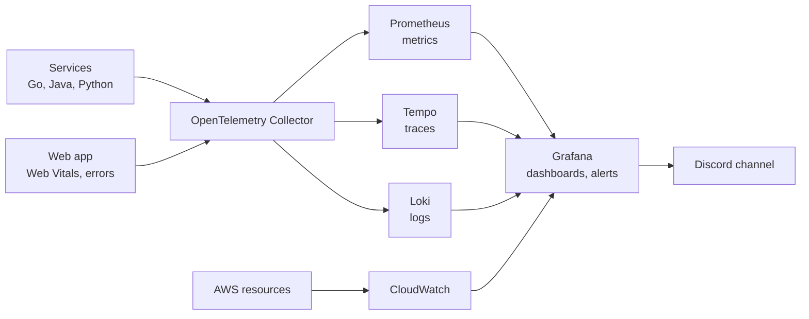

# Doodle Arena: observability

Logging, monitoring, tracing and alerting for every service. `CLAUDE.md` has the short checklist; this file is the full spec.

## 1. Pipeline



- Every service sends all three signals with the OpenTelemetry SDK, over OTLP, to one collector.
- The collector routes metrics to Prometheus, traces to Tempo and logs to Loki. Prometheus alone stores only metrics.
- In AWS, managed resources (load balancer, databases, containers) report to CloudWatch on their own. Grafana reads CloudWatch as a data source, so every signal is visible in one UI.
- Locally, `grafana/otel-lgtm` bundles the collector, Prometheus, Tempo, Loki and Grafana in one container. It is meant for development and demos. In AWS, either run the components separately or state clearly that the demo uses this image (ADR 0003).
- Every signal carries the resource attributes `service.name`, `service.version`, `service.instance.id` and `deployment.environment`.

## 2. Logging

Services write one JSON object per line to stdout:

```json
{"timestamp":"2026-10-20T14:03:12.481Z","level":"info","service":"marketplace","version":"0.4.1","trace_id":"4bf92f3577b34da6a3ce929d0e0e4736","span_id":"00f067aa0ba902b7","msg":"purchase completed","drawing_id":"d_81f2","user_id":"u_19ac","listing_id":"l_77e0","latency_ms":38}
```

- Required fields: `timestamp`, `level`, `service`, `version`, `trace_id`, `span_id`, `msg`.
- Domain fields where relevant: `room_id`, `match_id`, `user_id`, `drawing_id`, `listing_id`, `endpoint_id`.
- Levels: `debug` (off by default), `info` (state changes), `warn` (handled problems such as retries), `error` (needs attention).
- With the `trace_id`, Grafana can jump from a log line to its trace and back.

Never log:

- Secrets, tokens, API keys, Stripe payloads that contain secrets, or email addresses.
- Individual strokes. Log once per round instead (`round finished`, with the stroke count).

Logs are not the audit trail. They can be sampled and they expire. The history of money and ownership lives in the marketplace's Postgres tables, as data that is never dropped.

## 3. Metrics

Every service gets RED metrics (rate, errors and duration) from OpenTelemetry's HTTP and gRPC instrumentation. The domain metrics below are added by hand. Names follow OpenTelemetry style; Prometheus converts dots to underscores and adds unit suffixes.

Never put IDs such as `room_id`, `user_id` or `drawing_id` in metric attributes. Prometheus stores one time series per combination of attribute values, so thousands of rooms would create thousands of series. IDs belong in logs and traces.

| Metric | Type | Attributes | Service |
|---|---|---|---|
| `game.ws.connections` | UpDownCounter | – | game-server |
| `game.rooms.active` | UpDownCounter | `mode` | game-server |
| `game.broadcast.duration` | Histogram (ms) | `event_type` | game-server |
| `game.guesses` | Counter | `result` = correct, wrong, rate_limited | game-server |
| `game.reconnects` | Counter | `result` = resumed, snapshot, failed | game-server |
| `game.room.takeovers` | Counter | – | game-server |
| `game.ws.slow_client_disconnects` | Counter | – | game-server |
| `lobby.allocations` | Counter | `result` | lobby |
| `lobby.servers.healthy` | Gauge | – | lobby |
| `assets.pipeline.duration` | Histogram (ms) | `step` = fetch, render, upload, moderate | assets |
| `assets.jobs.oldest_age` | Gauge (s) | `queue` | assets |
| `assets.moderation` | Counter | `result` = approved, rejected, retry, manual | assets |
| `market.purchases` | Counter | `result` = success, conflict, insufficient_funds | marketplace |
| `market.idempotency.replays` | Counter | `operation` | marketplace |
| `market.stripe.webhooks` | Counter | `result` = processed, duplicate, invalid_signature | marketplace |
| `market.db.lock_wait.duration` | Histogram (ms) | `operation` | marketplace |
| `market.outbox.lag` | Gauge (s) | – | marketplace |
| `market.ledger.imbalance` | Gauge (coins) | – | marketplace |
| `market.ownership.violations` | Gauge | – | marketplace |
| `notifier.deliveries` | Counter | `result` = success, retry, dead | notifier |
| `notifier.delivery.duration` | Histogram (ms) | – | notifier |
| `notifier.dlq.size` | Gauge | – | notifier |
| `web.vitals.lcp`, `web.vitals.inp`, `web.vitals.cls` | Histogram | `page` | web |
| `web.ws.rtt` | Histogram (ms) | – | web |

Kafka consumer lag per consumer group comes from the collector's Kafka metrics receiver (or a Kafka exporter).

Dashboards are JSON files in `infra/observability/dashboards/`, provisioned into Grafana:

1. Service overview: RED metrics for every service.
2. Game server: connections, rooms, broadcast latency, reconnects, takeovers.
3. Marketplace: purchases and conflicts, lock waits, Stripe webhooks, outbox lag, the two invariants.
4. Async pipeline: Kafka lag, Celery job age, webhook deliveries and the dead-letter queue.
5. Load test: the panels used while k6 runs, so screenshots can go in the README.

## 4. Tracing

- Propagate W3C trace context over HTTP, gRPC and Kafka message headers (`traceparent`). Without the Kafka header, a trace breaks at every async step.
- The showcase trace follows a purchase across languages: gateway, marketplace (Java), Postgres, the outbox, Kafka, notifier (Go), and the outgoing webhook.
- Span names: `<service>.<operation>`, for example `market.purchase` or `assets.render`.
- Sampling:
  - Keep every trace for purchases, Stripe webhooks and rewards.
  - Sample game traffic. Trace rounds and room lifecycle events, not individual strokes.
  - Stage 6: tail sampling in the collector keeps every trace that errored or was slow.

## 5. Alerting

Principles:

- Alert on what players feel and on broken invariants, not on every possible cause.
- Every alert links to a runbook in `docs/runbooks/` (use `docs/runbooks/TEMPLATE.md`).
- Grafana alerting sends alerts to a Discord channel. `critical` means fix now; `warning` means look today.

Starting rules (tune the thresholds after the first load test):

| Alert | Condition | Severity |
|---|---|---|
| LedgerImbalance | `market.ledger.imbalance != 0` | critical |
| OwnershipViolation | `market.ownership.violations > 0` | critical |
| SlowBroadcasts | p99 of `game.broadcast.duration` above 150 ms for 5 minutes | warning |
| HighErrorRate | Server errors above 1% of requests for 5 minutes, per service | warning |
| ConsumerLagGrowing | Kafka lag growing for 10 minutes for any consumer group | warning |
| DeadLetters | `notifier.dlq.size > 0` | warning |
| StripeSignatureFailures | More than 5 invalid signatures in 10 minutes (a wrong secret or forged requests) | warning |
| GameServerDown | `lobby.servers.healthy` below the expected count for 1 minute | critical |
| AwsBudget | Spending above the budget (AWS Budgets, or a CloudWatch billing alarm; billing metrics live in `us-east-1`) | critical |

The two invariant alerts come from the marketplace's reconciliation job, which checks the ledger and ownership every minute and exports the results as gauges.

## 6. Release monitoring

- `service.version` on every signal lets dashboards compare the old and new versions during a rollout.
- CI adds a deploy marker (a Grafana annotation) for every release.
- During a rolling deploy of game servers, watch `game.reconnects`. A spike means connections aren't being drained properly.
- Automatic rollback is a later improvement.

## 7. When each part is built

- Stage 1: the stack runs, every service has auto-instrumentation and the JSON log format.
- Stages 2–4: a task isn't done until its metrics from section 3 exist.
- Stage 5: dashboards, alert rules, runbooks, the Discord contact point and the AWS budget alarm.
- Stage 6: SLOs, tail sampling, deploy markers. The kill test doubles as a fire drill: the right alert must fire, and its runbook must fix the problem.
