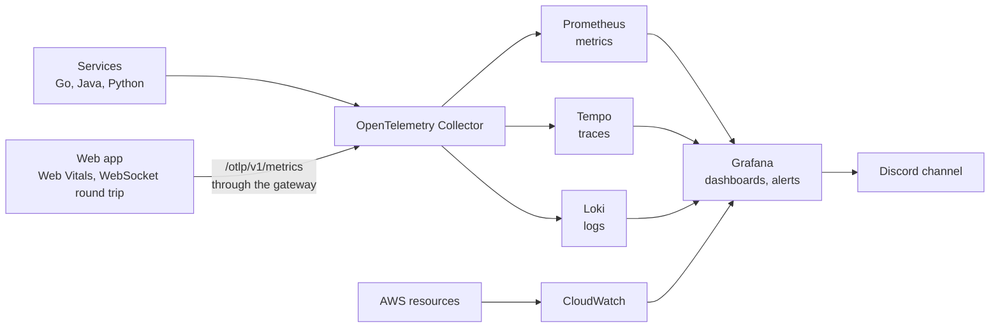

# Doodle Arena: observability

Logging, monitoring, tracing and alerting for every service. `CLAUDE.md` has the short checklist; this file is the full spec.

## 1. Pipeline



- Every service sends all three signals with the OpenTelemetry SDK, over OTLP, to one collector.
- The collector routes metrics to Prometheus, traces to Tempo and logs to Loki. Prometheus alone stores only metrics.
- In AWS, managed resources (load balancer, databases, containers) report to CloudWatch on their own. Grafana reads CloudWatch as a data source, so every signal is visible in one UI.
- Locally, `grafana/otel-lgtm` bundles the collector, Prometheus, Tempo, Loki and Grafana in one container. It is meant for development and demos. In AWS (ADR 0003, task 5.2) the demo uses the same image, on the data host, with the same dashboards and alert rules: services export to `http://data.doodle.internal:4318`, Grafana listens on the host's 127.0.0.1 only (reach it with `make aws-grafana`, a Session Manager port forward), anonymous visitors only view, and its CloudWatch data source reads AWS metrics through the data host's instance role. Every task's stdout also goes to CloudWatch Logs (`/doodle-arena/ecs`, 3 days), as a copy for when the collector is down. Every signal carries `deployment.environment=aws` there.
- Every signal carries the resource attributes `service.name`, `service.version`, `service.instance.id` and `deployment.environment`.

### How each service is wired (task 1.5)

Configuration is the standard `OTEL_*` environment, set once in `infra/docker-compose.yml`: OTLP over HTTP to `http://otel-lgtm:4318`, `OTEL_SEMCONV_STABILITY_OPT_IN=http`, a 10-second metric interval, and per service `OTEL_SERVICE_NAME` plus `OTEL_RESOURCE_ATTRIBUTES`. Without `OTEL_EXPORTER_OTLP_ENDPOINT` (unit tests, CI jobs), nothing is exported and only the JSON logs are written. Every service starts only after otel-lgtm is healthy (all backends ready, Loki included): records sent while Loki is still starting wait in the collector's retry queue for minutes, which is what made the CI check fail on a cold stack.

| Service | How | Logs to Loki |
|---|---|---|
| Go (lobby, game-server, notifier) | `internal/telemetry` (SDK with OTLP exporters, Go runtime metrics), `otelhttp` around the handlers | `slog` fans out to the JSON handler and the `otelslog` bridge |
| Python (auth, ai, assets) | `telemetry.py` (SDK plus the FastAPI or Django, SQLAlchemy, psycopg and httpx instrumentations). Called at startup, or in gunicorn's `post_fork` and Celery's `worker_process_init` for assets (the Celery instrumentation carries trace context from the sender to the task). Not `opentelemetry-instrument`, because the services' own logging config replaces root handlers and gunicorn forks after the agent starts its threads | an OTLP handler next to stdout in the logging config |
| Java (marketplace) | OpenTelemetry Java agent, pinned and checksum-verified in the Dockerfile | the agent exports logback records; trace ids come from the MDC |
| Gateway (Nginx) | `ngx_otel_module`: a server span per proxied API request, propagated upstream | no: its JSON access log (with `trace_id`) stays in stdout |

`service.instance.id` names one process, not one container: gunicorn's workers and Celery's pool processes append their own suffix (`assets-1-w1`, `assets-worker-1-p0`), because each exports its own cumulative counters, and under one id Prometheus sees a single series that keeps resetting.

otel-lgtm runs without a container memory limit, so when the Docker VM runs out of memory its OOM killer stops the biggest process inside, usually Tempo, then the collector, while Grafana and the rest keep running (`docker run --rm --privileged --pid=host alpine dmesg | grep -i oom` shows it). Two guards: the collector's `memory_limiter` (`infra/observability/otelcol/memory-limiter.yaml`, merged over the image's config through `OTELCOL_EXTRA_ARGS`) refuses data past 768 MiB instead of growing while Tempo is down, and the compose healthcheck requires Tempo's and the collector's `/ready` as well as the image's own check, which skips a backend that refuses connections. A dead Tempo or collector then shows as unhealthy in `make ps`; Compose doesn't restart it, `docker restart doodle-arena-otel-lgtm-1` does. The AWS data host (`infra/aws/data-host/compose.yml`) has the same two guards; docs/setup.md ("AWS") says how to look at it there.

Health checks and the Vite dev-server assets are not traced, except in marketplace: the Java agent has no simple path exclusion, so its container health check produces a small trace every few seconds until tail sampling arrives (Stage 6). Browser telemetry is below. `make telemetry-check` proves the pipeline end to end: a request with a known trace id must show up in Tempo (gateway and auth spans) and in Loki (an auth log line with that `trace_id`), and every service must export metrics. CI runs it in `stack.yml`.

### Browser telemetry (task 5.4)

The web app reports real users' Core Web Vitals and the room's WebSocket round trip as OpenTelemetry metrics. Errors and fetch spans are Stage 6.

- `web/src/rum.ts` loads with the app and is tiny. It names the page (`lobby`, `room`, `gallery`, `market`, `my-drawings`, `wallet`, `developer`, `moderate`, `leaderboard`, else `other`: a route, never an id) and queues up to 50 round trips. After the page's load event it imports `web/src/telemetry.ts`: the OpenTelemetry metrics SDK and `web-vitals`, 28 KB gzipped, so measuring the page doesn't slow its first paint.
- Each page load is a short-lived process, so it exports **deltas**, every 60 s and when the page is hidden (`visibilitychange`, `pagehide`; the exporter uses `sendBeacon`, which outlives the page). The vitals are final only then.
- The browser posts to `/otlp/v1/metrics` on the gateway: POST only, 64 KB at most, 2 requests a second per address with a burst of 10, no access log or span. The gateway forwards it to a receiver of its own on the collector (`otlp/browser`, port 4319; locally `otel-lgtm:4319`, in AWS `data.doodle.internal:4319`, open only to the gateway's security group), so nothing a browser sends reaches the services' pipelines.
- Anyone can post to a public endpoint, so the browser pipeline (`infra/observability/otelcol/browser.yaml`, merged over otel-lgtm's config like `memory-limiter.yaml`) keeps exactly what the web app sends: the four metric names, histograms only, the web app's own bucket bounds; resource attributes reduced to `service.name=web`, one `service.instance.id=browser` and `deployment.environment` (`local`, `aws`, else `unknown`); one scope; fixed units; no exemplars; and on each vital's point only `page`, from the list above or else `other` (`web.ws.rtt` has no attributes). A metric or point that breaks a rule is dropped, a value outside a list is replaced, so a client can't create new series.
- `delta_to_cumulative` then adds every browser's deltas into one cumulative series per metric and page, as Prometheus expects (at most 100 streams; one that's idle for 10 minutes is forgotten).
- Lighthouse is the lab-side check: `make lighthouse` (`scripts/lighthouse.sh`, `web/lighthouserc.json`), against the production image locally or the AWS stack with `GATEWAY`. It isn't a CI gate; its numbers are in `docs/performance.md`.

## 2. Logging

Services write one JSON object per line to stdout:

```json
{"timestamp":"2026-10-20T14:03:12.481Z","level":"info","service":"marketplace","version":"0.4.1","trace_id":"4bf92f3577b34da6a3ce929d0e0e4736","span_id":"00f067aa0ba902b7","msg":"purchase completed","drawing_id":"d_81f2","user_id":"u_19ac","listing_id":"l_77e0","latency_ms":38}
```

- Required fields: `timestamp`, `level`, `service`, `version`, `trace_id`, `span_id`, `msg`. `trace_id` and `span_id` are there whenever the line belongs to a span: a request, a gRPC call, a Kafka record, or a room's own span (a round ending, a match starting, a player's connection). Lines outside any trace (startup, shutdown, a room closing on its own) carry no trace ids.
- A few lines aren't JSON: the gateway's nginx error log (rate-limit and upstream warnings), the JVM and OpenTelemetry agent banners at marketplace start, and the Vite dev server behind `web`. Loki keeps them as plain text.
- Domain fields where relevant: `room_id`, `match_id`, `user_id`, `drawing_id`, `listing_id`, `endpoint_id`.
- Levels: `debug` (off by default), `info` (state changes), `warn` (handled problems such as retries), `error` (needs attention).
- With the `trace_id`, Grafana can jump from a log line to its trace and back.

Never log:

- Secrets, tokens, API keys, Stripe payloads that contain secrets, or email addresses.
- Individual strokes. Log once per round instead (`round finished`, with the stroke count).

The same goes for span attributes, which end up in Tempo. Query strings are the usual leak: auth replaces every query value in its server spans with `REDACTED` (`server_request_hook` in `services/auth/app/telemetry.py`), and the gateway doesn't trace `/api/auth/google/callback`, whose query holds the OAuth code and state (its span would record them as `http.target`). It sends no trace context there either, so that request's trace starts at auth.

Logs are not the audit trail. They can be sampled and they expire. The history of money and ownership lives in the marketplace's Postgres tables, as data that is never dropped.

## 3. Metrics

Every service gets RED metrics (rate, errors and duration) from OpenTelemetry's HTTP and gRPC instrumentation. The domain metrics below are added by hand. Names follow OpenTelemetry style; Prometheus converts dots to underscores and adds unit suffixes.

Every service sets `OTEL_SEMCONV_STABILITY_OPT_IN=http`, so the Go, Java and Python instrumentation all emit the stable HTTP metric names (`http.server.request.duration` and friends). Without it, the languages disagree on names and units, and one service-overview dashboard can't cover all of them.

Never put IDs such as `room_id`, `user_id` or `drawing_id` in metric attributes. Prometheus stores one time series per combination of attribute values, so thousands of rooms would create thousands of series. IDs belong in logs and traces.

| Metric | Type | Attributes | Service |
|---|---|---|---|
| `game.ws.connections` | UpDownCounter | – | game-server |
| `game.rooms.active` | UpDownCounter | `mode` | game-server |
| `game.broadcast.duration` | Histogram (ms) | `event_type` (time to marshal an event and queue it to every local socket, after the step's commit to Redis; it doesn't include the network write: `game.ws.send_lag` does) | game-server |
| `game.room.input_lag` | Histogram (ms) | – (from a socket handing a player's message to its room until the room's actor starts on it: the wait in the room's inbox, 256 deep, including any time the socket's reader was blocked on a full inbox. Each step ends with a Redis commit, so when the CPU is pinned inputs queue here for seconds; task 5.3) | game-server |
| `game.ws.send_lag` | Histogram (ms) | – (from queueing a message to a socket until the socket write returns: the wait in its send queue, for a CPU or behind a slow write, plus the write itself. Recorded by the socket's writer goroutine for every message written; one that is never written, because the socket closed first, isn't counted. It rises when a server falls behind, which `game.broadcast.duration` can't see; task 5.3) | game-server |
| `game.guesses` | Counter | `result` = correct, wrong, rate_limited | game-server |
| `game.reconnects` | Counter | `result` = resumed (missed events replayed), snapshot (a full `welcome`), failed (a join with `last_seq` that the room refused or never reached, for example a full room or one that just stopped) | game-server |
| `game.room.takeovers` | Counter | – (rooms this server restored from another owner's state) | game-server |
| `game.ws.slow_client_disconnects` | Counter | – | game-server |
| `game.events.published` | Counter | `topic`, `result` = success, failed (retried until the 2-minute deadline), dropped (queue full, or shutting down). A failed or dropped event stays in its room's outbox and is queued again | game-server |
| `game.outbox.pending` | Gauge | – (outbox entries older than a minute in this server's rooms: finished rounds and matches not yet in Kafka; ADR 0009) | game-server |
| `game.outbox.requeued` | Counter | `reason` = takeover (left by the previous owner), stale (this server's, failed or dropped) | game-server |
| `game.events.queued` | UpDownCounter | – (finished rounds and matches waiting for the publisher) | game-server |
| `game.events.publish.duration` | Histogram (ms) | `topic` (for rounds it includes the stroke-log upload; retries included) | game-server |
| `auth.logins` | Counter | `result` = success, failed | auth |
| `auth.refreshes` | Counter | `result` = rotated, reuse_detected, expired, invalid | auth |
| `lobby.allocations` | Counter | `result` = success, no_servers, exhausted (every tried server full or draining), error | lobby |
| `lobby.reassignments` | Counter | `result` = moved, ended (the game server answered NOT_FOUND), failed (retried on the next pass); `reason` = failover (the server's heartbeats stopped, or it no longer reports the room), drain (the server is shutting down and drains, task 5.5) | lobby |
| `lobby.servers.healthy` | Gauge | – (game servers whose heartbeat arrived in the last 6 s, draining ones included) | lobby |
| `lobby.leaderboard.matches` | Counter | `result` = applied, duplicate (the match was counted before: a redelivery), skipped (an unset or unknown `oneof` case, or a malformed message) | lobby |
| `assets.pipeline.duration` | Histogram (ms) | `step` = fetch, render, upload, moderate | assets |
| `assets.jobs.oldest_age` | Gauge (s) | `queue` | assets (pool process 0 of each worker; from a `sent_at` header on every task message, 0 when the queue is empty; a missing series means no worker is running) |
| `assets.admin.sign_ins` | Counter | `result` = ok, forbidden, unauthenticated | assets |
| `assets.rounds.received` | Counter | `result` = created, duplicate, empty, skipped | assets (consumer) |
| `assets.pipeline.results` | Counter | `result` = prepared, skipped, failed | assets |
| `assets.pipeline.requeued` | Counter | – | assets (sweeper) |
| `assets.outbox.lag` | Gauge (s) | – (age of the oldest outbox event Kafka hasn't confirmed; 0 when drained) | assets (relay) |
| `assets.events.published` | Counter | `result` = success, failed (left in the outbox and retried) | assets (relay) |
| `assets.moderation` | Counter | `result` = approved, rejected, retry, manual | assets (`manual`: sent to the review queue, after the last failed call, a refusal, or an unsure AI) |
| `ai.moderation.requests` | Counter | `decision` = approve, reject, review, unavailable, invalid, abandoned (the caller left before the answer) | ai |
| `market.purchases` | Counter | `result` = success, conflict (the listing was sold or cancelled: a lost race), insufficient_funds | marketplace |
| `market.idempotency.replays` | Counter | `operation` = create_listing, purchase, checkout (requests answered from a stored response) | marketplace |
| `market.stripe.webhooks` | Counter | `result` = processed (coins credited), duplicate (the event, or another event for the same session, was handled before), ignored (an unpaid or unrelated event), unknown_session (a paid session the marketplace didn't create, or for another user), invalid_signature | marketplace |
| `market.db.lock_wait.duration` | Histogram (ms) | `operation` = ledger_post (the balance rows), purchase (the listing row, where concurrent buyers queue) | marketplace |
| `market.outbox.lag` | Gauge (s) | – (age of the oldest outbox event Kafka hasn't acknowledged; 0 when drained) | marketplace |
| `market.ledger.imbalance` | Gauge (coins) | – | marketplace |
| `market.ledger.mismatched_accounts` | Gauge | – | marketplace |
| `market.ownership.violations` | Gauge | – | marketplace |
| `market.matches.received` | Counter | `result` = paid, duplicate (the match was paid before: a redelivery), ineligible (fewer than two players), skipped (undecodable, or an unset or unknown event), failed (an event that breaks its contract, or a record Postgres refuses as data) | marketplace |
| `market.drawings.received` | Counter | `result` = minted, duplicate (the drawing was minted before: a redelivery), rejected (a `DrawingRejected`, nothing to do), skipped (undecodable, or an unset or unknown event), failed (an event that breaks its contract, or a record Postgres refuses as data) | marketplace |
| `notifier.deliveries` | Counter | `result` = success, retry (failed, will try again), dead (failed for the last time) | notifier |
| `notifier.delivery.duration` | Histogram (ms) | – (from sending to the answer or the failure) | notifier |
| `notifier.dlq.size` | Gauge | – (deliveries that went DEAD in the last 24 hours, test pings aside; for dashboards: a dead delivery is usually a developer's server being down, so no alert pages on it) | notifier |
| `notifier.queue.oldest_age` | Gauge (s) | – (how long the oldest due delivery of a live, enabled endpoint has waited for a worker; 0 when none is due. It grows when the notifier falls behind, not when a developer's server fails) | notifier |
| `notifier.events` | Counter | `result` = queued, no_subscribers, duplicate (queued before: a redelivery; or a revocation not newer than the watermark), revoked (a `CredentialsRevoked` applied), skipped (unreadable) | notifier |
| `auth.api_keys.verifications` | Counter | `result` = valid, invalid, revoked | auth |
| `auth.events.published` | Counter | `result` = success (confirmed by Kafka), failed (left to retry) | auth (relay) |
| `auth.outbox.lag` | Gauge (s) | – (age of the oldest outbox event Kafka hasn't confirmed; 0 when drained) | auth (relay) |
| `notifier.endpoints.disabled` | Counter | – (endpoints disabled because auth revoked their owner's credentials) | notifier |
| `authn.jwks.fetches` | Counter | `reason` = max_age (the cached set was 10 minutes old, or older), unknown_kid; `result` = success, failed (the last good set stays in use for up to an hour) | lobby, notifier, assets (web) |
| `kafka.broker.authentication.failures` | Counter | `listener` = INTERNAL (the services), EXTERNAL (host tools), CONTROLLER, ADMIN; `processor` (the broker's network thread, 0 to 5; sum over it). Failed SASL logins, from the broker's JMX through the OpenTelemetry agent (infra/kafka/jmx.yaml): every client counts, ours or not. Prometheus: `kafka_broker_authentication_failures_total` | kafka (broker) |
| `kafka.broker.authentication.successes` | Counter | as above; on `listener=ADMIN`, the logins of `admin` (humans only). Prometheus: `kafka_broker_authentication_successes_total` | kafka (broker) |
| `kafka.broker.authorization.denied` | Gauge ({request}/min) | `role` = broker, controller. The authorizer's denied requests per minute. It also counts unauthorized topics quietly left out of metadata answers, so it never reads zero on a healthy stack: the alert uses the logged denials instead. Prometheus: `kafka_broker_authorization_denied_per_min` | kafka (broker) |
| `web.vitals.lcp`, `web.vitals.inp`, `web.vitals.cls` | Histogram (ms; CLS has no unit) | `page` = lobby, room, gallery, market, my-drawings, wallet, developer, moderate, leaderboard, other (Largest Contentful Paint, Interaction to Next Paint and Cumulative Layout Shift of real users' page loads; Prometheus: `web_vitals_lcp_milliseconds`, `web_vitals_inp_milliseconds`, `web_vitals_cls`) | web (browser) |
| `web.ws.rtt` | Histogram (ms) | – (the room's WebSocket `ping` until `pong`, every 5 s; Prometheus: `web_ws_rtt_milliseconds`) | web (browser) |

Two more sources besides the table: the Go services' runtime metrics (`go_goroutine_count`, `go_memory_used_bytes`, `go_memory_allocated_bytes_total`, from OpenTelemetry's Go runtime instrumentation, and, from the game server only, `go_schedule_duration_seconds`: how long runnable goroutines waited for a CPU, the runtime's own histogram, which tells a pinned CPU apart from a slow network when `game.ws.send_lag` rises; the Go services export no process CPU, so CPU comes from CloudWatch's `AWS/ECS` metrics in AWS), and k6 during a load test (task 5.3): `loadtest/rooms.js` sends its metrics over OTLP with `service.name=k6`, all prefixed `k6_`. Its own are in milliseconds:

| Metric | Type | What |
|---|---|---|
| `k6_stroke_fanout` | Histogram (ms) | A drawer's stroke batch until each other player in the room has it. The send time rides in the `stroke_id` (all four players live in one k6 process, one clock), so no protocol change was needed. Includes the client's network path |
| `k6_ws_rtt` | Histogram (ms) | `ping` until `pong`, answered without the room: the network, the gateway and the socket's send queue (`game.ws.send_lag` is the queue's share), to tell them apart from the room |
| `k6_guess_result` | Histogram (ms) | A guess until its `guess_result` |
| `k6_join`, `k6_welcome` | Histogram (ms) | `POST /join` until the ticket; connect until `welcome` |
| `k6_room_errors`, `k6_reconnects` | Counter | A room that failed (tagged `step`); a socket the server closed that the player then resumed, as the web app does (tagged with the close `code`: 4010 room moved, 1001 going away, 1006 dropped), expected during a failover or drain |
| `k6_resume` | Histogram (ms) | A socket closed until the player has `welcome` or `resumed` again: what a failover or drain costs a player under load |
| `k6_rounds_completed`, `k6_matches_completed` | Counter | Rounds and matches the rooms finished |

k6's built-ins (`k6_vus`, `k6_http_req_duration`, `k6_ws_msgs_sent` and the like) come along. A load test's virtual users are rooms, never metric attributes.

The broker runs the OpenTelemetry Java agent (infra/kafka/Dockerfile, task 5.5): its logs reach Loki as `service.name=kafka`, among them each request the authorizer denied (principal, operation, resource), and JMX rules (infra/kafka/jmx.yaml) export the three `kafka.broker.*` metrics below. Counting at the broker covers every client, ours or not; a client-side counter would miss the one that matters, a client that isn't ours. Traces and the agent's other instrumentation are off. The marketplace's own Java agent also counts its failed logins (`kafka_consumer_failed_authentication_total`, `kafka_producer_failed_authentication_total`).

Kafka consumer lag per consumer group comes from the broker, not the clients (task 5.1): a `kafka-metrics` container (`otel/opentelemetry-collector-contrib`, the same version as the collector inside otel-lgtm) runs the `kafka_metrics` receiver every 30 s and pushes OTLP to otel-lgtm. It reports `kafka.consumer_group.lag_sum` per `group` and `topic` (Prometheus: `kafka_consumer_group_lag_sum`), for every consumer whatever its language. A collector of its own rather than an edit of otel-lgtm's bundled collector config, so upgrading that image never means re-syncing a copied file. Once Kafka requires SASL (ADR 0013, task 5.5), it needs a read-only Kafka user of its own.

Dashboards are JSON files in `infra/observability/dashboards/`, provisioned into Grafana's "Doodle Arena" folder (task 5.1). They're read-only in the UI: change the JSON, and Grafana picks it up within 30 seconds.

1. Service overview (`da-overview`): firing alerts, recent error and warning logs from Loki, request rate, server-error share and p95 latency per service (HTTP and gRPC servers together), auth sign-ins and refreshes, and the lobby.
2. Game server (`da-game-server`): connections, rooms, broadcast latency, input and send lag, scheduler latency, guesses, reconnects, takeovers, and the event outbox.
3. Marketplace (`da-marketplace`): the three invariant gauges and the outbox lag as stats, purchases and conflicts, lock waits, idempotent replays, Stripe webhooks, rewards and minting.
4. Async pipeline (`da-async-pipeline`): Kafka consumer lag, the outbox lags, Celery job age, the drawing pipeline and moderation, webhook deliveries, the queue age and the dead-letter queue.
5. Load test (`da-load-test`, task 5.3): what k6 applies and what players feel, next to the game servers' broadcast latency, input and send lag, scheduler latency, rooms, connections and Go runtime, and, in AWS, ECS CPU from CloudWatch. The panels to watch while `make loadtest` runs, and to screenshot for the README.

The gateway (Nginx) exports traces but no metrics, so the overview shows the services behind it, not the gateway itself.

## 4. Tracing

- Propagate W3C trace context over HTTP, gRPC and Kafka message headers (`traceparent`). Without the Kafka header, a trace breaks at every async step.
- The showcase trace follows a purchase across languages: gateway, marketplace (Java), Postgres, the outbox, Kafka, notifier (Go), and the outgoing webhook.
- The gateway creates the root span with `ngx_otel_module`, which ships in the official `nginx` image's `-otel` variant. It starts a trace or continues the browser's `traceparent`.
- Span names: domain spans are `<service>.<operation>`, for example `market.purchase`, `lobby.quickplay` or `game.round.end` (the game server's prefix is `game`). HTTP, gRPC and database spans keep the names their instrumentation gives them, which follow the OpenTelemetry conventions, such as `POST /api/lobby/rooms/{room_id}/join`.
- A game server's drain (task 5.5) is one `game.server.drain` span: `rooms.start`, `rooms.left` and `drain.complete` (whether every room moved before `DRAIN_TIMEOUT`), with the `drain started` and `drain finished` logs.
- Span attributes for ids use dots: `room.id`, `match.id`, `user.id`, `round.no` (log fields keep `room_id` and the like). Ids are fine on spans, never on metrics.
- Sampling:
  - Keep every trace for purchases, Stripe webhooks and rewards.
  - Sample game traffic. Trace rounds and room lifecycle events, not individual strokes. A room commits every step (each stroke and guess) to Redis from its actor, outside any trace, so the game server's default sampler (`internal/telemetry/sampler.go`) drops a Redis client span that has no parent; Redis calls inside a trace (a join's ticket redeem, a takeover's reads) are still traced. The lobby uses the same sampler: its registry expiry and the reassigner's scan read Redis outside any trace every few seconds, and most of its traces were a single Redis `get`. Traced, those commits were one trace per stroke, about 97% of all spans at 80 rooms, and Tempo ran the Docker VM out of memory. Neither service's Redis spans carry `db.statement`: a commit's arguments are the room's events and snapshot, a redeem's the join ticket.
  - Stage 6: tail sampling in the collector keeps every trace that errored or was slow.

## 5. Alerting

Principles:

- Alert on what players feel and on broken invariants, not on every possible cause.
- Every alert links to a runbook in `docs/runbooks/` (use `docs/runbooks/TEMPLATE.md`).
- Grafana alerting sends alerts to a Discord channel. `critical` means fix now; `warning` means look today.

Starting rules (tune the thresholds after the first load test):

| Alert | Condition | Severity |
|---|---|---|
| LedgerImbalance | `market.ledger.imbalance != 0` or `market.ledger.mismatched_accounts > 0` | critical |
| ReconciliationStale | `market.ledger.imbalance` missing for 5 minutes (the job stopped or can't read the database; the two invariant alerts above are blind) | warning |
| OutboxStuck | `game.outbox.pending > 0` for 10 minutes (Kafka or S3 down, or an entry that can't be published; rewards and drawings are waiting) | warning |
| OwnershipViolation | `market.ownership.violations > 0` | critical |
| SlowBroadcasts | p95 of `game.room.input_lag` or of `game.ws.send_lag` above 250 ms for 5 minutes (one alert per lag, labelled `lag` = input or send), while the game servers write more than 10 messages a second (a near-idle stack with one slow phone isn't an incident). Input lag is the way into a room, send lag the way out; together they are most of what players feel. 250 ms from a local run with both game servers capped at 0.25 CPU (evidence log, 2026-10-19): healthy, input lag p95 stays under 1 ms; at 40 rooms its 5-minute p95 sat at 0.8 to 1.9 s, tracking k6's stroke fan-out, and the alert fired 5 minutes after it crossed. Send lag rarely gets there when the server is the cause (its 5-minute p95 peaked at 195 ms), but it's the signal for slow clients or a slow gateway. Until task 5.3 it watched `game.broadcast.duration`, which ends when an event is queued: in the AWS load test pongs waited seconds while it read under 0.1 ms. That metric stays on the dashboards to diagnose the room actor itself. p95 rather than p99, because one client on a slow network can be more than 1% of a small stack's messages; a server that falls behind moves them all | warning |
| HighErrorRate | Server errors (HTTP 5xx; gRPC `UNKNOWN`, `DEADLINE_EXCEEDED`, `INTERNAL`, `UNAVAILABLE`, `DATA_LOSS`) above 1% of requests for 5 minutes, per service, when the service had at least 20 requests in those 5 minutes | warning |
| ConsumerLagGrowing | A consumer group's lag (`kafka_consumer_group_lag_sum`) above 0 and higher than 10 minutes earlier, for 5 minutes | warning |
| AuthOutboxStuck | `auth.outbox.lag` above 60 s for 5 minutes (Kafka down, or `auth-relay` stopped: a credential revocation isn't reaching the notifier, so a thief's webhooks keep running) | critical |
| MarketOutboxStuck | `market.outbox.lag` above 60 s for 5 minutes (Kafka down, or the relay failing; sales and listings aren't reaching the notifier) | warning |
| DrawingEventsStuck | `assets.outbox.lag` above 60 s for 5 minutes (Kafka down, or the relay stopped; the marketplace isn't minting approved drawings) | warning |
| DrawingsFailing | `assets.pipeline.results{result=failed}` above 0 for 10 minutes (stroke logs missing or unreadable: an S3 outage longer than 7 days, or a game-server bug) | warning |
| JobsBacklog | `assets.jobs.oldest_age` above 300 s for 5 minutes, or the series missing for 5 minutes (no worker) | warning |
| WebhooksFailing | `notifier.deliveries{result!=success}` above half of all attempts for 15 minutes, with at least 50 failed attempts in 15 minutes (our sender or network is broken, not one developer's server; one dead endpoint makes 8 attempts over hours) | warning |
| WebhookQueueStuck | `notifier.queue.oldest_age` above 300 s for 5 minutes (workers stopped or Postgres slow) | warning |
| StripeSignatureFailures | More than 5 invalid signatures in 10 minutes (a wrong secret or forged requests) | warning |
| RefreshTokenReuse | More than 3 `auth.refreshes{result=reuse_detected}` in 10 minutes (stolen tokens, or a client that refreshes concurrently) | warning |
| GameServerDown | `lobby.servers.healthy` below the expected count (2, the local stack's game servers) for 1 minute | critical |
| KafkaAuthFailures | Every minute for 5 minutes: failed Kafka logins (`kafka.broker.authentication.failures`) or logged ACL denials (the broker's `is Denied` lines in Loki) above 0 (a service missing a credential or a grant, or someone probing; a one-off like CI's `make kafka-acl-check` doesn't last 5 minutes) | warning |
| KafkaAdminUsed | Any login on the broker's ADMIN listener in 5 minutes (`kafka.broker.authentication.successes{listener=ADMIN}`): `admin`, the super user for humans, used from inside the broker container | warning |
| AwsBudget | Spending above the budget (AWS Budgets, or a CloudWatch billing alarm; billing metrics live in `us-east-1`; task 5.2, not a Grafana rule) | critical |

### How the alerts are built (task 5.1)

- **Grafana-managed rules as code.** `infra/observability/grafana/alerting/` holds the rules (`rules.yaml`), the contact point and its message template (`contact-points.yaml`) and the notification policy (`policies.yaml`). Compose mounts them, with the dashboard provider, next to otel-lgtm's own provisioning files. Grafana rather than Prometheus rules, because the bundled Prometheus has no Alertmanager and Grafana is what sends to Discord. Provisioned rules can't be edited in the UI; change the file and restart otel-lgtm.
- **One rule per alert in the table**, evaluated every minute. Labels: `severity` and `service` (HighErrorRate carries the failing `service_name`, ConsumerLagGrowing the `group`). Annotations: a `summary` with the measured value, the `runbook_url`, and the dashboard panel that shows the same query, so the notification links to both.
- **No data is OK; missing data has its own rules.** A rule whose query returns nothing is Normal, because an idle service or an empty queue is not an incident. Where silence is the incident, a rule asks for it explicitly: ReconciliationStale and JobsBacklog count the series (`count(last_over_time(...[1m])) or vector(0)`). A query error is an alert of its own (`DatasourceError`), so a broken Prometheus doesn't look like a quiet one.
- **Ratios drop quiet series in the query.** An error share over no traffic is 0/0, which is NaN, and Grafana's math expressions treat NaN as firing. HighErrorRate and WebhooksFailing therefore filter by volume inside the PromQL (`... and requests >= 20`) instead of combining two queries in a math step.
- **Notifications.** One Discord contact point, from `DISCORD_ALERT_WEBHOOK_URL` in `.env` (a secret: anyone holding the URL can post to the channel). Without it, compose points the contact point at the `webhook-receiver` test service (`/hooks/alerts`), which keeps unsigned bodies, so CI and drills can prove a notification was sent. The policy groups by alert and service, waits 30 s before the first message of a group, and repeats a firing alert every hour (critical) or every 4 hours (warning).
- **Checks.** `make lint s=observability` checks offline that every alert in the table has exactly one rule, every rule an existing runbook and dashboard panel, and every metric a panel or rule reads is listed in section 3 (CI: `observability.yml`). `make alerts-check` checks live that Grafana loaded every dashboard, rule and the contact point, that every panel query runs, and that every rule evaluates without an error (CI's stack job). `scripts/drills/alerts.py` makes LedgerImbalance and HighErrorRate fire for real and clear again (evidence log in `docs/roadmap.md`).

The two invariant alerts come from the marketplace's reconciliation job, which checks the ledger and ownership every minute and exports the results as gauges. `market.ledger.imbalance` is the sum of every ledger entry, in coins; `market.ledger.mismatched_accounts` counts accounts whose balance isn't the sum of their entries, user balances below zero, and accounts without a balance row. When no run has succeeded for 3 minutes, all three gauges (with `market.ownership.violations` below) stop reporting, so a dead job shows as a missing series (ReconciliationStale) instead of a reassuring 0. `market.ownership.violations` counts drawings whose ownership row and provenance disagree (design doc, section 8). After a redeploy, the old container's last value stays visible for Prometheus's 5-minute lookback as a second series with its own `host_name`; an alert in the first minutes after a deploy should be checked against the new container's series.

Each run is a `market.reconcile` span (attributes `ledger.imbalance`, `ledger.mismatched_accounts` and `ownership.violations`) under the Java agent's span for the scheduled method, with one log line: `ledger reconciled` at info, or `invariants broken` at error with up to 20 `mismatched_account_ids` and `violating_drawing_ids`.

A purchase is a `market.purchase` span (`listing.id`, `drawing.id`, `sale.id`, `user.id`; `purchase.result` for a refused one) inside the HTTP server span, with the SQL in lock order below it. The relay sends each outbox row under a `market.outbox.publish` span whose parent is the trace context stored with the row, so the agent's `market.sales.v1 publish` span and every consumer of the event join the purchase's trace.

Starting a checkout is a `market.checkout` span (`user.id`, `coin_pack.id`, `stripe.session_id`) around the Stripe API call; a webhook is a `market.stripe.webhook` span (`stripe.event_type`, `stripe.event_id`, `stripe.result`). The webhook starts a new trace (Stripe sends no `traceparent`); its `CoinsCredited` is published under it. Logs carry the session id and `user_id`, never the payload or any key.

A webhook's trace continues the event's: the notifier's `notifier.queue` span (under kotel's consumer span) stores its trace context on the delivery row, and every attempt, however much later, is a `notifier.deliver` span under it (`delivery.id`, `endpoint.id`, `event.type`, `delivery.attempt`, `http.response.status_code`, `result`). Outgoing webhooks carry no `traceparent` (trace ids stay inside). Logs carry `endpoint_id`, `delivery_id` and the event id, never secrets, keys or response bodies; an API key appears only as its prefix. A `DeliveryDead` is published by a background relay in a trace of its own; its `delivery_id` leads to the delivery's attempts and their trace.

A credential theft is one trace (ADR 0015): auth's `POST /api/auth/refresh`, its SQL (the revocation and the outbox insert), the relay's `auth.users.v1 publish` (parented by the trace context stored with the row), then the notifier's `notifier.revoke` span (`user.id`, `event.id`, `endpoints.disabled`, `result`) under kotel's consumer span. Logs carry `user_id` and the event id, never tokens.

Paying a match is a `market.reward` span (`match.id`, `reward.players`, `reward.coins`, `reward.duplicate`) under the agent's consumer span for `game.matches.v1`, so the trace starts at the game server's `game.match.end`; its `CoinsCredited` events are published under that trace by the relay.

Minting a drawing is a `market.mint` span (`drawing.id`, `match.id`, `mint.duplicate`) under the agent's Kafka consumer span, which continues the assets relay's `traceparent`: one trace runs from the game server's `game.round.end` to the mint.

## 6. Release monitoring

- `service.version` on every signal lets dashboards compare the old and new versions during a rollout.
- CI adds a deploy marker (a Grafana annotation) for every release.
- During a rolling deploy of game servers, watch `game.reconnects`. A spike means connections aren't being drained properly.
- Automatic rollback is a later improvement.

## 7. When each part is built

- Stage 1: the stack runs, every service exports traces, metrics and logs over OTLP, and logs carry `trace_id` and `span_id` (task 1.5).
- Stages 2–4: a task isn't done until its metrics from section 3 exist.
- Stage 5: dashboards, alert rules, runbooks and the Discord contact point (task 5.1), the AWS budget alarm (task 5.2), browser telemetry and Lighthouse (task 5.4).
- Stage 6: SLOs, tail sampling, deploy markers. The kill test doubles as a fire drill: the right alert must fire, and its runbook must fix the problem.
